# Enpresa Kudeaketa Sistemak (ERP-CRM) — 1T Jatetxea S.L.
## Odoo 17 Community ERP: Langileak (`Employees / HR`) Moduluaren Inplantazio eta Dokumentazio Txostena

**Ikastetxea:** Goierri Eskola (Ordizia, Gipuzkoa) — 2. Mailako Erronka Integratua (2025-2026)  
**Enpresa / Proiektua:** 1T Jatetxea S.L. — *Osteria & Parrilla Italo-Euskalduna* (`IFZ: ESB20987654`)  
**Taldea:** 1. Taldea (IT Administrazioa eta Garapena) — Ander Urien Telleria (IT Lead), Julen Aguado Fernández, Iker Araujo Dominguez, Aratz Huegun Flores  
**Aukeratutako ERP Sistema:** Odoo 17.0 Community Edition (On-Premise Docker)  
**Aukeratutako Modulu Nagusia:** **Langileak (`hr` — Employees)** eta lotutako Giza Baliabideen ekosistema (`hr_contract`, `hr_attendance`, `hr_holidays`, `hr_skills`, `hr_org_chart`, `jatetxea_hr`)  
**Sarbide URL Ofiziala:** `http://localhost:8070`

---

## Aurkibidea

1. [Aukeratutako Modulua eta Talde Koordinazioa](#1-aukeratutako-modulua-eta-talde-koordinazioa)
2. [ERP-CRM Aukeren Azterketa, Konparaketa eta Justifikazioa](#2-erp-crm-aukeren-azterketa-konparaketa-eta-justifikazioa)
3. [Odoo 17 Instalazio Mota, Lizentzia Mota eta Hedapen Prozesua](#3-odoo-17-instalazio-mota-lizentzia-mota-eta-hedapen-prozesua)
4. [1T Jatetxearen Marka Identitatea eta Web Portala (`http://localhost:8070/`)](#4-1t-jatetxearen-marka-identitatea-eta-web-portala-httplocalhost8070)
5. [Langileak (`Employees`) Moduluaren Erabileraren Arrazoiketa](#5-langileak-employees-moduluaren-erabileraren-arrazoiketa)
6. [Moduluaren Erabilpen Erreala: Adibideak, Datu Errealak eta Pantaila-Argazkiak](#6-moduluaren-erabilpen-erreala-adibideak-datu-errealak-eta-pantaila-argazkiak)
7. [Erronkako Ebaluazio-Errubrikaren Betetze-Matrizea](#7-erronkako-ebaluazio-errubrikaren-betetze-matrizea)

---

## 1. Aukeratutako Modulua eta Talde Koordinazioa

1T Jatetxea S.L. erronkako Enpresa Kudeaketa Sistemak (EKS) atalean, **1. Taldeak** aukeratutako modulu nagusia **Langileak (`hr` — Employees)** da, eta modu koordinatuan hautatu da gelako gainerako taldeekin **beste talde batekin errepikatuta egon ez dadin**.

Modulu nagusiak (`hr`) funtzionamendu integral eta errealista eskaini dezan, Giza Baliabideen (HR) ekosistema estuki lotutako azpimodulu ofizialekin eta gure garapen propioarekin osatu dugu:

| Modulua (Teknika-izena) | Mota | Funtzioa 1T Jatetxea S.L.-n |
| :--- | :--- | :--- |
| **`hr` (Employees / Langileak)** | Modulu Nagusia (Odoo Core) | 15 langileen fitxa integralak, 6 sailen egitura hierarkikoa, lanpostuak, datu pertsonalak, larrialdi-kontaktuak, banku-kontuak (IBAN) eta NAN/GS datuak. |
| **`hr_org_chart`** | Azpimodulua (Odoo Core) | Enpresaren organigrama grafiko interaktiboa, Zuzendaritza Nagusitik (CEO) sail bakoitzeko langileetaraino. |
| **`hr_skills`** | Azpimodulua (Odoo Core) | Langileen Curriculuma (esperientzia, ikasketak, ziurtagiriak) eta gaitasunen matrizea (hizkuntzak, ostalaritza, IT, lidergoa). |
| **`hr_contract`** | Azpimodulua (Odoo Core) | 15 lan-kontratu aktibo, soldata gordinak, kontratu-motak (mugagabea, lanaldi osoa, asteburuko partziala) eta hitzarmen-klausulak. |
| **`hr_attendance`** | Azpimodulua (Odoo Core) | Eguneroko sarrera-irteeren fitxaketa-kontrola, lan-orduen kalkulua eta 4 digituko PIN Kiosk sarbidea (TPV PINekin sinkronizatua). |
| **`hr_holidays`** | Azpimodulua (Odoo Core) | Urteko 23 opor-egunen esleipena, opor-eskaeren onarpen-fluxua, gaixotasun-bajak eta prestakuntza-egunak. |
| **`jatetxea_hr` (v17.0.2.0.0)** | Modulu Pertsonalizatua (Gurea) | 1T Jatetxearen datu-karga automatizatua, T1 v2.0 estilo diseinu gida (SCSS/QWeb) eta logo korporatiboa. |

---

## 2. ERP-CRM Aukeren Azterketa, Konparaketa eta Justifikazioa

Odoo 17 aukeratu aurretik, merkatuan dauden ERP-CRM soluzio nagusiak aztertu eta konparatu ditugu, 1T Jatetxea S.L. bezalako ostalaritza-enpresa ertain-txiki (ETE) baten eta gure IT azpiegituraren (Docker, Linux/Windows zerbitzariak, ASP.NET Core API, MySQL) beharrak kontuan hartuta.

### 2.1 ERP-CRM Soluzioen Konparaketa-Taula

| Irizpidea | **Odoo 17 Community** | **Dolibarr ERP/CRM** | **ERPNext (Frappe)** | **SAP Business One** | **Microsoft Dynamics 365** |
| :--- | :--- | :--- | :--- | :--- | :--- |
| **Lizentzia Mota** | Open Source (**LGPL-3**) | Open Source (GPL-3) | Open Source (GPL-3) | Jabeduna (Komertziala) | Jabeduna (SaaS harpidetza) |
| **Lizentzia Kostua** | **0 €** (Community) | 0 € (Core) | 0 € (Self-hosted) | Oso altua (1.500–3.000 €/erab.) | Altua (65–180 €/erab./hil) |
| **Arkitektura / Stack** | Python 3 + **PostgreSQL 15** + OWL JS | PHP + MySQL/MariaDB | Python + MariaDB + Redis | C++/Java + SAP HANA / SQL Server | .NET + Azure Cloud |
| **Docker Hedapena** | **Bikaina** (irudi ofizial arina) | Ona | Konplexua (hainbat edukiontzi) | Mugatua / Zaila ETEtan | Hodeia soilik (SaaS) |
| **HR / Langileak Modulua** | **Oso osoa**: Fitxak, Organigrama, CV/Gaitasunak, Kontratuak, Fitxaketak, Bajak | Oinarrizkoa (modulu osagarri asko ordainpekoak) | Oso ona, baina UI konplexuagoa | Indartsua baina zurruna | Oso ona, kostu oso altuarekin |
| **Pertsonalizazioa** | **Oso altua** (Addons Python/XML/SCSS propioak) | Ertaina (PHP moduluak) | Altua (Frappe Framework) | Garestia (aholkulari ziurtatuak) | Garestia (Power Platform) |
| **API / Integrazioa** | **XML-RPC eta JSON-RPC** natiboak (`sync_mysql_to_odoo.py`) | REST API | REST API | Service Layer / DI API | Dataverse / Graph API |
| **UI / UX Modernotasuna** | **Bikaina** (Kanban, Zerrenda, Hierarkia, Egutegia) | Zaharkitua / Klasikoa | Modernoa baina trinkoagoa | Korporatibo klasikoa | Modernoa |
| **Komunitatea eta Euskarria** | Munduko Open Source ERP handiena | Handia (batez ere Frantzia/Espainia) | Hazten ari da | Enpresa handiak | Enpresa ertain-handiak |

### 2.2 Aukeraketaren Justifikazioa: Zergatik Odoo 17 Community?

1. **Kostu-Eraginkortasuna eta Askatasun Teknologikoa:** Ostalaritzako ETE batek (15 langile) ezin du SAP edo Dynamics 365 bezalako lizentzia-kosturik bere gain hartu. Odoo 17 Community-k **0 €-ko lizentzia-kostuarekin** maila profesionaleko Giza Baliabideen plataforma eskaintzen du.
2. **HR Ekosistema Osoa Kaxatik Aterata:** Dolibarr-ek ez bezala (non fitxaketak, kontratuak eta gaitasunak ordainpeko moduluen bidez osatu behar diren), Odoo 17-k natiboki integratzen ditu `Employees`, `Org Chart`, `Skills/Resume`, `Contracts`, `Attendances` eta `Time Off`.
3. **Hedapen Garbia eta Erreproduzigarria Docker-ekin:** `odoo:17.0` + `postgres:15-alpine` irudi ofizialek gure `1T_Jatetxea_Erronka_Zentrala` azpiegituran (VLAN 10) edukiontzi isolatu eta seguruan hedatzea ahalbidetzen dute, Windows zerbitzu lokalekin portu-talkarik sortu gabe (`8070 -> 8069`).
4. **Pertsonalizazio eta Integrazio Gaitasuna:** Python/XML/SCSS bidez gure **`jatetxea_hr`** modulu propioa sortu ahal izan dugu (1T Jatetxearen T1 v2.0 diseinu-sistema barne), eta XML-RPC APIaren bidez gure MySQL (`jatetxea_db`) datu-basearekin sinkronizazio automatikoa presta daiteke.

---

## 3. Odoo 17 Instalazio Mota, Lizentzia Mota eta Hedapen Prozesua

### 3.1 Instalazio Mota: On-Premise Docker Kontainerizazioa

Odoo hedatzeko lau eredu nagusi daude:

| Hedapen Mota | Deskribapena | Gure Proiektuan Egokia? |
| :--- | :--- | :--- |
| **Odoo Online (SaaS)** | Odooren hodeian ostatatua. Ez du modulu pertsonalizaturik (`jatetxea_hr`) onartzen. | Ez (ezin da gure modulu propioa kargatu ezta VLAN 10ean integratu). |
| **Odoo.sh (PaaS)** | Hodeiko garapen-plataforma, Enterprise lizentzia derrigorrezkoa eta ordainpekoa. | Ez (kostu komertziala). |
| **On-Premise Natiboa (Windows/Linux)** | Zerbitzarian zuzenean instalatua (`odoo-server-17.0`). Menpekotasun eta portu-talkak sor ditzake. | Bigarren mailako aukera. |
| **On-Premise Docker Compose (Aukeratua)** | Edukiontzi isolatuak (`odoo:17.0` + `postgres:15-alpine`), bolumen iraunkorrekin (`odoo_postgres_data`, `odoo_web_data`). | **BAI — Aukeratutako arkitektura ofiziala.** |

**Zergatik Docker Compose + PostgreSQL 15?**
* **Odoo-ren ORM eskakizuna:** Odoo-k **PostgreSQL** datu-basea erabiltzen du esklusiboki (ez du MySQL onartzen). Horrela, jatetxearen zerbitzu operatiboek (TPV, KDS, Web PHP, Flutter) MySQL (`jatetxea_db:3308`) erabiltzen duten bitartean, Odoo ERP-k bere PostgreSQL (`jatetxea_odoo:5432`) dedikatuan lan egiten du.
* **Portuen Banaketa Garbia:** Host makinan Windows-eko aurreko zerbitzua `8069` atakan egon zitekeenez, 1T Jatetxearen Odoo 17 edukiontzi ofiziala **`8070` atakan** argitaratu da (`8070:8069`), talka guztiak ekidinez.
* **Datuen Iraunkortasuna eta Moduluen Muntaketa:** `./addons:/mnt/extra-addons` eta `./config/odoo.conf:/etc/odoo/odoo.conf:ro` bind-mount bidez muntatuta daude, eta PostgreSQL zein filestore datuak Docker bolumen iraunkorretan gordetzen dira.

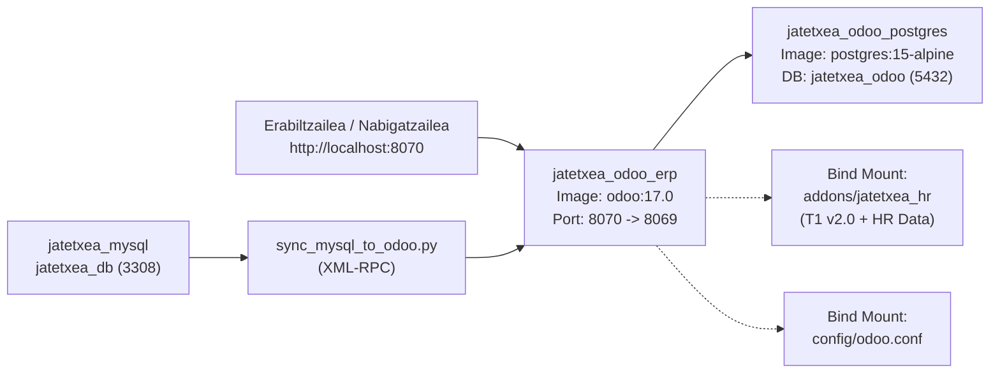

### 3.2 Lizentzia Mota: LGPL-3 (Odoo 17 Community)

* **Odoo 17 Community Edition** **GNU Lesser General Public License v3.0 (LGPL-3)** lizentziapean banatzen da.
* **Abantailak 1T Jatetxea S.L.-rentzat:**
  * Erabilera komertzialerako **guztiz doakoa**, erabiltzaile-kopuru mugagabearekin (gure 15 langileek + Superadmin kontuak sarbide propioa dute kostu gehigarririk gabe).
  * Iturburu-kode irekia eta auditoria segurua egiteko aukera (gure Zibersegurtasun taldearentzat funtsezkoa).
  * Gure modulu pertsonalizatua (`jatetxea_hr`) ere **LGPL-3** lizentziarekin garatu dugu (`__manifest__.py`), Odoo komunitatearen estandarrak errespetatuz.
* **Enterprise vs Community alderaketa:** Enterprise edizioak erabiltzaile bakoitzeko hileko kuota ordainpekoa eskatzen du (`Odoo Proprietary License v1.0`). Gure kasuan, Community edizioak eta `jatetxea_hr` moduluak behar ditugun HR funtzio guztiak (%100) estaltzen dituzte.

### 3.3 Instalazioaren eta Hedapenaren Argazkiak Azalpenekin

#### 1. Urratsa: Zerbitzuen Hedapena Docker-en eta Admin IT Zentralaren Monitorizazioa
`docker-compose.yml` eta `scripts/abiarazi_odoo.ps1` bidez `jatetxea_odoo_erp` (`127.0.0.1:8070`) eta `jatetxea_odoo_postgres` (`127.0.0.1:5432`) edukiontziak martxan jarri dira VLAN 10 sarean. Admin IT Zentralean bi zerbitzuak **ONLINE** egoeran ageri dira, 1–3 ms-ko latentziarekin:

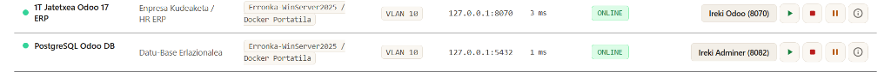

> **Konfigurazio fitxategi nagusiak:**
> * `01_aplikazioak/admin/odoo_erp/docker-compose.yml` eta `02_azpiegitura_birtuala/1T_Jatetxea_Entorno_Birtuala/docker-compose.yml`
> * `01_aplikazioak/admin/odoo_erp/config/odoo.conf` (`addons_path = /usr/lib/python3/dist-packages/odoo/addons,/mnt/extra-addons`, `db_name = jatetxea_odoo`, `http_port = 8069`)

#### 2. Urratsa: `jatetxea_hr` Modulu Pertsonalizatuaren Instalazioa eta Egiaztapena
Docker edukiontzian `/mnt/extra-addons/jatetxea_hr` muntatuta, Odoo Apps zerrendan **`1T Jatetxea - Giza Baliabideak, Langile Kudeaketa eta Marka Identitatea`** (`v17.0.2.0.0`) modulua instalatu da bere logo ofizialarekin (`static/description/icon.png`), `hr`, `hr_contract`, `hr_attendance`, `hr_holidays`, `hr_skills`, `hr_org_chart` eta `website` menpekotasunekin batera:

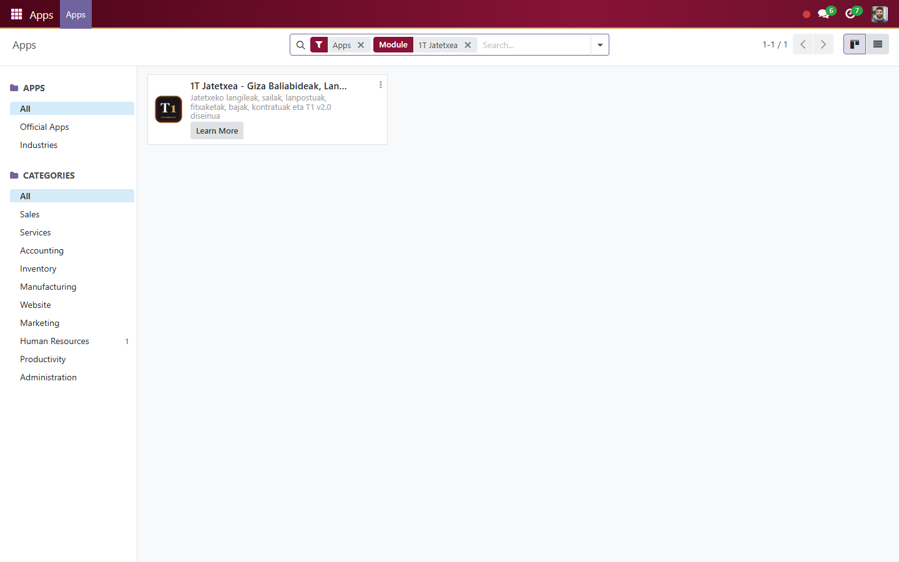

#### 3. Urratsa: Saio-Hasiera Segurua eta Autentifikazioa (`http://localhost:8070/web/login`)
15 langileetako bakoitzak bere erabiltzaile korporatiboa du (`res.users`), `kredentzialak_zentrala.md` dokumentuan jasotako rol eta baimenekin (HR Kudeatzaileak, IT Administratzaileak eta Langile arruntak). Saio-hasierako pantaila 1T Jatetxearen irudi korporatiboarekin eta logo ofizialarekin pertsonalizatu da:

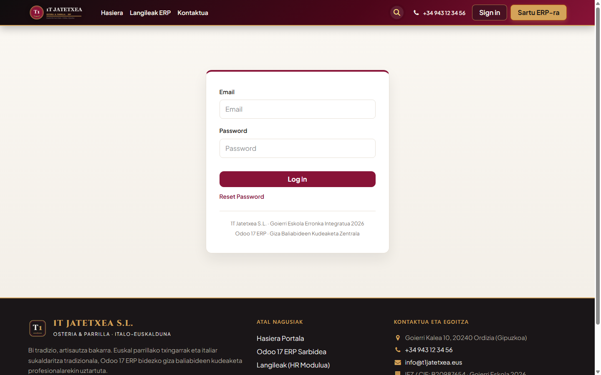

---

## 4. 1T Jatetxearen Marka Identitatea eta Web Portala (`http://localhost:8070/`)

Erronkan aplikazio guztiek koherentzia grafiko bera izan dezaten, Odoo 17 Web Portala (`http://localhost:8070/`) eta ERP Backend-a **T1 Jatetxea v2.0 — Warm Hospitality Light & Evening Espresso Dark** estilo diseinu gidarekin (`01_DISEINU_SISTEMA_ETA_KOLOREAK.md` eta `web_php_bezeroak/assets/css/base.css`) eguneratu ditugu:

### Aplikatutako Estilo-Tokenak eta Hobekuntzak
* **Logo Korporatiboa eta Favicona:** Odooren lehenetsitako `YourLogo` eta `+1 555-555-5556` telefonoa guztiz ezabatu dira. Enpresan (`res.company`) **1T Jatetxea S.L.** logo ofiziala (`t1_logo_official.png`), webgoiburuan bertsio argia (`t1_logo_header_dark.png`) eta nabigatzailean isotipo ofiziala (`t1_favicon.png`) ezarri dira.
* **Kolore Paleta Ofiziala:**
  * **Chianti & Ardo Gorria (`#881337`)** eta **Erromatar Borgoina (`#4C0519`)**: Odoo Backend goiko barra, botoi nagusiak, izenburuak eta Hero gradientea.
  * **Antique Gold (`#D4A359` / `#FDE68A`)**: Goiburu eta oineko azentu-marra, CTA botoi nagusia (`Sartu Odoo ERP Sisteman`) eta ikono-xehetasunak.
  * **Warm Hospitality Light (`#FAF7F2` / `#FFFFFF` / `#E6DFD5`)**: Gorputzeko gainazal garbiak eta txartelak.
  * **Evening Espresso Dark (`#0F0D0E` / `#1A1618`)**: Goiburua, Hero hondoa eta Oina (Footer) Ordiziako helbide ofizialarekin (`Goierri Kalea 10, 20240 Ordizia`, `+34 943 12 34 56`, `info@t1jatetxea.eus`).
* **Tipografia Ofiziala:** `Cinzel` (goiburu klasiko-modernoak eta KPIak), `Plus Jakarta Sans` (UI eta testuak) eta `JetBrains Mono` (etiketa teknikoak eta langile-kopuruak).
* **UTF-8 Kodeketa Zuzendua:** Aurreko `€"` karaktere-akatsak zuzendu eta menuak zein atal guztiak euskara txukunean jarri dira (`Hasiera`, `Langileak ERP`, `Kontaktua`, `Sartu ERP-ra`).

#### Web Portalaren Hasiera-Orria (Hero + KPI Adierazleak)
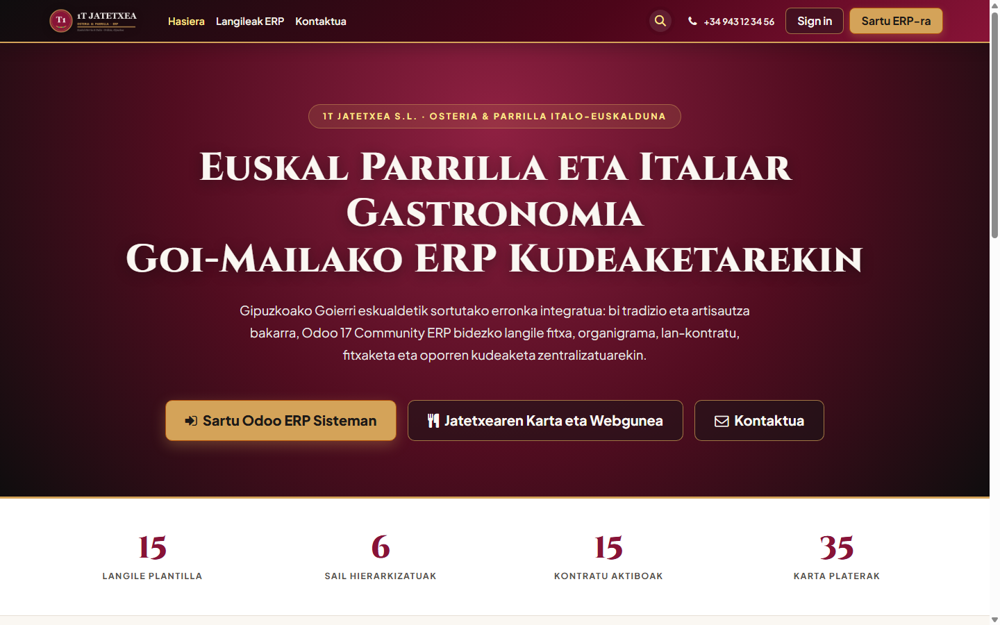

#### Web Portalaren 6 Sailen Ikuspegia
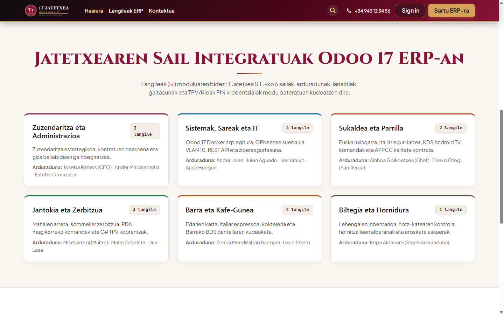

---

## 5. Langileak (`Employees`) Moduluaren Erabileraren Arrazoiketa

Ostalaritza eta sukaldaritza sektorean lan-antolaketa oso dinamikoa da: txanda ezberdinak (goizekoak, arratsaldekoak, asteburuko errefortzuak), sail espezializatuak (sukaldea, jantokia, barra, biltegia) eta legezko betebehar zorrotzak (elikagai-manipulatzaile ziurtagiriak, APPCC, Gipuzkoako Ostalaritza Hitzarmena, eguneroko lanaldi-erregistro derrigorrezkoa).

**Zertarako erabili dugu Odoo 17-ko Langileak (`hr`) modulua 1T Jatetxea S.L.-n?**

1. **Langileen Espediente Digital Zentralizatua:** Excel kalkulu-orriak eta paperezko karpetak ordezkatuz, 15 langileen datu profesionalak (saila, lanpostua, arduraduna, kokalekua) zein pribatuak (helbidea, NAN, Gizarte Segurantza, IBAN kontua nominetarako, larrialdi-kontaktua, ibilgailua eta ikasketak) toki bakarrean eta baimen-kontrolpean gordetzen dira.
2. **Hierarkia eta Arduradun-Katea Argitzea:** 6 sailak modu zuzenean egituratu dira **Zuzendaritza eta Administrazioa** sailaren azpian (`Sistemak IT`, `Sukaldea`, `Jantokia`, `Barra`, `Biltegia`), sail bakoitzeko arduradunak bere taldearen oporrak eta fitxaketak kudeatu ditzan.
3. **Gaitasunen eta Ziurtagirien Kudeaketa:** Ostalaritzan funtsezkoa da jakitea nork duen *Elikagai-Manipulatzaile* ziurtagiria, *Lehen Sorospenak*, hizkuntza mailak (Euskara, Gaztelania, Ingelesa, Italiera) edo *Sommelier* gaitasuna.
4. **Lan-Kontratuen eta Kostuen Jarraipena:** 15 langileen kontratu aktiboak, soldata gordinak, lanaldi motak (40h bulegoa, 40h ostalaritza, 20h asteburukoa) eta hasiera-datak kontrolatzen dira.
5. **Legezko Lanaldi-Erregistroa (Fitxaketak) eta TPV PIN Bateratzea:** Langile bakoitzak Odoo HR Settings-en bere 4 digituko **PIN ofizial bera** du (`kredentzialak_zentrala.md` matrizearekin sinkronizatua: `0001`–`5003`) eta `1TJ-EMP-001`..`015` Badge kodea, fitxaketa-kioskoan sarrera-irteerak erregistratzeko.
6. **Oporren eta Lan-Bajen Plangintza:** Jantokiko edo sukaldeko txandak hutsik gera ez daitezen, 23 opor-egunen saldoa, onartutako oporrak eta gaixotasun-bajak egutegi bateratuan kudeatzen dira.

---

## 6. Moduluaren Erabilpen Erreala: Adibideak, Datu Errealak eta Pantaila-Argazkiak

Jarraian, 1T Jatetxea S.L.-ko **15 langile errealekin** betetako datuak eta benetako erabilera-kasuak erakusten dira, zuzeneko Odoo 17 sistemako pantaila-argazkiekin justifikatuta.

### 6.1 Plantillaren Laburpen Taula (15 Langile Erreal)

| Badge ID | Langilea | Saila | Lanpostua | TPV/Kiosk PIN | Kontratua / Soldata | Herria (Gipuzkoa) |
| :--- | :--- | :--- | :--- | :---: | :--- | :--- |
| `1TJ-EMP-001` | **Joseba Ramos** | Zuzendaritza eta Administrazioa | Zuzendari Nagusia (CEO) | `5002` | Mugagabea · 3.200 €/hil | Ordizia (1 km) |
| `1TJ-EMP-002` | **Ander Madinabeitia** | Zuzendaritza eta Administrazioa | Zuzendaria (Eragiketak eta HR) | `5001` | Mugagabea · 3.200 €/hil | Beasain (4 km) |
| `1TJ-EMP-003` | **Estebe Ormazabal** | Zuzendaritza eta Administrazioa | Zuzendaria (Finantzak) | `5003` | Mugagabea · 3.200 €/hil | Lazkao (5 km) |
| `1TJ-EMP-004` | **Ander Urien Telleria** | Sistemak, Sareak eta IT | IT Lead / FullStack Arkitektoa | `0001` | Mugagabea · 2.850 €/hil | Ordizia (2 km) |
| `1TJ-EMP-005` | **Julen Aguado Fernández** | Sistemak, Sareak eta IT | Sare eta Suebaki Administratzailea | `0002` | Mugagabea · 2.700 €/hil | Beasain (4 km) |
| `1TJ-EMP-006` | **Iker Araujo Dominguez** | Sistemak, Sareak eta IT | Sistemen eta Birtualizazio Ingeniaria | `0003` | Mugagabea · 2.700 €/hil | Urretxu (14 km) |
| `1TJ-EMP-007` | **Aratz Huegun Flores** | Sistemak, Sareak eta IT | Zibersegurtasun Teknikaria | `0004` | Mugagabea · 2.750 €/hil | Tolosa (15 km) |
| `1TJ-EMP-008` | **Ainhoa Goikoetxea** | Sukaldea | Chef Burua / Sukaldari Nagusia | `3001` | Mugagabea · 2.500 €/hil | Idiazabal (8 km) |
| `1TJ-EMP-009` | **Eneko Otegi** | Sukaldea | Bigarren Sukaldaria / Parrilleroa | `3002` | Mugagabea · 1.950 €/hil | Segura (10 km) |
| `1TJ-EMP-010` | **Mikel Arregi** | Jantokia eta Zerbitzua | Maître / Zerbitzari Burua | `1001` | Mugagabea · 2.100 €/hil | Ordizia (1 km) |
| `1TJ-EMP-011` | **Maite Zabaleta** | Jantokia eta Zerbitzua | Jantokiko Zerbitzaria | `1002` | Lanaldi Osoa · 1.400 €/hil | Zaldibia (6 km) |
| `1TJ-EMP-012` | **Unai Lasa** | Jantokia eta Zerbitzua | Jantokiko Zerbitzaria (Asteburuak) | `1003` | Partziala 20h · 950 €/hil | Ataun (9 km) |
| `1TJ-EMP-013` | **Gorka Mendizabal** | Barra eta Kafe-Gunea | Barman / Barrako Arduraduna | `2001` | Mugagabea · 1.850 €/hil | Ormaiztegi (7 km) |
| `1TJ-EMP-014` | **Uxue Etxarri** | Barra eta Kafe-Gunea | Barrako Zerbitzaria | `2002` | Mugagabea · 1.600 €/hil | Itsasondo (5 km) |
| `1TJ-EMP-015` | **Kepa Aldasoro** | Biltegia eta Hornidura | Biltegi eta Stock Arduraduna | `4001` | Mugagabea · 1.800 €/hil | Legazpi (17 km) |

---

### 6.2 1. Adibidea: Langileen Direktorioko Kanban Ikuspegia eta 6 Sail Independenteak

Ezkerreko panelean enpresaren **6 sail funtzional independenteak** maila berean ageri dira (`Barra eta Kafe-Gunea [2]`, `Biltegia eta Hornidura [1]`, `Jantokia eta Zerbitzua [3]`, `Sistemak, Sareak eta IT [4]`, `Sukaldea [2]`, `Zuzendaritza eta Administrazioa [3]`), eta aginte-katea `Org Chart` bidez bereizita kudeatzen da. Langile bakoitzak bere profil-argazki errealista, etiketa operatiboak (*Elikagai-Manipulatzailea*, *Lehen Sorospenak*, *HR Kudeatzailea*, txandak) eta harremanetarako datuak ditu:

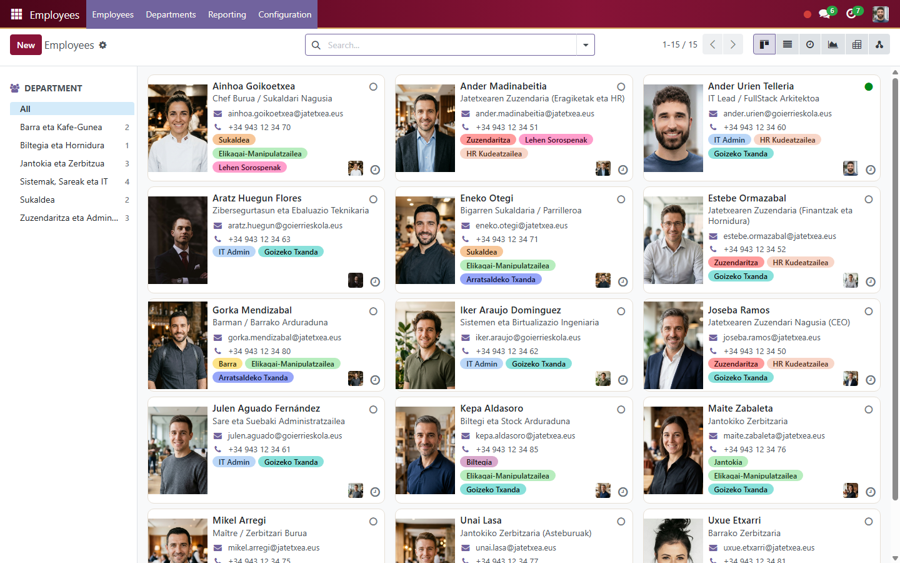

Sailen kudeaketa-panelean (`Departments`) sail bakoitzeko langile-kopurua eta zain dauden eskaerak (adibidez, `Biltegia eta Hornidura`: *1 Time Off Requests*) zuzenean bistaratzen dira:

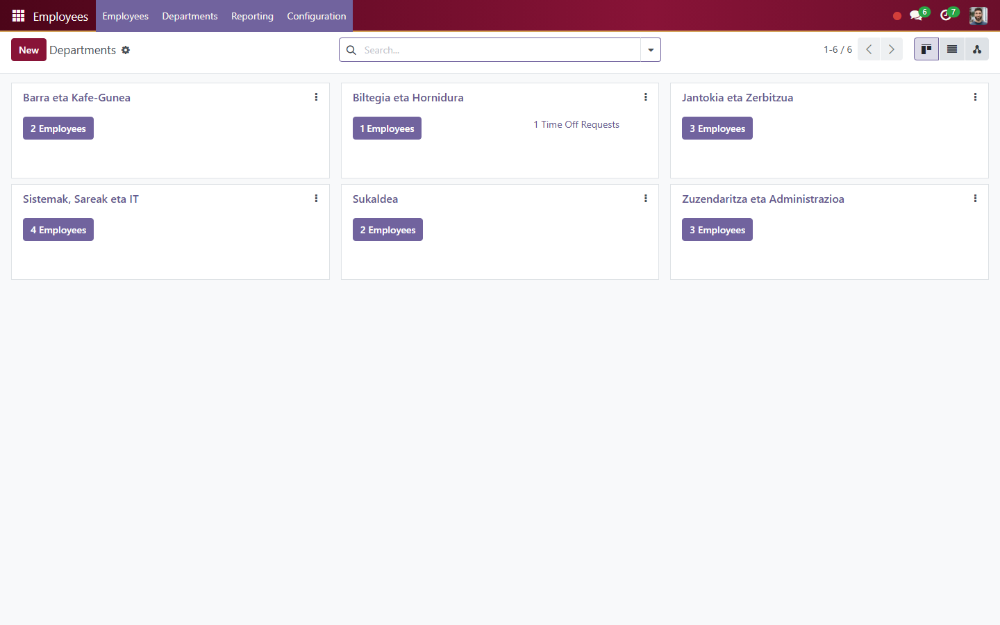

---

### 6.3 2. Adibidea: Enpresaren Organigrama Hierarkiko Interaktiboa (`Org Chart`)

Odoo 17-ko `hr_org_chart` ikuspegi hierarkikoak erakusten du nola dagoen egituratuta aginte-katea: **Joseba Ramos (CEO)** gailurrean, eta haren azpian **Ander Madinabeitia** (Sukaldea, Jantokia eta Barrako arduradunak koordinatzen), **Estebe Ormazabal** (Biltegia gainbegiratzen) eta **Ander Urien Telleria** (IT Taldeko 3 ingeniariak gidatzen):

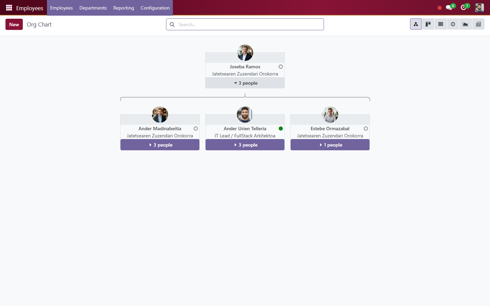

---

### 6.4 3. Adibidea: Langile Fitxa Sakonean Beteta (Ainhoa Goikoetxea — Chef Burua)

Langile bakoitzaren fitxak **4 atal nagusi** ditu %100ean datu errealekin beteta (guztira **79 gaitasun-erregistro** eta **37 CV lerro** 15 langileen artean):

1. **Resume (CV eta Gaitasunak):** Esperientzia profesionala (1T Jatetxea, Osteria del Borgo), ikasketak (*Basque Culinary Center*), APPCC ziurtagiria eta gaitasun-mailak (*Euskara %100*, *Gaztelania %100*, *Italiera %85*, *Euskal Parrilla %100*, *Italiar Labea %100*, *APPCC %100*). Goiko botoi adimentsuek kontratu aktiboa (`In Contract Since 01/15/2025`), opor saldoa (`23/23 Days`) eta hileko orduak (`21:35 Hours`) erakusten dituzte:

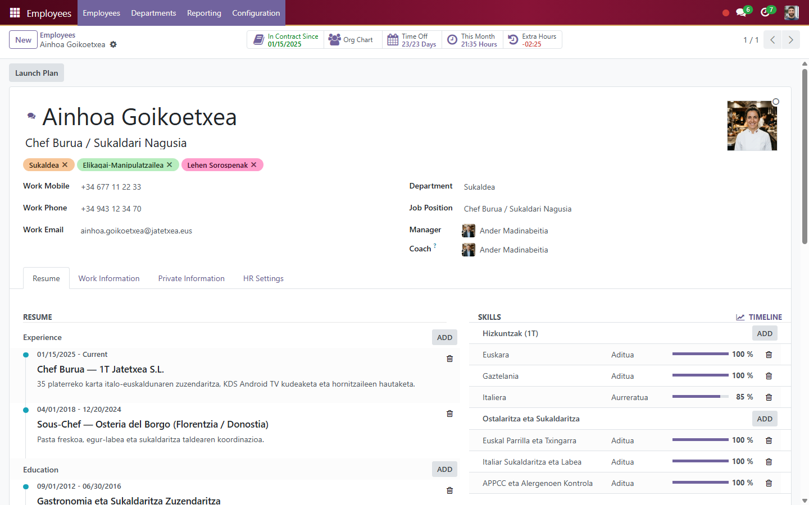

2. **Work Information (Lan Informazioa eta Talde Organigrama):** Enpresaren helbidea (`1T Jatetxea S.L., Goierri Kalea 10, 20240 Ordizia`), lan-kokaleku zehatza (`Sukalde Nagusia eta Euskal Parrilla`), onarpen-arduraduna (`Ander Madinabeitia`) eta eskuinaldean bere mendeko langilea (`Eneko Otegi — Bigarren Sukaldaria / Parrilleroa`):

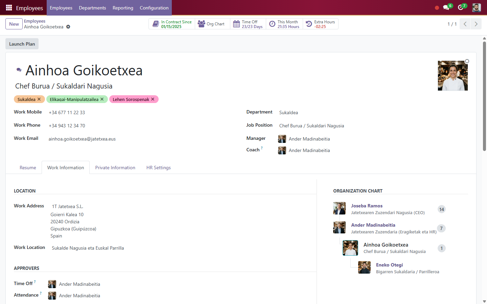

3. **Private Information (Datu Pribatuak, Bankua, Larrialdia eta Ikasketak):** Helbide pribatua (`Kale Nagusia 31, 2.B, 20213 Idiazabal, Gipuzkoa`), posta pribatua, telefonoa, **Kutxabank IBAN kontua** (`ES33 2095 5044 80 9102345608`), egoera zibila (`Married`, ezkontidea `Iñigo Larrañaga`, seme-alaba 1), lantokirako distantzia (`8 km`), matrikula (`5512 KTR`), larrialdi-kontaktua (`Jon Goikoetxea`), ikasketak, NAN (`72548905E`) eta Gizarte Segurantza (`20/10891432/41`):

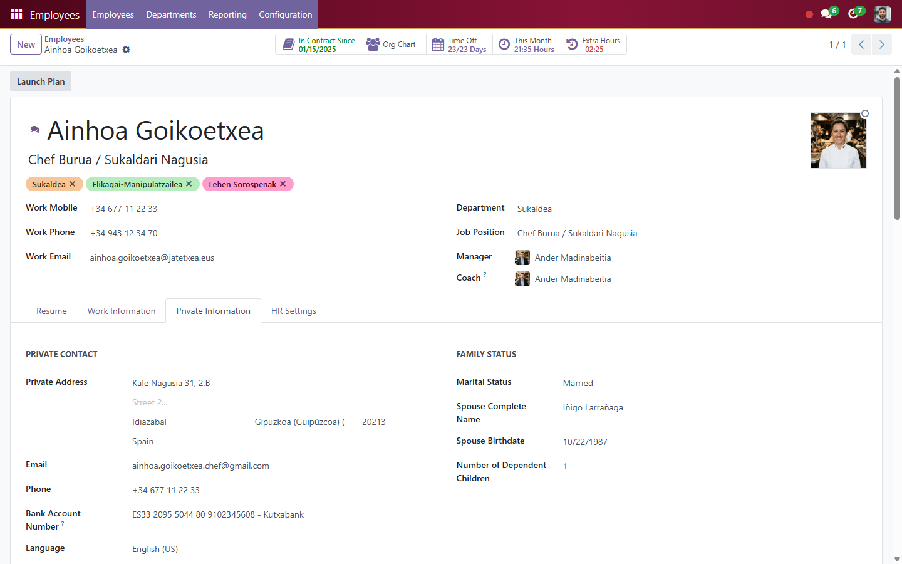

4. **HR Settings (Odoo Erabiltzailea, TPV/Kiosk PIN eta Badge ID):** Odoo kontuarekin lotura (`ainhoa.goikoetxea@jatetxea.eus`), **PIN Code `3001`** (Sukaldeko KDS eta Odoo Attendance Kiosk-ean bateratua) eta **Badge ID `1TJ-EMP-008`** txartela inprimatzeko aukerarekin:

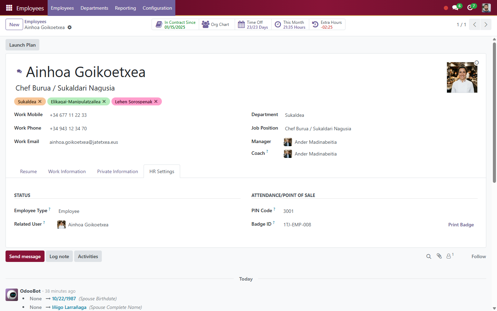

---

### 6.5 4. Adibidea: Lan-Kontratuen Kudeaketa (`hr_contract`)

15 langileek kontratu aktiboa (`Running`) dute `hr_contract` moduluan, bakoitzak bere kode ofizialarekin (`KONT-2026-ZUZ01` .. `KONT-2026-BIL01`), hasiera-datarekin, kontratu-motarekin (`Permanent`, `Full-Time`, `Part-Time`), ordutegiarekin (`Lanaldi Osoa 40h`, `Ostalaritza 40h`, `Lanaldi Partziala 20h`) eta hitzarmen-oharrekin:

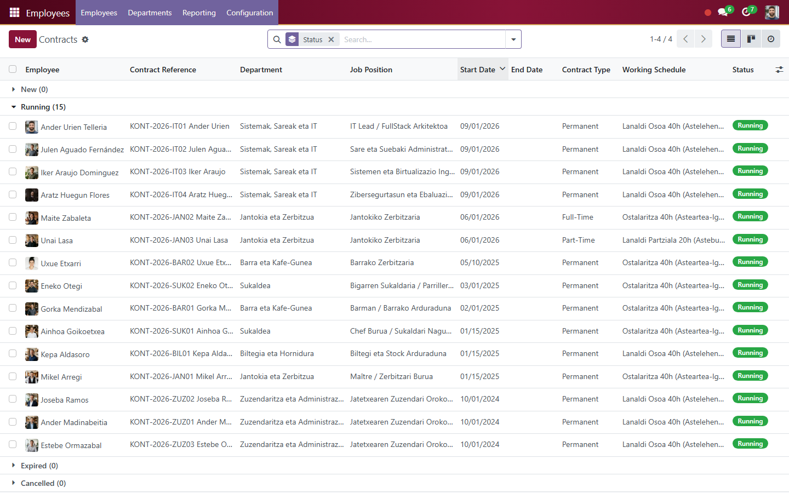

---

### 6.6 5. Adibidea: Eguneroko Fitxaketak eta Ordu-Kontrola (`hr_attendance`)

Azaroaren 20tik 26ra bitarteko **53 fitxaketa erreal** erregistratu dira 15 langileentzat (IT eta Zuzendaritza astelehenetik ostegunera, Sukaldea/Jantokia/Barra asteartetik ostegunera, eta Unai Lasa asteburuko 20 orduko txandan). Sistemak automatikoki kalkulatzen ditu lan egindako orduak eta aparteko orduak (`Over Time`):

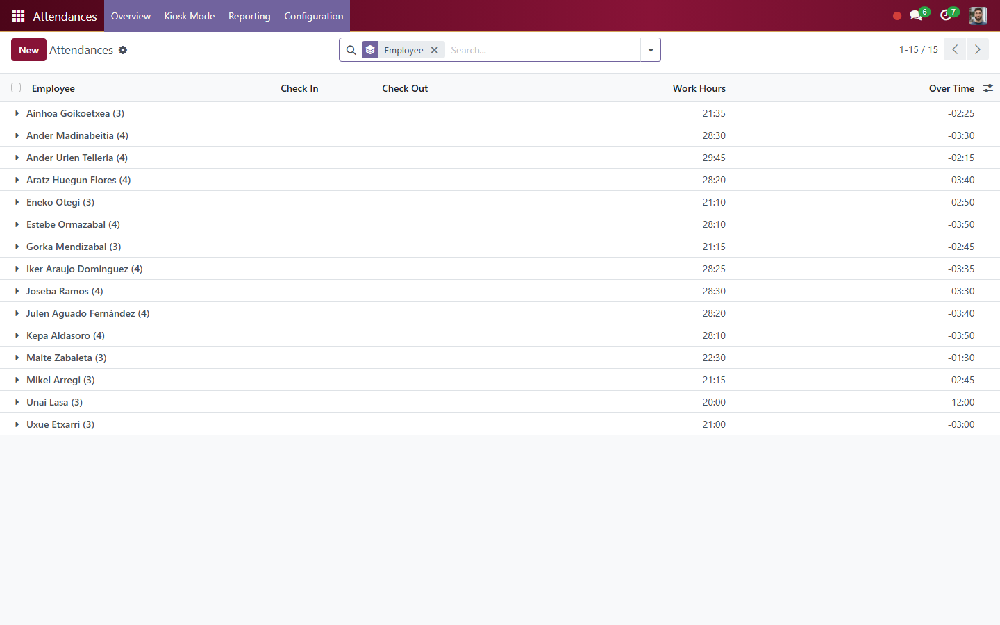

---

### 6.7 6. Adibidea: Oporrak, Mediku-Bajak eta Prestakuntza (`hr_holidays`)

15 langileei **2026ko 23 opor-egun** esleitu zaizkie (`Paid Time Off`), eta IT taldeari **5 prestakuntza-egun** (`Training Time Off`). Horrez gain, 4 kasu erreal kudeatzen dira:
* **Maite Zabaleta (Onartua / Approved):** Urteko oporrak (azaroak 10–13, 4 egun).
* **Eneko Otegi (Onartua / Approved):** Gripe arruntagatiko mediku-baja (`Sick Time Off`, azaroak 2–5, 4 egun).
* **Iker Araujo Dominguez (Onartua / Approved):** Proxmox & Docker Segurtasun Prestakuntza (`Training Time Off`, azaroak 19, egun 1).
* **Kepa Aldasoro (Onartzeko Zain / To Approve):** Abenduko zubiko opor-eskaera (abenduak 7–11, 5 egun) — Zuzendaritzak zuzenean pantailatik *Approve / Refuse* egiteko prest!

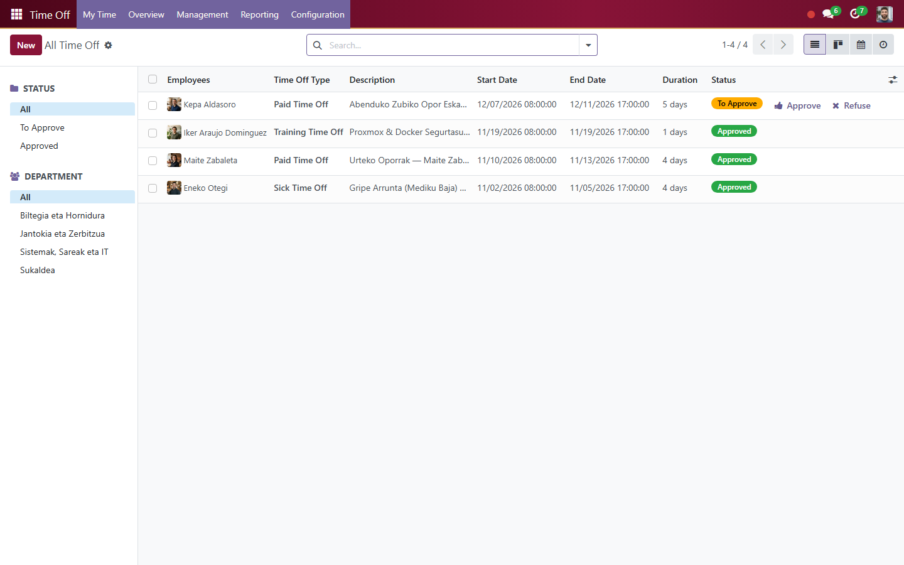

---

## 7. Erronkako Ebaluazio-Errubrikaren Betetze-Matrizea

`05_erronka_egin_beharrak/enpresa_kudeaketa_sistemak/enpresa_kudeaketa_sistemak_egin_beharrak.png` taulako betekizun guztien egiaztapena:

| Noiz konprobatu | Zer konprobatu | Egoera | Ebidentzia / Kokapena |
| :--- | :--- | :---: | :--- |
| **Dokumentuan** | Aukeratutako modulua adierazita dago eta ez dago beste talde batekin errepikatuta | **BETETA** | 1. Atala: **Langileak (`hr` — Employees)** eta HR azpimoduluak (1. Taldeari esleituta). |
| **Dokumentuan** | ERP-CRM aukerak aztertu eta konparatu dituzte, eta aukeraketa justifikatu dute | **BETETA** | 2. Atala: Odoo 17 vs Dolibarr vs ERPNext vs SAP B1 vs Dynamics 365 taula eta justifikazioa. |
| **Aplikazioa erakustean** | Odooren instalazioa zuzen egin dute (Windows edo Linux zerbitzarian) | **BETETA** | `jatetxea_odoo_erp` (`:8070`) + `jatetxea_odoo_postgres` (`:5432`) Docker-en ONLINE. |
| **Dokumentuan** | Instalazio mota eta lizentzia mota azalduta daude; instalazio argazkiak azalpenekin | **BETETA** | 3. Atala: On-Premise Docker Compose + LGPL-3 Community azalpena eta instalazio argazkiak (`00`, `03`, `14`). |
| **Aplikazioa erakustean** | Odook ongi funtzionatzen du | **BETETA** | `http://localhost:8070/` (T1 v2.0 diseinua + logoa) eta `/web` backend-a akatsik gabe egiaztatuta. |
| **Dokumentuan** | Aukeratutako moduluaren erabilera arrazoitu dute (zertarako erabili duten) | **BETETA** | 5. Atala: 6 arrazoi operatibo eta legal 1T Jatetxea S.L.-rako. |
| **Aplikazioa erakustean eta dokumentuan** | Moduluaren erabilpena adibideekin justifikatu dute; aurkezpenean eta dokumentuan datu "errealak" ikusten dira | **BETETA** | 6. Atala: 15 langile, 6 sail, 79 gaitasun, 37 CV lerro, 15 kontratu, 53 fitxaketa, 4 opor/baja eskaera eta 14 pantaila-argazki erreal. |
