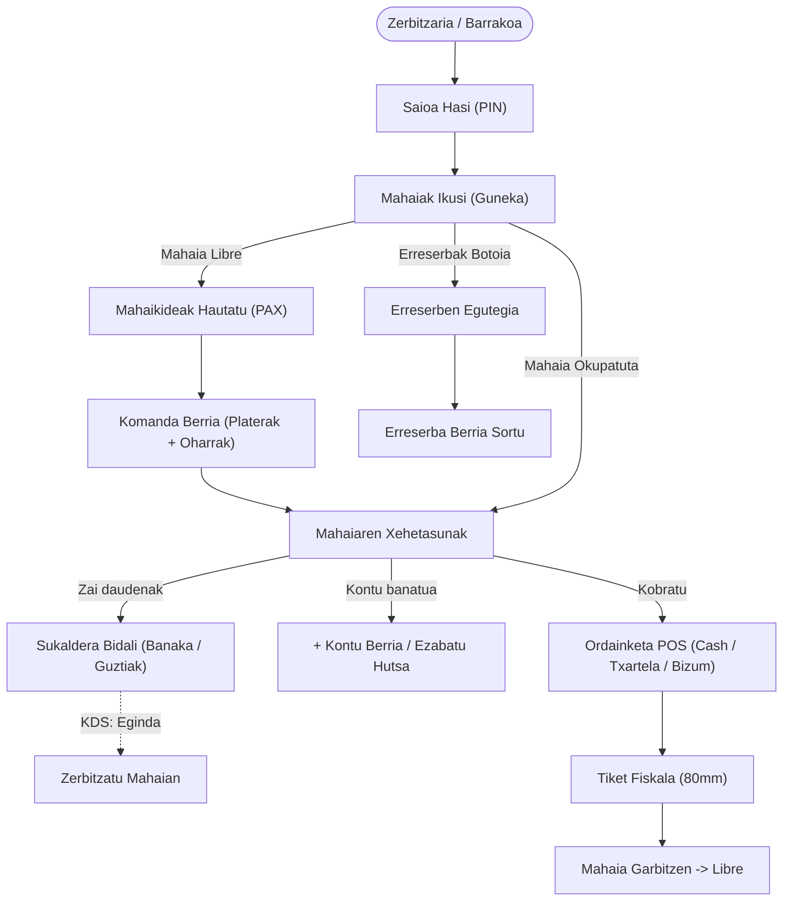
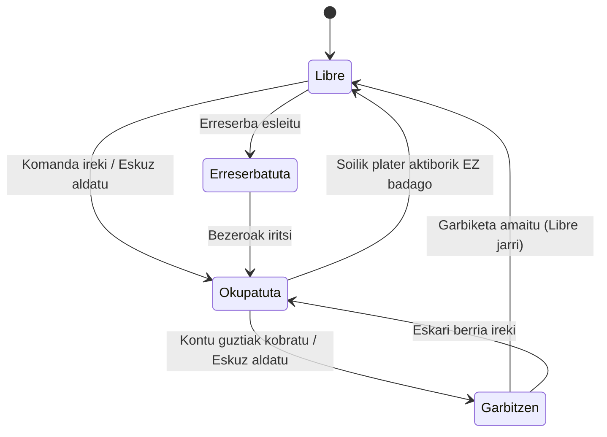
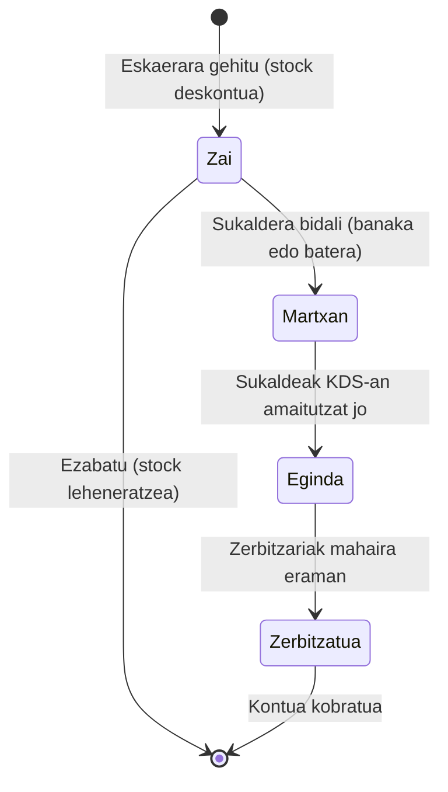
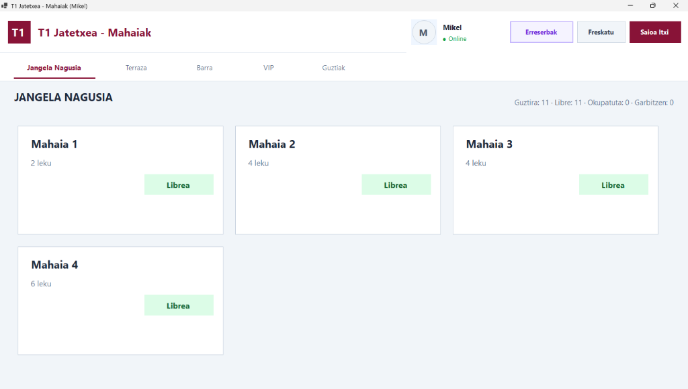
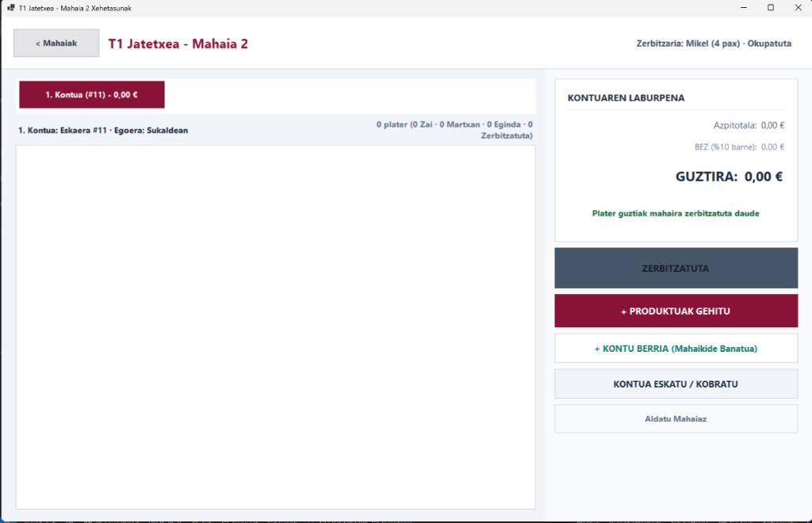

# 1. TPV Analisia

> [← Aurkibidera itzuli](README.md) · [Hurrengoa: 2. TPV Diseinua →](2_tpv_diseinua.md)

## 1.1. Testuingurua eta Helburua

**T1 Jatetxea Desktop TPV** mahaigaineko / ukipen-pantailako terminal profesionala da jatetxeko aretoan, barran eta kutxan lan egiten duten langileentzat. Bere helburu nagusia zerbitzu-fluxu osoa denbora errealean koordinatzea da: mahaien okupazioa, mahaikideen kontu banatuak (*split-bill*), sukaldeko KDS pantailarekin komunikazioa, erreserben egutegia eta POS kobrantza (80mm-ko tiket fiskalarekin).

---

## 1.2. Erabiltzaile Rolak eta Baimen Matrizea

Aplikazioak `LoginForm`-ean langileen rolak iragazten ditu (`DaBaimendua` metodoa) eta bakoitzari dagozkion funtzioak gaitzen dizkio:

| Rola (`LangileaDto.Rola`) | Sarrera TPV-ra | Mahaiak & Xehetasunak | Plateren Katalogoa | Erreserbak | Kobrantza (POS) |
| :--- | :---: | :---: | :--- | :---: | :---: |
| **`Zerbitzaria`** (Maitre / Jangela) | Bai | Osoa | Guztiak (Edariak, Hastekoak, Haragiak, Postreak) | Bai | Bai |
| **`Barrakoa`** | Bai | Osoa | **Mugatua**: Edariak, kafeak eta postreak soilik | Bai | Bai |
| **`AdminIT` / `Admin`** | Bai | Osoa | Guztiak | Bai | Bai |
| **`Kudeatzailea`** (Zuzendari) | Bai | Osoa | Guztiak | Bai | Bai |
| Beste rolak (adib. Sukaldaria) | Ez | — | KDS Android TV erabiltzen dute | — | — |

---

## 1.3. Eskakizun Funtzionalak (RF)

| Kodea | Eskakizuna | Deskribapena | Pantaila |
| :---: | :--- | :--- | :--- |
| **RF-01** | PIN bidezko autentifikazioa | Langilea avatarretan hautatu eta 4 digituko PINa sartu (ukipen-teklatu edo teklatu fisikoarekin). | `LoginForm` |
| **RF-02** | API/DB osasun-kontrola | `/health` bidez konexioa egiaztatu eta 3 segundoro automatikoki berriz konektatu offline badago. | `LoginForm` |
| **RF-03** | Mahaien kudeaketa guneka | Mahaiak iragazi (*Jangela Nagusia*, *Terraza*, *Barra*, *VIP*, *Guztiak*) eta egoera ikusi. | `MahaiakForm` |
| **RF-04** | Mahaiaren egoera-aldaketa | Mahaia *Libre*, *Okupatuta* edo *Garbitzeko* egoeretara aldatu. **Arau kritikoa**: plater aktiboak badaude, ezin da *Libre* jarri. | `MahaiaXehetasunakForm` |
| **RF-05** | Mahaikide kopurua (PAX) | Mahai libre bat irekitzean pertsona kopurua azkar hautatu (`1..8+` eta `-`/`+`). | `MahaikideakModal` |
| **RF-06** | Komanda eta stock kontrola | Platerak kategoriaka gehitu, sukaldeko stock erabilgarria erakutsi eta bezero-oharrak gehitu. | `EskaeraForm`, `OharraModal` |
| **RF-07** | Kontu anitzak (Split-Bill) | Mahai berean kontu banatuak ireki (`+ KONTU BERRIA`) eta fitxa bidez aldatu. | `MahaiaXehetasunakForm` |
| **RF-08** | Kontu hutsen ezabaketa | Platerik gabeko (`0,00 €`) kontuetan fitxan `✕` botoia eta pantaila erdian zentratutako ezabaketa-botoia erakutsi. | `MahaiaXehetasunakForm` |
| **RF-09** | Banakako eta taldekako bidalketa | Sukaldera bidali gabeko (`Zai`) platerak banaka (`▶ Sukaldera`) edo batera bidali, eta nahi izanez gero ezabatu (`🗑`). | `MahaiaXehetasunakForm` |
| **RF-10** | KDS prest-abisuak | Sukaldeak platera `Eginda` markatzean lehen postuan igo eta dir-dir bisualarekin abisatu zerbitzatzeko. | `MahaiaXehetasunakForm` |
| **RF-11** | POS kobrantza eta tiketa | Eskudirua (kanbio kalkuluarekin), Txartela (EMV) eta Bizum onartu; 80mm-ko tiketa erakutsi, gorde eta inprimatu. | `OrdainketaForm`, `TiketIkusteaForm` |
| **RF-12** | Erreserben egutegia | 5 hilabeteko ikuspegia, 4 txanda (*Bazkaria 1/2*, *Afaria 1/2*), erreserba berriak sortu (astelehenak blokeatuta) eta ezeztatu. | `ErreserbakForm`, `ErreserbaBerriaModal` |

---

## 1.4. Eskakizun Ez-Funtzionalak (RNF)

| Kodea | Kategoria | Baldintza Neurgarria |
| :---: | :--- | :--- |
| **RNF-01** | **Responsive & Leihoak** | Formulario guztiak beti `WindowState.Maximized` egoeran hasiko dira, baina txikitu ahal izango dira **`800×500 px`** gutxieneko tamainaraino gainjarpenik gabe. |
| **RNF-02** | **Parpadeorik gabe (0 Flicker)** | Auto-freskatzeak AJAX-moduko diff konparaketa erabiliko du; daturik aldatu ez bada 0 UI berreraikitze, eta aldaketetan in-place patching + `DoubleBuffered` + `WM_SETREDRAW`. |
| **RNF-03** | **Errendimendua & Sarea** | HTTP eskaerek gehienez `2.5s`-ko timeout-a izango dute, hari nagusia blokeatu gabe (`async/await`). |
| **RNF-04** | **Irisgarritasuna (WCAG 2.2)** | Testu/hondo kontraste egokia (`EspressoInk` `#1C1917` `WarmLinen` `#FAF7F2` gainean) eta ukipen-botoi handiak (`>= 42 px`). |
| **RNF-05** | **Mantengarritasuna** | Formulario bakoitza bere karpetan (`.cs`, `.Designer.cs`, `.resx`), Visual Studio Designer-ekin 100% bateragarria. |
| **RNF-06** | **Marka-koherentzia** | `zerbitzaria_komandera_android` v2.0 (*Warm Hospitality*) estilo-gidarekin bateratua kolore, logo eta tipografian. |

---

## 1.5. Erabilera-Kasuak eta Zerbitzu-Fluxua

---

## 1.6. Egoera-Makinak (Mahaiak eta Plater-Lerroak)

### Mahaiaren bizi-zikloa

### Plater-lerroaren bizi-zikloa (TPV ↔ KDS Sukaldea)

---

## 1.7. Hasierako Zirriborroak eta Aurreko Egoeraren Analisia

Proiektuaren hasieran `ui_zirriborroak/` karpetako zirriborroak erabili ziren oinarri gisa, eta lehen bertsioan interfaze estatikoa (`Tailwind Slate` tonu hotzak, tamaina finkoko modalak eta `Controls.Clear()` bidezko freskatzea) garatu zen:

| Zirriborroa / Hasierako Egoera | Irudia | Identifikatutako Hobekuntza-Beharrak |
| :--- | :---: | :--- |
| **Mahaiak (Aurreko bertsioa)** |  | 3 segundoro `Controls.Clear()` egitean parpadeoa; paleta hotza (`#F1F5F9`); `MinimumSize` altuegia (`1180×750`). |
| **Mahaiaren Xehetasunak (Aurrekoa)** |  | Kontu hutsen ezabaketa falta hasieran; goiko barra gainjartzen zen `800×500`-n; estiloa Android v2.0-rekin bateratu gabe. |
| **Hasierako Zirriborroak (`ui_zirriborroak`)** | [1-saioa_hasi](../ui_zirriborroak/1-saioa_hasi_interfazea.jpg) · [2-Mahaiak](../ui_zirriborroak/2-Mahaiak_interfazea.jpg) · [4-Xehetasunak](../ui_zirriborroak/4-mahaia_xehetasunak_interfazea.jpg) | Kontzeptu funtzional ona, baina diseinu sistema profesional eta responsive arau argirik gabe. |
