# 2. TPV Diseinua

> [← Aurrekoa: 1. TPV Analisia](1_tpv_analisia.md) · [Aurkibidea](README.md) · [Hurrengoa: 3. TPV Garapena →](3_tpv_garapena.md)

## 2.1. Sistema-Arkitektura Orokorra

TPV mahaigaineko aplikazioak **Bezero-Zerbitzari (REST JSON)** arkitektura jarraitzen du, jatetxeko gainerako aplikazioekin (*Android Komandera* eta *Sukaldea KDS Android TV*) backend eta datu-base bera partekatuz:

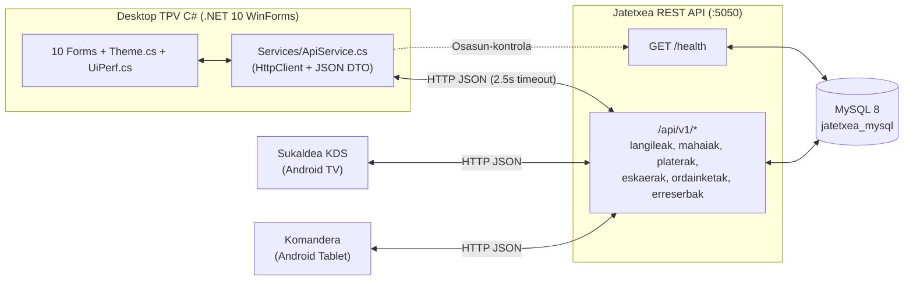

---

## 2.2. Klase-Egitura eta Geruzak

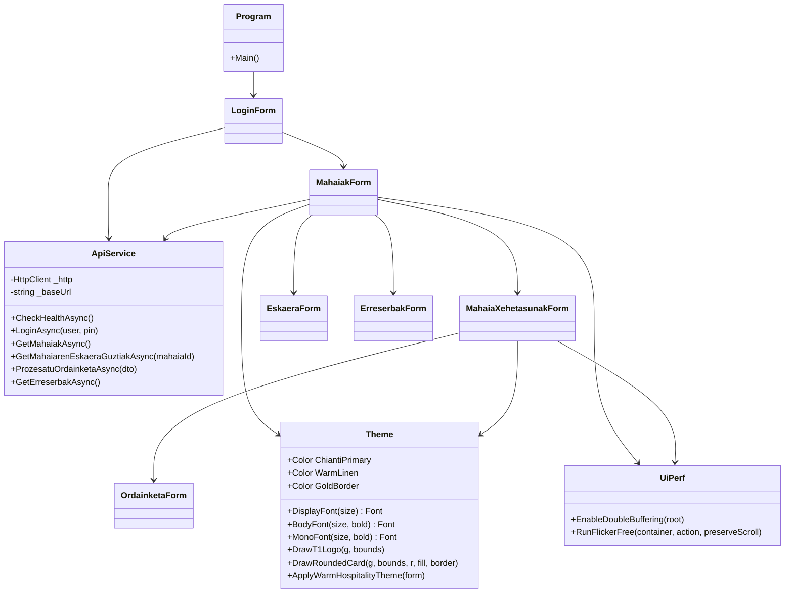

---

## 2.3. Diseinu Sistema: T1 Jatetxea v2.0 (*Warm Hospitality*)

Diseinu osoa **`zerbitzaria_komandera_android`** estilo-gidarekin lerrokatu da eta **Figma**-n dokumentatu da profesionalki:

- **Figma fitxategia**: [T1 Jatetxea - Desktop TPV C# (UI Diseinua)](https://www.figma.com/design/DVmurlGmkzECO2NE6jTI8Y) (`2MG3 / desktop_TPV_csharp` karpetan)
- **3 orri Figma-n**: `01 · Estilo Gida & Osagaiak` (56 aldagai Light/Dark + 11 testu-estilo + 10 osagai), `02 · Pantaila Nagusiak (1440×900)` eta `03 · Modalak & Responsive (800×500)`.

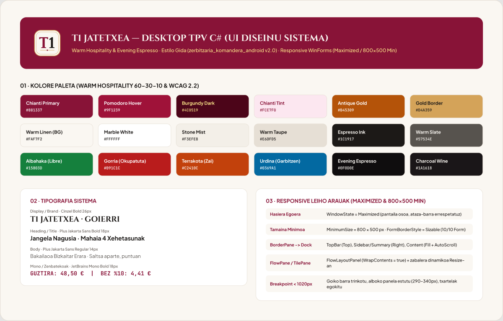

### Kolore-Paleta (60–30–10 Araua & WCAG 2.2 AA)

| Token izena | Hex | Erabilera nagusia |
| :--- | :---: | :--- |
| **`WarmLinen`** | `#FAF7F2` | Aplikazioaren atzeko plano nagusia (%60) |
| **`MarbleWhite`** | `#FFFFFF` | Txartelak, goiko barrak eta azalera jasoak (%30) |
| **`StoneMist`** | `#F3EFE8` | Botoi sekundarioak, chip-ak eta hondo leunak |
| **`WarmTaupe`** | `#E6DFD5` | Txartel-ertzak eta marra banatzaileak |
| **`ChiantiPrimary`** | `#881337` | Marka-kolore nagusia, CTA botoiak eta aktibo-egoerak (%10) |
| **`PomodoroHover`** | `#9F1239` | Hover egoera botoi nagusietan |
| **`GoldBorder` / `AntiqueGold`** | `#D4A359` / `#B45309` | T1 monograma, laburpen-txartelen marko dotorea eta azentuak |
| **`EspressoInk`** | `#1C1917` | Testu nagusiak eta *Okupatuta* pilula iluna |
| **`WarmSlate` / `StoneMuted`** | `#57534E` / `#78716C` | Testu sekundarioak eta laguntza-etiketak |
| **`Success` / `SuccessBg`** | `#15803D` / `#DCFCE7` | *Libre* egoera eta *Eginda / Bidali* ekintza berdeak |
| **`Danger` / `DangerBg`** | `#B91C1C` / `#FEE2E2` | Erroreak, ezabaketa eta kontu hutsak (`✕`) |
| **`Warning` / `WarningBg`** | `#C2410C` / `#FFEDD5` | *Zai / Sukaldean* egoera |
| **`Info` / `InfoBg`** | `#0369A1` / `#E0F2FE` | *Garbitzen / Martxan* egoera |

### Tipografia Sistema (`Assets/Fonts/`)

| Maila | Letra-tipoa | Estiloa | Erabilera |
| :--- | :--- | :--- | :--- |
| **Display / Marka** | `Cinzel` | Bold | Goiburuko markak (`T1 JATETXEA · MAHAIAK`), T1 monograma |
| **UI / Gorputza** | `Plus Jakarta Sans` | Regular / Medium / SemiBold / Bold | Botoiak, mahai-izenak, platerak, nabigazio-fitxak |
| **Zenbatekoak / POS** | `JetBrains Mono` | Medium / Bold | Prezioak, `GUZTIRA`, kanbioa, 80mm-ko tiketa |

---

## 2.4. Responsive Diseinu Arkitektura (`Maximized` + `800×500` Min)

JavaFX-eko layout-eredu responsive-ak (`BorderPane`, `HBox`/`VBox`, `GridPane`, `FlowPane`, breakpoint listener) zuzenean WinForms-era itzuli dira 10 formulario guztietan:

| Kontzeptua | WinForms Inplementazioa | Portaera `800×500` → `4K` tartean |
| :--- | :--- | :--- |
| **Hasiera eta Muga** | `WindowState = Maximized`, `MinimumSize = (800, 500)`, `FormBorderStyle = Sizable` | Pantaila osoan irekitzen da (ataza-barra errespetatuz) eta `800×500`-raino txikitu daiteke. |
| **Egitura Nagusia** | `Dock = Top / Left / Right / Bottom / Fill` | Goiko barra goian, alboko panela eskuinean/ezkerrean eta edukia erdian beti. |
| **Txartel Saretak** | `FlowLayoutPanel` (`AutoScroll = true`, `WrapContents = true`) | Zutabe kopurua (2, 3, 4...) eta txartelen zabalera dinamikoki birkalkulatzen dira `Resize`-an. |
| **Breakpointak** | `< 1080px`, `< 1020px`, `< 960px`, `< 920px`, altuera `< 600px` | Goiko barra trinkotzen da (`84px` → `68px`), alboko panela estutzen da (`420px` → `290px`) eta erdiko testu osagarriak ezkutatzen dira gainjarpenik ez izateko. |

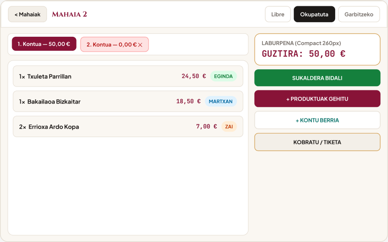

---

## 2.5. Pantailen Katalogoa eta Nabigazio-Mapa

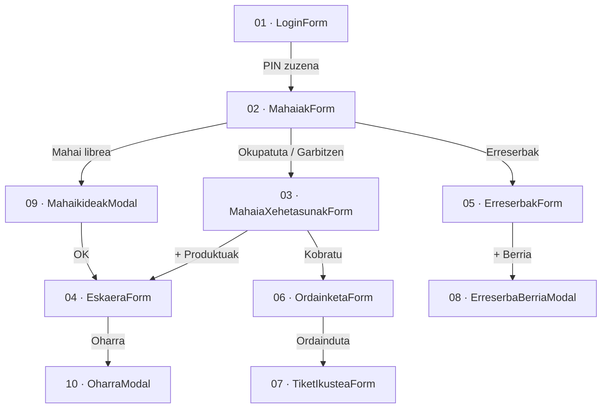

### Pantaila Nagusien Diseinuak

#### 01 · Saioa Hasi (`LoginForm`)
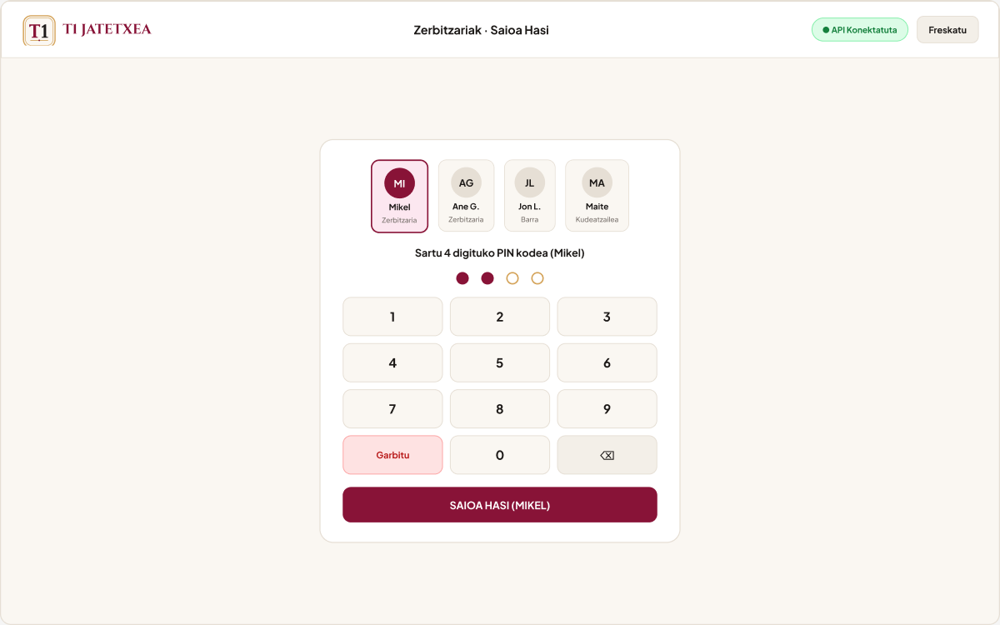

#### 02 · Mahaien Ikuspegia (`MahaiakForm`)
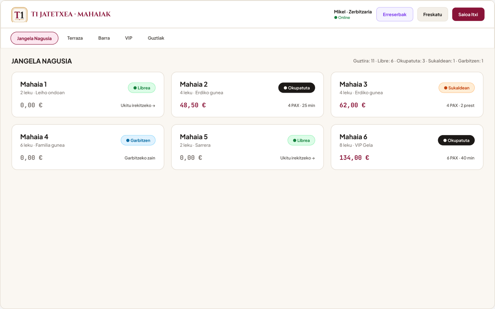

#### 03 · Mahaiaren Xehetasunak eta Kontu Anitzak (`MahaiaXehetasunakForm`)
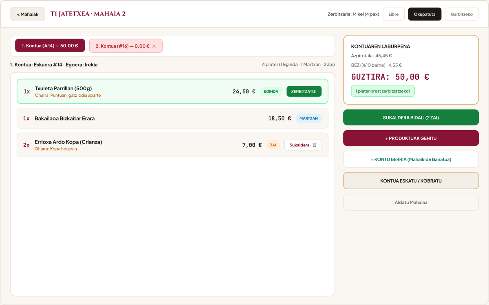

#### 04 · Komanda / Plateren Katalogoa (`EskaeraForm`)
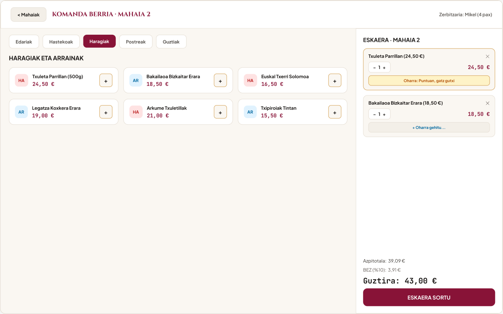

#### 05 · Erreserben Egutegia (`ErreserbakForm`)
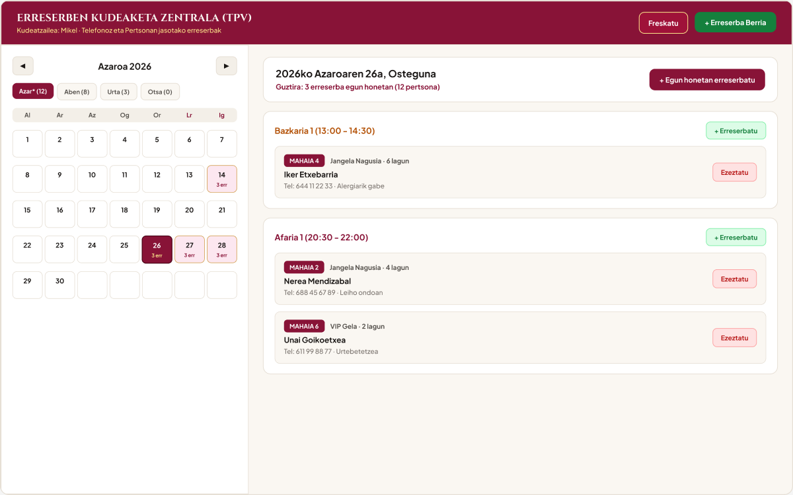

#### 06 · Ordainketa POS (`OrdainketaForm`) eta 07 · Tiket Fiskala (`TiketIkusteaForm`)

| Ordainketa POS (`OrdainketaForm`) | 80mm Tiket Fiskala (`TiketIkusteaForm`) |
| :---: | :---: |
| 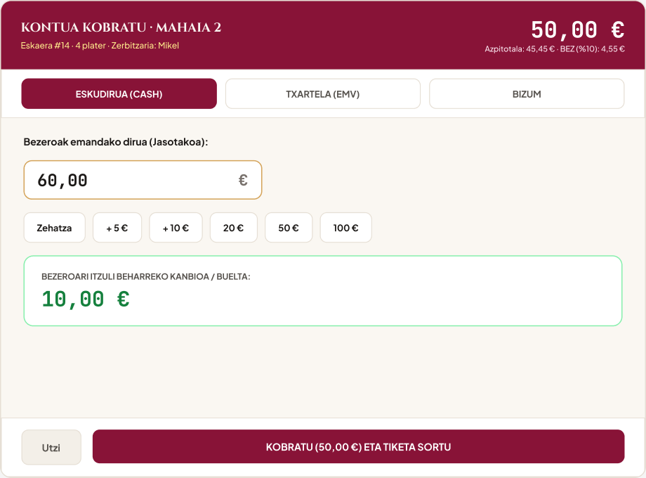 | 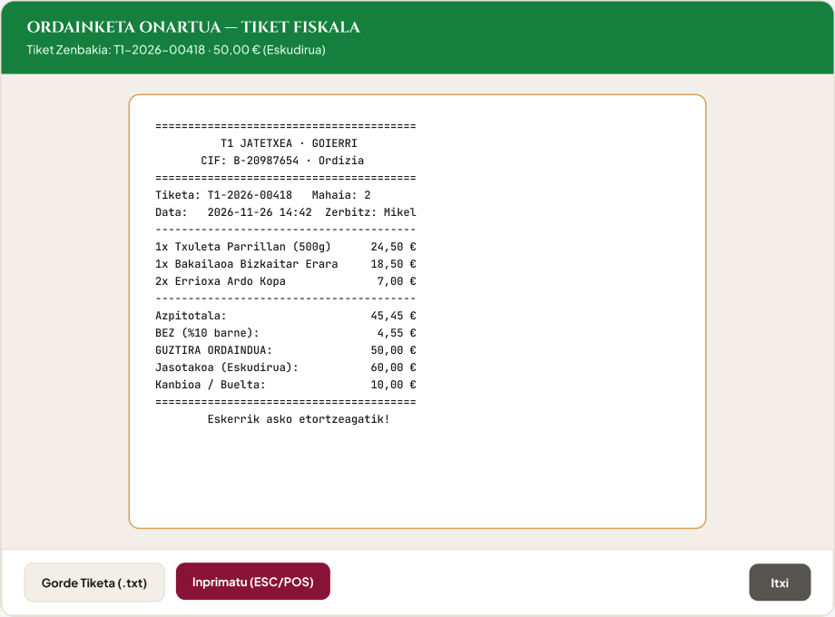 |
