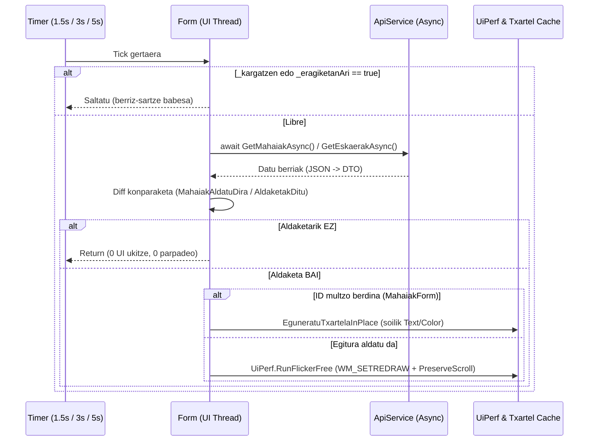

# 3. TPV Garapena

> [← Aurrekoa: 2. TPV Diseinua](2_tpv_diseinua.md) · [Aurkibidea](README.md) · [Hurrengoa: 4. TPV Frogak →](4_tpv_frogak.md)

## 3.1. Stack Teknologikoa

| Geruza | Teknologia | Xehetasuna |
| :--- | :--- | :--- |
| **Lengoaia eta Runtime** | `C#` / `.NET 10.0-windows` | `Nullable` gaituta, `ImplicitUsings` gaituta |
| **Interfaze Grafikoa** | `Windows Forms` + `GDI+` (`System.Drawing.Drawing2D`) | `PrivateFontCollection`, AntiAlias, Region biribilduak |
| **Errendimendua (Win32)** | `user32.dll` (`WM_SETREDRAW`) + `DoubleBuffered` | Parpadeorik gabeko eguneraketa masiboak |
| **Sare Komunikazioa** | `HttpClient` + `System.Net.Http.Json` | `System.Text.Json` (case-insensitive DTO serializazioa) |
| **IDE & Diseinatzailea** | Visual Studio 2022/2026 WinForms Designer | 10/10 formularioek `.cs`, `.Designer.cs` eta `.resx` dituzte |

---

## 3.2. Proiektuaren Karpeta-Egitura

```text
desktop_tpv_csharp/
├── Assets/Fonts/               # Cinzel, Plus Jakarta Sans, JetBrains Mono (.ttf)
├── Forms/
│   ├── Login/                  # LoginForm (.cs, .Designer.cs, .resx)
│   ├── Mahaiak/                # MahaiakForm (.cs, .Designer.cs, .resx)
│   ├── MahaiaXehetasunak/      # MahaiaXehetasunakForm (.cs, .Designer.cs, .resx)
│   ├── Eskaera/                # EskaeraForm (.cs, .Designer.cs, .resx)
│   ├── Erreserbak/             # ErreserbakForm (.cs, .Designer.cs, .resx)
│   ├── Ordainketa/             # OrdainketaForm (.cs, .Designer.cs, .resx)
│   ├── TiketIkustea/           # TiketIkusteaForm (.cs, .Designer.cs, .resx)
│   ├── ErreserbaBerria/        # ErreserbaBerriaModal (.cs, .Designer.cs, .resx)
│   ├── Mahaikideak/            # MahaikideakModal (.cs, .Designer.cs, .resx)
│   └── Oharra/                 # OharraModal (.cs, .Designer.cs, .resx)
├── Models/Models.cs            # ApiResponse<T> eta DTO guztiak
├── Services/ApiService.cs      # REST API bezero osoa + /health fallback
├── UI/
│   ├── Theme.cs                # T1 Warm Hospitality v2.0 paleta, tipografia eta GDI+
│   └── UiPerf.cs               # DoubleBuffering errekurtsiboa + WM_SETREDRAW + Scroll lock
├── docs/                       # Dokumentazio osoa (1..6 faseak + img/)
├── appsettings.json            # ApiBaseUrl konfigurazioa
├── hasi_tpv_mahaigaina.bat     # Abiarazteko script automatikoa
├── Jatetxea.Desktop.csproj     # Proiektuaren definizioa
└── Program.cs                  # Sarrera-puntua (LoginForm)
```

---

## 3.3. REST API Kontratua (`Services/ApiService.cs`)

`ApiService`-ek goiburu identifikatzaileak gehitzen ditu eskaera guztietan trazabilitaterako (`X-App-Id: csharp_tpv`, `X-App-Name`, `X-Langilea`, `X-Erabiltzailea`, `X-Rola`) eta `2.5s`-ko timeout-a ezartzen du.

| Metodoa (`ApiService`) | HTTP | Endpoint-a | Funtzioa |
| :--- | :---: | :--- | :--- |
| `CheckHealthAsync` | `GET` | `/health` | API eta MySQL osasuna egiaztatu (`localhost` / `127.0.0.1` / `appsettings` fallback) |
| `GetLangileakAsync` | `GET` | `/api/v1/langileak` | Login pantailako langile-zerrenda |
| `LoginAsync` | `POST` | `/api/v1/langileak/login` | Erabiltzailea + PIN balidazioa |
| `GetMahaiakAsync` | `GET` | `/api/v1/mahaiak` | Mahai guztien egoera eta kokapena |
| `AldatuMahaiarenEgoeraAsync` | `PUT` | `/api/v1/mahaiak/{id}/egoera` | Mahaiaren egoera eguneratu (*Libre/Okupatuta/Garbitzen*) |
| `GetPlaterakAsync` | `GET` | `/api/v1/platerak` | Katalogoa (kategoriaren arabera iragazgarria) |
| `GetPlaterenStockAhalmenaAsync` | `GET` | `/api/v1/platerak/erabilgarritasuna` | Osagaien arabera egin daitezkeen plater kopurua |
| `GetMahaiarenEskaeraGuztiakAsync` | `GET` | `/api/v1/eskaerak?mahaiaId={id}` | Mahai bateko kontu ireki guztiak eta lerroak |
| `SortuEskaeraAsync` | `POST` | `/api/v1/eskaerak` | Kontu/eskaera berria ireki |
| `GehituPlateraEskaeraraAsync` | `POST` | `/api/v1/eskaerak/{id}/lerroak` | Platera + oharra gehitu (transakzioa + stock deskontua) |
| `BidaliSukalderaAsync` | `POST` | `/api/v1/eskaerak/{id}/sukaldera` | `Zai` dauden plater guztiak KDS-ra bidali |
| `EguneratuLerroEgoeraAsync` | `PUT` | `/api/v1/eskaerak/lerroak/{id}/egoera` | Banakako platera bidali (`Sukaldean`) edo zerbitzatu (`Zerbitzatua`) |
| `EzabatuEskaeraLerroaAsync` | `DELETE` | `/api/v1/eskaerak/lerroak/{id}` | Bidali gabeko platera ezabatu eta stocka itzuli |
| `EzabatuEskaeraAsync` | `DELETE` | `/api/v1/eskaerak/{id}` | Kontu hutsa itxi/ezabatu (*soft delete*) |
| `ProzesatuOrdainketaAsync` | `POST` | `/api/v1/ordainketak` | Ordainketa burutu eta 80mm-ko tiketa sortu |
| `GetErreserbakAsync` / `SortuErreserbaAsync` / `EzeztatuErreserbaAsync` | `GET/POST/DELETE` | `/api/v1/erreserbak` | Erreserben CRUD osoa |

---

## 3.4. Parpadeorik Gabeko Freskatze Arkitektura (AJAX Diff + In-Place Patching)

Erabiltzaileak ez nabaritzeko atzeko planoko eguneraketak, 4 geruzako mekanismo profesionala inplementatu da:



### Funtsezko osagaiak kodean
1. **`UI/UiPerf.cs`**:
   - `EnableDoubleBuffering(Control root)`: Kontrol-zuhaitz osoari eta dinamikoki sortutako panelei (`ControlAdded`) `DoubleBuffered = true` ezartzen die reflection bidez.
   - `RunFlickerFree(Control container, Action action, bool preserveScroll = true)`: Win32 `SendMessage(Handle, WM_SETREDRAW, 0/1, 0)` erabiltzen du margotzea blokeatzeko, `AutoScrollPosition` gordetzen du eta amaieran behin bakarrik margotzen du.
2. **In-Place Patching (`MahaiakForm._txartelakById`)**:
   - `Dictionary<int, MahaiTxartelUi>` hiztegian gordetzen dira mahai bakoitzaren kontrol-erreferentziak (`LblZenbakia`, `PnlBadge`, `LblBadgeText`, `LblBeheEzkerra`, `BtnLibreJarri`).
   - 3 segundoro mahairen baten egoera aldatzen bada, **ez da `Controls.Clear()` deitzen**: dagokion txartelaren etiketa eta kolorea soilik aldatzen dira lekuan bertan.
3. **Eragiketa-babesa eta Diff zabaldua**:
   - `MahaiaXehetasunakForm`-en `_eragiketanAri` banderak auto-freskatzea pausatzen du zerbitzaria kobratzen edo platerak bidaltzen ari den bitartean.
   - `AldaketakDitu(...)` metodoak `Id`, `Egoera`, `Guztira`, `Kantitatea`, `UnitatePrezioa` eta `Oharrak` konparatzen ditu.
   - `ErreserbakForm`-ek 5 segundoro `ErreserbakAldatuDira(...)` diff-a exekutatzen du.

---

## 3.5. `Theme.cs` — Diseinu Motor Zentralizatua

- **`PrivateFontCollection`**: Exekuzio-garaian `Assets/Fonts/*.ttf` fitxategiak kargatzen ditu (`Cinzel`, `Plus Jakarta Sans`, `JetBrains Mono`) eta Visual Studio Designer moduan (`LicenseUsageMode.Designtime`) automatikoki sistemako fallback seguruak erabiltzen ditu (`Georgia`, `Segoe UI`, `Consolas`).
- **`Theme.ApplyWarmHospitalityTheme(Form)`**: Formulario osoaren kontrol-zuhaitza zeharkatzen du, kolore hotzak paleta berora mapatzen ditu, letra-tipoak bateratzen ditu eta `UiPerf.EnableDoubleBuffering` aktibatzen du.
- **`Theme.DrawT1Logo` eta `Theme.DrawRoundedCard`**: Anti-alias GDI+ marrazketarekin ertz biribildu garbiak eta T1 monograma bektoriala sortzen ditu.
