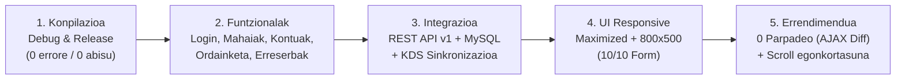

# 4. TPV Frogak (QA eta Egiaztapena)

> [← Aurrekoa: 3. TPV Garapena](3_tpv_garapena.md) · [Aurkibidea](README.md) · [Hurrengoa: 5. TPV Martxan Jartzea →](5_tpv_martxan_jartzea.md)

## 4.1. Proba-Estrategia

Kalitatea bermatzeko, 5 proba-mailatan egiaztatu da `desktop_tpv_csharp` aplikazioa:



---

## 4.2. Proba-Kasuen Matrizea (`TC-01` .. `TC-18`)

### A) Autentifikazioa, Konexioa eta Rolak

| ID | Proba-kasua | Sarrera / Ekintza | Espero den emaitza | Egoera |
| :---: | :--- | :--- | :--- | :---: |
| **TC-01** | PIN login zuzena | Langilea hautatu + 4 digituko PIN zuzena sartu (`Enter` edo `SARTU`) | `MahaiakForm` maximizatuta irekitzen da; `X-Langilea` eta `X-Rola` goiburuak ezartzen dira | ✅ Gainditua |
| **TC-02** | PIN okerra | PIN okerra sartu | Errore-mezua agertzen da, PIN kutxa garbitzen da, ez da saiorik irekitzen | ✅ Gainditua |
| **TC-03** | API deskonektatuta (Offline) | Backend `:5050` itzalita abiarazi `LoginForm` | Gorrizko oharra agertzen da; 3 segundoro automatikoki berriz konektatzen saiatzen da UI blokeatu gabe | ✅ Gainditua |
| **TC-04** | Barrako rolen mugaketa | `Barrakoa` rolarekin sartu eta `EskaeraForm` ireki | `Hastekoak`, `Haragiak` eta `Guztiak` botoiak ezkutatuta; soilik edariak, kafeak eta postreak ikusgai | ✅ Gainditua |

### B) Mahaiak, Kontu Anitzak eta Sukaldeko Fluxua

| ID | Proba-kasua | Sarrera / Ekintza | Espero den emaitza | Egoera |
| :---: | :--- | :--- | :--- | :---: |
| **TC-05** | Guneen iragazketa | Fitxak sakatu: *Jangela Nagusia*, *Terraza*, *Barra*, *VIP*, *Guztiak* | Dagokion guneko mahaiak erakusten dira parpadeorik gabe (`UiPerf.RunFlickerFree`) | ✅ Gainditua |
| **TC-06** | Mahaiaren egoera-balidazioa | Plater aktiboak dituen mahai batean `Libre` botoia sakatu | Blokeatu egiten da: platerak dauden bitartean ezin da mahaia libre jarri | ✅ Gainditua |
| **TC-07** | Platera banaka sukaldera bidali | `Zai` egoerako plater batean `▶ Sukaldera` sakatu | Soilik lerro hori `Martxan` (`Sukaldean`) egoerara pasatzen da | ✅ Gainditua |
| **TC-08** | Bidali gabeko platera ezabatu | `Zai` egoerako plater batean `🗑` botoia sakatu | `DELETE /eskaerak/lerroak/{id}` exekutatzen da eta stocka leheneratzen da | ✅ Gainditua |
| **TC-09** | Kontu hutsa (`0,00 €`) ezabatu | Kontu berria sortu platerik gehitu gabe; fitxako `✕` edo erdiko botoia sakatu | Kontu hutsa ezabatzen da (`DELETE /eskaerak/{id}`), testua/botoia zentratuta eta moztu gabe agertzen dira | ✅ Gainditua |
| **TC-10** | KDS `Eginda` abisua | Sukaldeak platera `Eginda` markatzen du | 1.5s barru lerroa zerrendako goialdera igotzen da eta dir-dir bisualarekin `ZERBITZATU!` agertzen da | ✅ Gainditua |

### C) Ordainketa, Tiketa eta Erreserbak

| ID | Proba-kasua | Sarrera / Ekintza | Espero den emaitza | Egoera |
| :---: | :--- | :--- | :--- | :---: |
| **TC-11** | Eskudiru ordainketa + kanbioa | `50,00 €` kontuan `60,00 €` jaso | Kanbioa `10,00 €` berdez kalkulatzen da; `POST /ordainketak` ondoren 80mm-ko tiketa irekitzen da | ✅ Gainditua |
| **TC-12** | Txartela / Bizum balidazioa | Txartel preset edo Bizum telefonoa sartu | Formatu-balidazioa egiten da eta `TiketIkusteaForm`-en `.txt` gorde eta inprimaketa simulatu daiteke | ✅ Gainditua |
| **TC-13** | Astelehenetan erreserba blokeoa | `ErreserbaBerriaModal`-en astelehen bat hautatu | Errore-mezua: *"Astelehenetan jatetxea itxita dago (atseden eguna)"* | ✅ Gainditua |

### D) Responsive, Parpadeorik Eza eta Konpilazioa

| ID | Proba-kasua | Sarrera / Ekintza | Espero den emaitza | Egoera |
| :---: | :--- | :--- | :--- | :---: |
| **TC-14** | Hasiera Maximized (10/10 Form) | Formulario guztien `.Designer.cs` egiaztatu | 10/10 formularioek `WindowState = FormWindowState.Maximized` eta `FormBorderStyle = Sizable` dute | ✅ Gainditua |
| **TC-15** | Gutxieneko tamaina `800×500` | Leihoa `800×500`-raino txikitu pantaila nagusi eta modaletan | Ez dago gainjarpenik ezta testu mozturik; goiko barra eta alboko panelak trinkotzen dira (`< 1020px`/`< 920px`) | ✅ Gainditua |
| **TC-16** | Parpadeorik gabeko auto-freskatzea | `MahaiakForm` (3s), `MahaiaXehetasunakForm` (1.5s), `ErreserbakForm` (5s) martxan utzi | Daturik aldatu ez bada **0 UI berreraikitze**; mahaia aldatzean in-place patching eta scroll posizioa mantenduta | ✅ Gainditua |
| **TC-17** | Tipografia eta baliabideak | `bin/Debug/net10.0-windows/Assets/Fonts/` egiaztatu | 7 `.ttf` letra-tipoak (`Cinzel`, `Plus Jakarta Sans`, `JetBrains Mono`) behar bezala kopiatuta | ✅ Gainditua |
| **TC-18** | Visual Studio Designer bateragarritasuna | Karpeta bakoitzean `.cs`, `.Designer.cs`, `.resx` eta parametro gabeko eraikitzailea egiaztatu | 10/10 formularioek 3 fitxategiak eta Designer eraikitzailea dituzte | ✅ Gainditua |

---

## 4.3. Konpilazio Egiaztapena eta Akatsen Erregistroa (Bugfix Log)

### Egiaztatutako konpilazio-emaitza
```text
dotnet build -c Debug --nologo
  Jatetxea.Desktop -> ...\bin\Debug\net10.0-windows\Jatetxea.Desktop.dll
  Compilación correcta.
    0 Advertencia(s)
    0 Errores
```

### Garapenean detektatu eta konpondutako akats nagusiak

| Data / Fasea | Detektatutako arazoa | Kausa | Aplikatutako konponbidea |
| :--- | :--- | :--- | :--- |
| **Kontu hutsak** | *"Kontu honek ez du platerik..."* eta ezabatzeko botoia eskuinean moztuta agertzen ziren | Koordenatu finkoak panel txikiagoan | `TableLayoutPanel` (`Dock.Fill`, `Anchor.None`) erabilita erdian guztiz zentratu da |
| **Visual Studio Designer** | 5 karpetatan `.Designer.cs` eta/edo `.resx` fitxategiak falta ziren | Eskuz sortutako formularioak | Falta ziren `.Designer.cs` eta `.resx` guztiak sortu dira 10/10 karpetetan |
| **Responsive `800×500`** | Modalak `FixedDialog` ziren eta pantaila nagusiek `MinimumSize(1180, 750)` zuten | Tamaina finkoen konfigurazioa | 10 formulario guztiak `Sizable`, `Maximized` eta `MinimumSize(800, 500)` jarri dira breakpoint-ekin |
| **Errefreskatze parpadeoa** | `MahaiakForm`-ek 3 segundoro `pnlMahaiak.Controls.Clear()` deitzen zuen | Diff konparaketa eta double-buffering falta | `MahaiakAldatuDira` + `_txartelakById` in-place patching + `UiPerf.cs` (`DoubleBuffered` + `WM_SETREDRAW`) |
| **Release `.exe` blokeoa** | `MSB3027` abisua `Release` eraikitzean | Aurreko `Jatetxea.Desktop.exe` irekita zegoen | Aplikazioa itxi ondoren `Release` konpilazioa garbi osatzen da |
