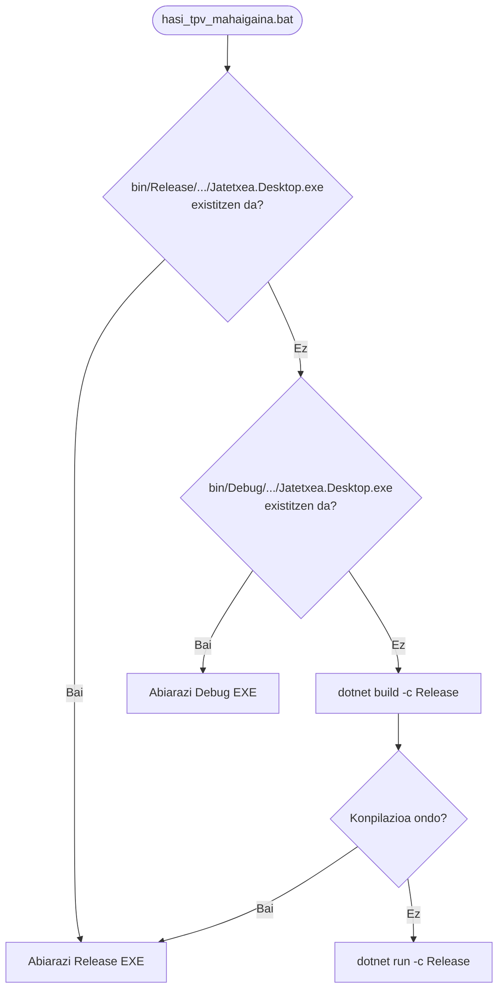

# 5. TPV Martxan Jartzea (Desplieguea)

> [← Aurrekoa: 4. TPV Frogak](4_tpv_frogak.md) · [Aurkibidea](README.md) · [Hurrengoa: 6. TPV Mantentzea →](6_tpv_mantentzea.md)

## 5.1. Sistemaren Baldintzak

| Osagaia | Gutxieneko Baldintza | Gomendatua (Jatetxeko TPV) |
| :--- | :--- | :--- |
| **Sistema Eragilea** | Windows 10 (64-bit) | Windows 11 Pro (ukipen-euskarriarekin) |
| **Runtime / SDK** | `.NET 10.0 Desktop Runtime (Windows)` | `.NET 10.0 SDK` (garapen/konpilaziorako) |
| **Pantaila bereizmena** | `800 × 500 px` (gutxieneko muga bermatua) | `1366×768` edo `1920×1080` ukipen-pantaila |
| **Sarea** | TCP/IP konexioa API zerbitzarira (`:5050`) | Ethernet / Wi-Fi 5GHz lokala (latentzia `< 10ms`) |
| **Backend zerbitzaria** | Jatetxea REST API (`:5050`) + `jatetxea_mysql` | Zerbitzari dedikatua LAN sarean |

---

## 5.2. Konfigurazioa (`appsettings.json` eta Ingurune-Aldagaiak)

`ApiService.cs`-ek honako **lehentasun-ordena** jarraitzen du APIaren helbidea ebazteko:

1. **`API_BASE_URL` ingurune-aldagaia** (ezarrita badago, lehentasun osoa du).
2. **`appsettings.json`** fitxategiko `ApiBaseUrl` giltza (exekutagarriaren karpetan):
   ```json
   {
     "ApiBaseUrl": "http://10.100.30.128:5050/api/v1"
   }
   ```
3. **Fallback lehenetsia**: `http://127.0.0.1:5050/api/v1` (eta `/health` egiaztapenean automatikoki `localhost:5050`, `127.0.0.1:5050` eta `appsettings.json` probatzen ditu).

> **Oharra**: `Jatetxea.Desktop.csproj`-ek automatikoki kopiatzen ditu irteera-karpetara bai `appsettings.json` bai `Assets/Fonts/*.ttf` 7 letra-tipoak.

---

## 5.3. Konpilazioa eta Abiaraztea

### 1. Aukera: Script automatikoa (`hasi_tpv_mahaigaina.bat`)
Ekoizpeneko terminaletan klik bikoitzarekin abiarazteko prest dago [hasi_tpv_mahaigaina.bat](../hasi_tpv_mahaigaina.bat):



### 2. Aukera: Komando-lerrotik (`PowerShell` / `CMD`)
```powershell
# 1. Konpilatu Release moduan
dotnet build Jatetxea.Desktop.csproj -c Release

# 2. Abiarazi zuzenean
dotnet run --project Jatetxea.Desktop.csproj -c Release

# 3. Ekoizpeneko pakete autonomoa (Self-Contained, .NET instalatu gabe exekutatzeko)
dotnet publish Jatetxea.Desktop.csproj -c Release -r win-x64 --self-contained true -o .\publish\tpv_win64
```

### 3. Aukera: Visual Studio IDE
1. Ireki `Jatetxea.Desktop.csproj` Visual Studio-n.
2. Ziurtatu aurreko `Jatetxea.Desktop.exe` prozesurik ez dagoela zabalik.
3. Hautatu `Release` (edo `Debug`) eta sakatu **F5** edo **Ctrl+F5**.

---

## 5.4. Martxan Jartzeko Egiaztapen-Zerrenda (Go-Live Checklist)

- [ ] `jatetxea_mysql` datu-basea martxan dago eta taulak/hasierako datuak kargatuta daude.
- [ ] Backend REST API zerbitzaria entzuten dago `:5050` portuan (`GET /health` → `HTTP 200`).
- [ ] `appsettings.json`-en LAN IP zuzena jarrita dago (adib. `http://10.100.30.128:5050/api/v1`).
- [ ] `Assets/Fonts/` karpetako 7 `.ttf` fitxategiak exekutagarriaren ondoan daude.
- [ ] Langile baten PINarekin saioa hasi, mahai bat ireki, platera KDS-ra bidali eta ordainketa-proba bat egin da.
- [ ] `hasi_tpv_mahaigaina.bat`-erako lasterbidea sortu da mahaigainean (aukeran, Windows-en hasierako karpetan `shell:startup`).

---

## 5.5. Arazo Ohikoenen Konponketa (*Troubleshooting*)

| Sintoma | Arrazoi Ohikoena | Konponbidea |
| :--- | :--- | :--- |
| **`API zerbitzaria deskonektatuta dago`** gorriz `LoginForm`-en | Backend `:5050` itzalita edo IP okerra `appsettings.json`-en | Abiarazi backend-a, egiaztatu `http://<IP>:5050/health` nabigatzailean eta eguneratu `appsettings.json` |
| **`HTTP 503 - MySQL deskonektatuta`** | APIa martxan baina `jatetxea_mysql` geldituta | Abiarazi MySQL zerbitzua / Docker edukiontzia |
| **`MSB3027: El archivo se ha bloqueado por Jatetxea.Desktop`** | Aplikazioaren aurreko instantzia irekita dago konpilatzean | Itxi irekita dagoen `Jatetxea.Desktop.exe` leihoa eta konpilatu berriro |
| **Letra-tipoak `Segoe UI` / `Georgia` bezala ikusten dira** | `Assets/Fonts/*.ttf` ez dira kopiatu exekutagarriaren karpetara | Exekutatu `dotnet build` garbi bat eta ziurtatu `Assets\Fonts\*.ttf` daudela `bin/...` barruan |
| **Barrako langileak ez ditu Haragiak/Hastekoak ikusten** | Rol-murrizketa aurreikusita dago (`Barrakoa`) | Portaera normala da (RF-01/TC-04); jangelako zerbitzariek `Zerbitzaria` rola behar dute |
