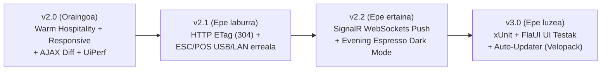

# 6. TPV Mantentzea eta Eboluzioa

> [← Aurrekoa: 5. TPV Martxan Jartzea](5_tpv_martxan_jartzea.md) · [Aurkibidea](README.md)

## 6.1. Mantentze-Plana

Softwarearen kalitatea denboran mantentzeko, 4 mantentze-mota bereizten dira:

| Mantentze-mota | Helburua | Adibide zehatzak TPV honetan | Maiztasuna |
| :--- | :--- | :--- | :--- |
| **Zuzentzailea** (*Corrective*) | Ekoizpenean agertutako akatsak azkar konpontzea | API errore-kode berriak kudeatu, ertzeko kasu batean layout-a egokitu | Behar denean (berehala) |
| **Egokitzailea** (*Adaptive*) | Ingurunearen aldaketetara moldatzea | `.NET` LTS bertsio berrietara igotzea, Windows eguneraketak, API v2 aldaketak | 6–12 hilabetero |
| **Hobetzailea** (*Perfective*) | Funtzionalitate eta errendimendu berriak gehitzea | SignalR push denbora errealean, Dark Mode (*Evening Espresso*), ESC/POS inprimaketa erreala | Sprint / bertsio bakoitzean |
| **Prebentiboa** (*Preventive*) | Zor teknikoa eta hutsegiteak aurreikustea | `HttpClient` baliabideen kudeaketa, `Timer.Dispose()` egiaztapenak, `Theme.cs` garbiketa | Hiruhilero |

---

## 6.2. Garapen eta Eguneraketa Protokoloa

Aldaketa berri bat sartzean jarraitu beharreko arau zorrotzak:

1. **Diseinu Sistema Zentralizatua (`Theme.cs`)**:
   - **Ez erabili** kolore gordinak (`Color.FromArgb(...)`) edo `new Font("Segoe UI", ...)` zuzenean formularioetan; erabili beti `Theme.ChiantiPrimary`, `Theme.WarmLinen`, `Theme.DisplayFont(...)`, `Theme.BodyFont(...)`, `Theme.MonoFont(...)` eta `Theme.StyleButton(...)`.
   - Kolore edo osagai berri bat sortzen bada, lehenik eguneratu [Figma Fitxategia](https://www.figma.com/design/DVmurlGmkzECO2NE6jTI8Y) eta ondoren `UI/Theme.cs`.
2. **Parpadeorik Gabeko Araua (`UiPerf.cs`)**:
   - Kontrol-zerrenda dinamiko guztietan (`FlowLayoutPanel`, `Panel`) erabili beti **diff konparaketa** eta ahal denean **in-place patching** (`Dictionary<int, ...>`).
   - Egitura osoa berreraiki behar denean, bildu beti `UiPerf.RunFlickerFree(container, () => { ... }, preserveScroll: true)` barruan.
3. **Responsive Araua (10/10 Form)**:
   - Formulario berri bat gehitzean, ezarri derrigorrez `WindowState = FormWindowState.Maximized`, `MinimumSize = new Size(800, 500)`, `FormBorderStyle = FormBorderStyle.Sizable`, eta sortu bere karpeta osoa (`.cs`, `.Designer.cs`, `.resx` + parametro gabeko eraikitzailea Visual Studio Designer-erako).
4. **Konpilazioa eta Bertsio-kontrola**:
   - Commit egin aurretik egiaztatu `dotnet build -c Debug` eta `dotnet build -c Release` **0 errore eta 0 abisurekin** amaitzen direla.

---

## 6.3. Monitorizazioa eta Trazabilitatea

- **Backend trazabilitatea**: Eskaera guztiek daramate:
  - `X-App-Id: csharp_tpv`
  - `X-App-Name: C# TPV Areto & Kutxazaina`
  - `X-Langilea`, `X-Erabiltzailea`, `X-Rola` (saioa hasi ondoren)
  Horri esker, backend-eko logetan uneoro jakin daiteke zein terminalek eta zein langilek exekutatu duen operazio bakoitza (eskaera, ezabaketa, kobrantza).
- **Osasun-kontrola (`/health`)**: `ApiService.CheckHealthAsync()` metodoak APIa eta MySQL egoera bereizten ditu (`200 OK` vs `503 Service Unavailable`).
- **Diagnostiko lokala**: Salbuespenak `System.Diagnostics.Debug.WriteLine(...)` bidez erregistratzen dira Visual Studio-ko *Output* leihoan, erabiltzailearen lan-fluxua eten gabe.

---

## 6.4. Etorkizuneko Hobekuntza-Orria (Roadmap)

| Lehentasuna | Hobekuntza | Onura nagusia |
| :---: | :--- | :--- |
| **P1** | **SignalR (WebSockets) / HTTP ETag (`304 Not Modified`)** | Polling trafikoa ia `0`-ra murriztea eta KDS-eko plater-abisuak milisegundotan jasotzea. |
| **P1** | **ESC/POS Inprimaketa Erreala** | `TiketIkusteaForm`-eko inprimaketa simulatuaren ordez USB/Ethernet 80mm-ko inprimagailu fiskalera zuzeneko bidalketa + tiradera irekitzea. |
| **P2** | **Evening Espresso Dark Mode Toggle** | Figma-ko `T1 Semantic Colors` aldagaietan dagoeneko diseinatuta dagoen gaueko modua (`#0F0D0E` / `#1A1618`) botoi bakarrarekin aktibatzea. |
| **P2** | **Proba Automatizatuak (`xUnit` + `FlaUI`)** | `ApiService` mock probak eta CI pipeline automatikoa (`GitHub Actions`) erregresioak saihesteko. |
| **P3** | **Fitxategi-logak (`Serilog`)** | Erroreen erregistro iraunkorra `%LocalAppData%\T1Jatetxea\logs\` karpetan (eguneko errotazioarekin). |
