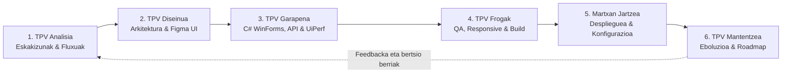
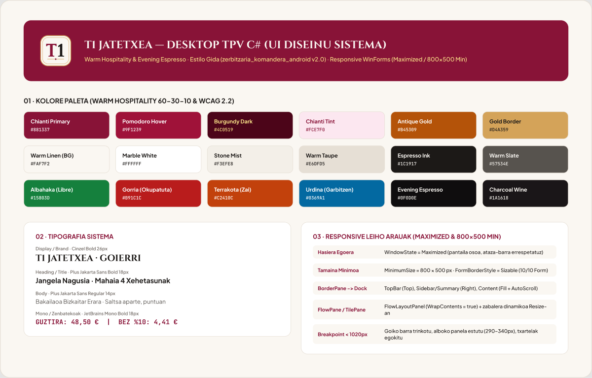

# T1 Jatetxea — Desktop TPV C# Dokumentazio Teknikoa

Ongi etorri **T1 Jatetxea (`desktop_tpv_csharp`)** areto- eta kutxazain-aplikazioaren dokumentazio ofizialera. Dokumentazio honek softwarearen garapenaren bizi-ziklo osoa (SDLC) 6 fasetan antolatuta jasotzen du, diagrama, taula eta pantaila-irudi errealekin.

> **Aplikazioa**: `Jatetxea.Desktop` (.NET 10 · C# · Windows Forms)  
> **Diseinu Sistema**: T1 Jatetxea v2.0 — *Warm Hospitality* (`zerbitzaria_komandera_android` estilo-gida)  
> **Figma Plantillak**: [T1 Jatetxea - Desktop TPV C# (UI Diseinua)](https://www.figma.com/design/DVmurlGmkzECO2NE6jTI8Y)

---

## Software Garapenaren Bizi-Zikloa (SDLC)

---

## Dokumentazioaren Aurkibidea

| Fasea | Dokumentua | Eduki Nagusia |
| :---: | :--- | :--- |
| **1** | [1. TPV Analisia](1_tpv_analisia.md) | Negozio-beharra, erabiltzaile-rolak, RF/RNF eskakizunak, egoera-makinak eta hasierako zirriborroak |
| **2** | [2. TPV Diseinua](2_tpv_diseinua.md) | Arkitektura-diagrama, klase-diagrama, *Warm Hospitality* estilo-gida, responsive breakpointak eta 10 pantailen diseinuak |
| **3** | [3. TPV Garapena](3_tpv_garapena.md) | Stack teknologikoa, karpeta-egitura, REST API kontratua, `UiPerf` parpadeorik gabeko motorra eta `Theme.cs` |
| **4** | [4. TPV Frogak](4_tpv_frogak.md) | Proba-estrategia, 18 proba-kasuen matrizea, responsive eta parpadeo-egiaztapenak, eta bugfix erregistroa |
| **5** | [5. TPV Martxan Jartzea](5_tpv_martxan_jartzea.md) | Eskakizunak, `appsettings.json`, `hasi_tpv_mahaigaina.bat`, aretoko checklist-a eta arazoen konponketa |
| **6** | [6. TPV Mantentzea](6_tpv_mantentzea.md) | Mantentze-plana, Designer/Figma sinkronizazio-protokoloa, monitorizazioa eta etorkizuneko roadmap-a |

---

## Laburpen Exekutiboa

| Ezaugarria | Xehetasuna |
| :--- | :--- |
| **Plataforma** | Windows 10/11 · `.NET 10.0-windows` · WinForms (`Jatetxea.Desktop.csproj`) |
| **Formulario kopurua** | 10 formulario oso (`.cs` + `.Designer.cs` + `.resx` bakoitzean) |
| **Leiho-politika** | Hasiera beti **Maximized**, tamaina aldagarria (`Sizable`), minimoa **`800×500 px`** |
| **Freskatze-motorra** | AJAX-moduko diff detekzioa + In-Place Patching + `DoubleBuffered` + Win32 `WM_SETREDRAW` |
| **Backend integrazioa** | REST API v1 (`/api/v1/*`, `/health` auto-fallback, HTTP 2.5s timeout, trazabilitate-goiburuak) |
| **Tipografia** | `Cinzel Bold` (marka), `Plus Jakarta Sans` (UI), `JetBrains Mono` (zenbatekoak/tiketa) |
