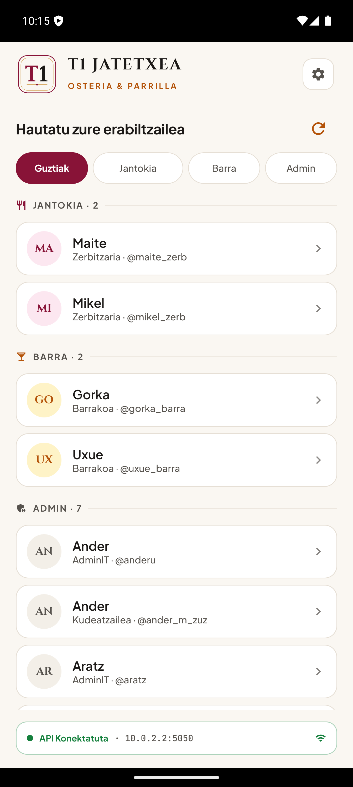
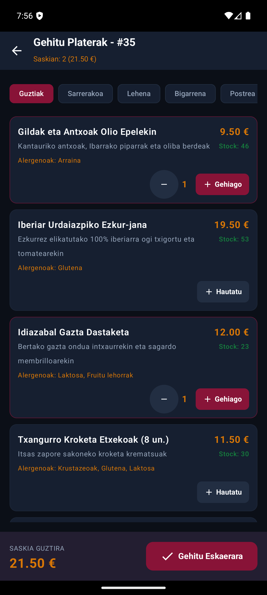
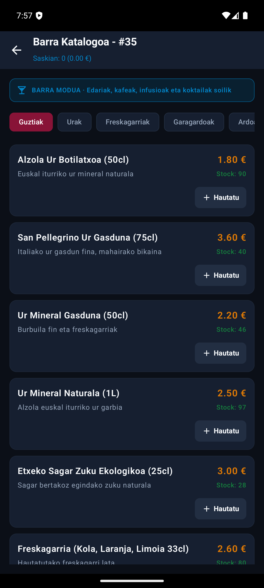

# 1T Jatetxea — Zerbitzaria Komandera (Android Jetpack Compose)

**Egileak:** `[Zure Izena / Bikotearen Izenak]` · **Goierri Eskola (PR 4.15)**

**Kotlin** eta **Jetpack Compose (Material 3)** erabiliz garatutako Android aplikazio natiboa (XML diseinurik gabea), 1T Jatetxeko (*Osteria & Parrilla*) zerbitzariek eta barrako langileek mahaiak, komandak, erreserbak eta ordainketak denbora errealean kudeatzeko.

---

## 1. Ideia eta Funtzionalitate Nagusiak

Aplikazioak **4 pantaila** nagusi (`NavHost` + pantaila arteko trantsizio animatuak) eta dialog modularrak ditu, **rolaren araberako ikuspegiarekin**:

1. **Saio-hasiera (`LoginScreen`):** Langileen zerrenda (`LazyColumn`), 4 zifrako PIN teklatu animatua (**Maite — Zerbitzaria: `1002`** · **Gorka — Barrakoa: `2001`**), Wi-Fi detekzioa eta API/DB `/health` egoera-adierazlea.
2. **Mahaien Mapa (`MahaiakScreen`):** Sare moldagarria (`LazyVerticalGrid` — `GridCells.Adaptive`), eremu-iragazkiak (`rememberSaveable`), 5 segundoro auto-freskatzea, **Erreserbak** (hilabeteko egutegi interaktiboa egun markatuekin) eta **Ezarpenak** (Modu Argia lehenetsita / Iluna, Hizkuntza EU/ES/EN, Sare profilak).
3. **Mahaiaren Xehetasunak (`MahaiaXehetasunakScreen`):** Mahai-egoera aldatzea, eskaera irekitzea, lerroak (`LazyColumn`) sukaldera bidaltzea edo zerbitzatzea, **Kontua Proforma**, **Ordainketa** (Eskudirua + kanbioa, Txartela, Bizum) eta **80mm Tiket Fiskala** (`.txt` + Android `PrintManager`).
4. **Plater eta Barra Katalogoa (`EskaeraScreen`):** **Testu eta ahots bidezko bilatzailea** (`RecognizerIntent` — `Intent` bidez), kategoria karusela (`LazyRow`), denbora errealeko stock-muga eta saski barra animatua (`AnimatedVisibility` + `derivedStateOf`).
   - **Zerbitzariak (Maite):** Karta osoa ikusten du (`Sarrerakoa`, `Lehena`, `Bigarrena`, `Postrea` + edari guztiak).
   - **Barrakoak (Gorka):** **Barra Modua** aktibatzen da automatikoki — platerak ezkutatu eta **10 edari-kategoria zehatz** soilik ikusten ditu (`Urak`, `Freskagarriak`, `Garagardoak`, `Sagardoak`, `Ardoak`, `Kafeak`, `Infusioak`, `Likoreak`, `Konbinatuak`, `Koktailak`).

---

## 2. Pantaila-Argazkiak (Emuladorean Exekutatuta)

| Saio-hasiera (API & PIN) | Mahaien Mapa (Maite) | Plater Katalogoa (Maite) | Barra Modua (Gorka) |
| :---: | :---: | :---: | :---: |
|  |  |  |  |

---

## 3. UI/UX Diseinu Sistema v2.0 eta Figma

Aplikazioaren interfazea **Figma**-n diseinatu da lehenik (*Warm Hospitality* Modu Argia lehenetsita + *Evening Espresso* Modu Iluna, **Logo B Monograma Arkitektonikoa**, `Cinzel` + `Plus Jakarta Sans` + `JetBrains Mono` letra-tipoak `res/font/`-en txertatuta, WCAG 2.2 POUR kontrasteak eta Fitts ≥ 48dp ukipen-eremuak):

- **Figma — Smartphone Diseinua (`390×844` + 3 Logo Proposamenak + Design Tokens + Components):** https://www.figma.com/design/F4azLhQtLVxyvu2WDcPnU8
- **Figma — Tablet POS Diseinua (`1194×834` Landscape Master-Detail):** https://www.figma.com/design/s6dk3RNbbDMEIDiD3BOq8Y

---

## 4. Aukeratutako Erronkak

- **Komunikazioa (REST API — Nagusia):** Retrofit 2.11 + OkHttp + Gson (`JatetxeaApiService.kt`, 17 endpoint) C# backend-era konektatuta (`5050` ataka), HTTP goiburu pertsonalizatuekin eta emuladore/Wi-Fi detekzio automatikoarekin (`NetworkProfiles.kt`).
- **Datuak gorde (`SharedPreferences`):** APIaren Base URL-a, Gai Iluna/Argia eta Hizkuntza iraunkorki gordetzen dira (`ApiClient`, `AppPreferences`).
- **Itxura eta Animazioak:** Material 3 *Dark & Light Mode* osoa, `NavHost` trantsizioak, `AnimatedVisibility`, `AnimatedContent`, `animateColorAsState`, `animateDpAsState` eta `@Preview` pantaila guztietan.

---

## 4. Hartutako Diseinu-Erabakiak

1. **Rolaren araberako iragazkia (`KategoriaLaguntzailea`):** `Barrakoa` rolak edari-kategoriak soilik ikustea (eta edariak zuzenean zerbitzatzea sukaldetik pasa gabe) barrako lana bizkortu eta erroreak saihesten ditu.
2. **Stateless UI (`*Content`) + `@Preview` eredua:** Pantaila bakoitzaren UIa API deietatik bereizita dago, `@Preview` funtzioek Android Studio-n zuzenean eta fidagarritasunez errendatzeko.
3. **Sare-profil automatikoak (`NetworkProfiles`):** Emuladorea (`10.0.2.2:5050`) edo tokiko Wi-Fia automatikoki detektatzen du, eta `ApiClient.service` dinamikoki eguneratzen da.

---

## 5. IAren Erabilera

Garapenean IA pausoz pauso erabili da, kode guztia berrikusiz eta ulertuz:
- **Zertarako:** `NavHost` nabigazio parametrizatua eta pantaila-trantsizioak, Retrofit REST bezeroa, datu-baseko edari-kategorien zabalkuntza (`zabaldu_edari_kategoriak.sql`), rol-iragazkia, `@Preview`-ak eta Material 3 UI txartelak.
- **Prompt lagungarriak:**
  - *"Sortu Jetpack Compose-ko `NavHost` bat `sealed class Screen` erabiliz, `mahaiId` parametroarekin eta slide/fade trantsizioekin."*
  - *"Zabaldu MySQL datu-baseko `Edaria` kategoria (`Urak`, `Ardoak`, `Freskagarriak`, `Garagardoak`, `Kafeak`, `Infusioak`, `Likoreak`, `Koktailak`) eta iragazi `EskaeraScreen` `Barrakoa` rolak edariak soilik ikusteko."*
  - *"Banatu pantailak Composable txikiagoetan (`LangileaItem`, `PlateraItem`) eta gehitu `AnimatedVisibility` eta `@Preview`-ak."*

---

## 6. Nola Exekutatu

- **Teknologiak:** Kotlin `2.2.10` · Jetpack Compose (BOM `2024.06.00`) · Material 3 · Navigation Compose `2.7.7` · Retrofit `2.11.0`.
- **Pausoak:**
  1. Ireki **Android Studio** → `Open` → `01_aplikazioak/zerbitzari_langileak/zerbitzaria_komandera_android`.
  2. Utzi Gradleri sinkronizatzen eta abiarazi jatetxeko backend REST APIa (`5050` atakan, Docker `jatetxea_api` + `jatetxea_mysql`).
  3. Sakatu **Run (`Shift + F10`)** emuladorean (`10.0.2.2:5050` automatikoki detektatzen da) edo mugikorrean (`adb reverse tcp:5050 tcp:5050`).
  4. **Demo erabiltzaileak:** **Maite** (`Zerbitzaria`, PIN: `1002`) · **Gorka** (`Barrakoa`, PIN: `2001`).
