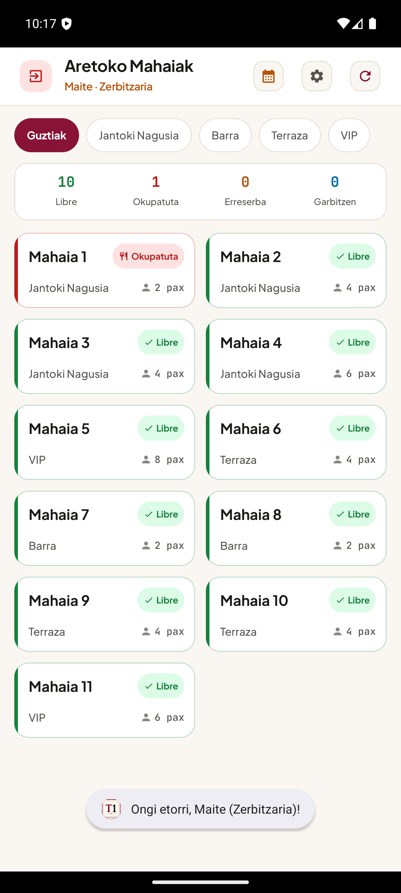

# T1 Jatetxea — Zerbitzaria Komandera

**Osteria & Parrilla · Android Komandera Mugikorra (Jetpack Compose)**  
*Egilea: **Ander Urien Telleria** · Goierri Eskola (PR 4.15)*

  
  
  
  

  
  

---

## Pantaila-Argazkiak (v2.0 · Warm Hospitality)

| Saio-hasiera (3 Bloke & PIN) | Mahaien Mapa (Maite) | Plater Katalogoa (Ahotsa & Bilaketa) | Barra Modua (Gorka · 10 Kategoria) |
| :---: | :---: | :---: | :---: |
|  |  |  |  |

---

## 1. Ideia eta Funtzionalitate Nagusiak

**Kotlin** eta **Jetpack Compose (Material 3)** erabiliz garatutako Android aplikazio natiboa (XML UI diseinurik gabea), **T1 Jatetxea (*Osteria & Parrilla*)** jatetxeko zerbitzariek eta barrako langileek mahaiak, komandak, erreserbak eta ordainketak denbora errealean kudeatzeko (`NavHost` + 4 pantaila nagusi + 5 dialog modular):

| Pantaila / Modulua | Funtzionalitate Nagusiak |
| :--- | :--- |
| **Saio-hasiera (`LoginScreen`)** | Langileak 3 bloketan (`Jantokia`, `Barra`, `Admin`), 4 digituko PIN teklatu animatua, `/health` API/DB egoera-adierazlea eta **Tablet Split-Pane** diseinu moldagarria (`≥ 800dp`). |
| **Mahaien Mapa (`MahaiakScreen`)** | `LazyVerticalGrid` moldagarria (`GridCells.Adaptive`), 4 zutabeko KPI barra, eremu-iragazkiak (`rememberSaveable`), 5 segundoro auto-freskatzea, **hilabeteko egutegidun Erreserbak** eta **Ezarpenak** (`EU/ES/EN`, Modu Argia/Iluna, Sare profilak). |
| **Mahaiaren Xehetasunak (`MahaiaXehetasunakScreen`)** | Eskaeren kudeaketa, lerroak sukaldera bidali / zerbitzatu / ezabatu (*Fitts* banaketa seguruarekin), kobratu gabeko mahaiaren blokeoa, **Kontua Proforma**, **3 ordainketa mota** (Eskudirua + kanbioa, Txartela, Bizum) eta **80mm Tiket Fiskala** (`.txt` + `PrintManager`). |
| **Katalogoa & Barra Modua (`EskaeraScreen`)** | **Testu eta ahots bidezko bilaketa** (`RecognizerIntent`), stock-kontrola denbora errealean, saski barra animatua (`derivedStateOf`) eta **Barra Modua** (`Gorka` barrakoak 10 edari-kategoria soilik ikusten ditu). |

---

## 2. Aukeratutako Erronkak & UI/UX Diseinu Sistema v2.0

| Erronka | Inplementazioa |
| :--- | :--- |
| **REST API Komunikazioa (Nagusia)** | **Retrofit 2.11 + OkHttp + Gson** (`JatetxeaApiService.kt`, 19 endpoint) C# backend-era konektatuta (`5050` ataka), mDNS (`ANDER-SGB5PRO.local`) eta emuladore (`10.0.2.2`) detekzio automatikoarekin. |
| **Datu-iraunkortasuna (`SharedPreferences`)** | API URL-a, Modu Argia/Iluna eta Hizkuntza (`EU/ES/EN`) iraunkorki gordetzen dira (`ApiClient`, `AppPreferences`). |
| **UI/UX v2.0, Figma & Animazioak** | **Figma** diseinu-sistema ([Smartphone](https://www.figma.com/design/F4azLhQtLVxyvu2WDcPnU8) & [Tablet](https://www.figma.com/design/s6dk3RNbbDMEIDiD3BOq8Y)), **Logo B** bektoriala + Adaptive App Icon, 3 letra-tipo (`Cinzel`, `Plus Jakarta Sans`, `JetBrains Mono`), *Warm Hospitality Light* & *Evening Espresso Dark*, `NavHost` trantsizioak, `AnimatedVisibility`, `AnimatedContent`, `animateColorAsState` eta `@Preview` pantaila guztietan. |
| **Android Intent & Gailu Fisikoa** | Ahots-bilaketa (`RecognizerIntent`), 80mm inprimaketa (`PrintManager`), eta **Samsung SM-A376B** mugikor fisikoan zein emuladorean probatua. |

---

## 3. Hartutako Diseinu-Erabakiak

1. **Rolaren araberako ikuspegia (`KategoriaLaguntzailea`):** `Barrakoa` rolak 10 edari-kategoriak soilik ikusteak eta sukaldetik pasa gabe zuzenean zerbitzatzeak barrako zerbitzua bizkortzen du.
2. **Stateless `*Content` + `@Preview` arkitektura:** Pantaila bakoitzaren UIa API logikatik bereizita dago, `@Preview` Light/Dark bertsioak Android Studio-n fidagarritasunez errendatzeko.
3. **Ergonomia eta akatsen prebentzioa (*WCAG 2.2 + Norman Constraints*):** Egoera guztiek ikonoa + testua daramate (inoiz ez kolore hutsez), `Ezabatu` eta `Zerbitzatu` fisikoki bananduta daude, eta kobratu gabeko mahaia ezin da `Libre`/`Garbitzen` jarri.

---

## 4. IAren Erabilera

Garapenean IA laguntzaile gisa erabili da pausoz pauso, kode eta diseinu guztia berrikusiz, ulertuz eta gailu errealean probatuz (`NavHost` nabigazioa, Retrofit bezeroa, MySQL edari-kategorien zabalkuntza, `@Preview`-ak eta Figma v2.0 diseinu-sistema).

<strong>Ikusi erabilitako prompt adibideak</strong>

- *"Sortu Jetpack Compose-ko `NavHost` bat `sealed class Screen` erabiliz, `mahaiId` parametroarekin eta slide/fade trantsizioekin."*
- *"Zabaldu MySQL datu-baseko `Edaria` kategoria 10 edari-kategoriatan eta iragazi `EskaeraScreen` `Barrakoa` rolak edariak soilik ikusteko."*
- *"Sortu Figman Warm Hospitality paleta eta Logo B diseinu-sistema Smartphone eta Tablet-erako, eta migratu Jetpack Compose pantailak tipografia pertsonalizatuarekin."*

---

## 5. Nola Exekutatu

- **Teknologiak:** Kotlin `2.2.10` · Jetpack Compose BOM `2024.06.00` · Material 3 · Navigation Compose `2.7.7` · Retrofit `2.11.0`.
- **Pausoak:**
  1. Ireki **Android Studio** → `Open` → `zerbitzaria_komandera_android`.
  2. Abiarazi jatetxeko REST API backend-a (`5050` atakan, Docker `jatetxea_api` + `jatetxea_mysql`).
  3. Sakatu **Run (`Shift + F10`)** emuladorean (`10.0.2.2:5050` automatikoa) edo mugikor fisikoan (`ANDER-SGB5PRO.local:5050` mDNS automatikoa Wi-Fi lokalean, edo `adb reverse tcp:5050 tcp:5050` USB bidez).
  4. **Demo erabiltzaileak:** **Maite** (`Zerbitzaria`, PIN: `1002`) · **Gorka** (`Barrakoa`, PIN: `2001`).
