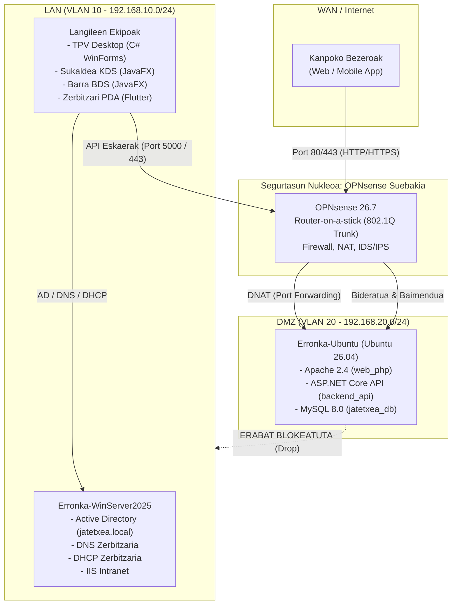

# Erronka 1 - Jatetxea Sare Sistema eta Aplikazioen Hedapena
## 00. Aurkibidea eta Proiektuaren Ikuspegi Orokorra

---

### 1. Sarrera eta Testuingurua

Proiektu honek Goierri Eskolako Zibersegurtasuneko 2. mailako 2. ebaluazioko erronka teknikoa jasotzen du. Helburu nagusia da jatetxe-kudeaketarako software plataforma oso bat (`1T_Jatetxea_erronka_agents`) sare-azpiegitura birtualizatu, segmentatu eta ziberseguru batean hedatzea.

Sistema honek hiru zutabe nagusi uztartzen ditu:
1. **Sare eta Sistema Ingeniaritza:** Makina birtualen bidezko azpiegitura birtualizatua (OPNsense suebakia, Ubuntu Server DMZ gunean eta Windows Server 2025 LAN barneko gunean), VLAN segmentazioarekin eta bideratze seguruarekin.
2. **Software Garapena:** Maila anitzeko (3-tier) arkitektura integratua: MySQL datu-base erlazionala, C# ASP.NET Core REST API transakzionala eta plataforma anitzeko bezero aplikazioak (Web PHP, C# Desktop TPV, JavaFX KDS/BDS sukaldeko sistema eta Flutter bidezko mugikorreko aplikazioak).
3. **Zibersegurtasuna:** DMZ desmilitarizatuaren isolamendua, suebaki bidezko sarbide-kontrol zorrotza (Least Privilege), transakzio pesimisten bidezko datu-integritatea, eta PCI-DSS / PSD2 segurtasun estandarren simulazioa.

---

### 2. Proiektuaren Arkitektura Laburpena

---

### 3. Dokumentazio Multzoaren Egitura

Proiektuaren alderdi guztiak sakon eta modu profesionalean garatu dira ondorengo dokumentu teknikoetan:

| Dokumentua | Titulua | Deskribapena |
| :--- | :--- | :--- |
| **[00. Aurkibidea](file:///c:/Dev/GoierriEskola/2_maila/Zibersegurtasuna/2_ebaluaketa/erronka_sare_sistema/doc/00_aurkibidea_eta_proiektu_ikuspegia.md)** | Ikuspegi Orokorra | Proiektuaren sarrera, helburuak eta arkitekturaren laburpena. |
| **[01. Sare Topologia](file:///c:/Dev/GoierriEskola/2_maila/Zibersegurtasuna/2_ebaluaketa/erronka_sare_sistema/doc/01_sare_topologia_eta_azpiegitura.md)** | Azpiegitura & Sare Plana | Arbelaren eta eskemen analisia, VLANak, Trunk (802.1Q) eta IP helbideratze plana. |
| **[02. OPNsense Suebakia](file:///c:/Dev/GoierriEskola/2_maila/Zibersegurtasuna/2_ebaluaketa/erronka_sare_sistema/doc/02_opnsense_suebakia_eta_segurtasun_matrizea.md)** | Segurtasun Politika & NAT | Firewall arau-matrizea, DMZ isolamendua, Port Forwarding (DNAT) eta Outbound NAT. |
| **[03. Zerbitzarien Rolak](file:///c:/Dev/GoierriEskola/2_maila/Zibersegurtasuna/2_ebaluaketa/erronka_sare_sistema/doc/03_zerbitzarien_arkitektura_eta_rolak.md)** | Sistemak & Zerbitzuak | Ubuntu Server (DMZ zerbitzuak) eta Windows Server 2025 (Active Directory, DNS, DHCP). |
| **[04. DB & Backend API](file:///c:/Dev/GoierriEskola/2_maila/Zibersegurtasuna/2_ebaluaketa/erronka_sare_sistema/doc/04_datu_basea_eta_backend_api_hedapena.md)** | Datu Maila & API Hedapena | MySQL 8.0 eskema, transakzio pesimistak, C# REST API Systemd daemon-a eta Reverse Proxy-a. |
| **[05. Bezero Aplikazioak](file:///c:/Dev/GoierriEskola/2_maila/Zibersegurtasuna/2_ebaluaketa/erronka_sare_sistema/doc/05_bezero_aplikazioak_eta_plataformak.md)** | Plataforma Anitzeko Stack-a | Web PHP, C# Desktop TPV, JavaFX Sukaldea/Barra eta Flutter Mugikorreko bezeroak. |
| **[06. Hedapen Gida](file:///c:/Dev/GoierriEskola/2_maila/Zibersegurtasuna/2_ebaluaketa/erronka_sare_sistema/doc/06_hedapen_gida_urratsez_urrats.md)** | Runbook & Inplementazioa | Makina birtualak konfiguratzeko, zerbitzuak altxatzeko eta probak egiteko gida praktikoa. |

---

### 4. Printzipio Profesionalak eta Betetze Arauak

1. **Emotikonorik Gabeko Dokumentazioa eta Kodea:** Dokumentu, kode, script eta mezu guztietan estilo tekniko, zehatz eta profesionala mantentzen da.
2. **Mailakatze Zorrotza (3-Tier Separation):** Bezeroek ez dute inoiz datu-basearekin zuzenean komunikatuko; bide bakarra C# ASP.NET Core REST API segurua da.
3. **Datuen eta Prezioen Zibersegurtasuna:** Prezioen kalkulu guztiak eta lehengaien stock murrizketak backend-eko datu-basetik zuzenean exekutatzen dira transakzio atomiko eta pesimisten bidez (`SELECT ... FOR UPDATE`).
4. **Isolamendu Radikala (Zero Trust DMZ):** DMZ guneak zerbitzu publikoak eskaintzen ditu, baina ezin du inola ere barneko LANeko zerbitzari edo ekipoetan konexiorik hasi.
