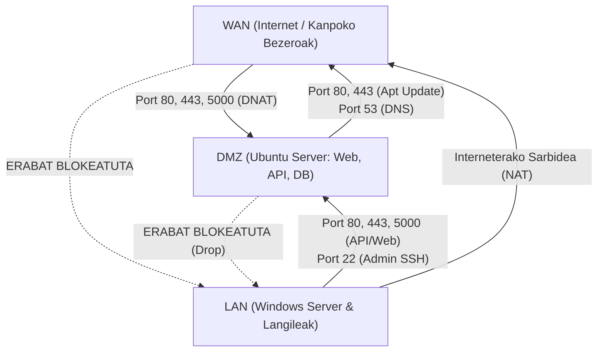

# Erronka 1 - Jatetxea Sare Sistema eta Aplikazioen Hedapena
## 02. OPNsense Suebakia eta Segurtasun Matrizea

---

### 1. Sarrera eta Segurtasun Printzipioak

OPNsense suebakiak azpiegitura osoaren segurtasun-nukleo gisa jokatzen du. Bere zeregina da sare-eremu ezberdinen (WAN, LAN eta DMZ) arteko komunikazioak ikuskatzea, baimendutako zerbitzuak soilik igarotzen uztea eta gainerako trafiko guztia lehenespenez ukatzea (**Default Deny** printzipioa).

Zibersegurtasuneko printzipio nagusi hauek aplikatzen dira:
1. **Gutxieneko Pribilegioen Printzipioa (Least Privilege):** Behar-beharrezkoak diren atakak eta protokoloak soilik irekitzen dira.
2. **DMZ Gunearen Isolamendu Erabatekoa:** DMZko zerbitzariek ez dute inoiz baimenik barneko LAN sarera konexiorik hasteko. DMZko zerbitzari bat konprometitua suertatuko balitz ere, erasotzaileak ezin du barne-sarera jauzi egin.
3. **Helbide Bideraketa Segurua (NAT):** Barneko IP pribatuak ez dira kanpoan erakusten; Port Forwarding (DNAT) bidez kanpotik eskuragarri egon behar duten zerbitzu bakarrak (Web/API) bideratzen dira.

---

### 2. OPNsense Interfazeak eta Subinterfazeak

| Interfazearen Izena | Fisikoa / Mota | IP Helbidea / Maskara | Deskribapena |
| :--- | :--- | :--- | :--- |
| **WAN** | `em0` (edo `vtnet0`) | DHCP / NAT IP | Interneteko konexioa |
| **LAN** | `em1` (edo `vlan10`) | `192.168.10.1 / 24` | Barne enpresa-sarea (Active Directory eta bezeroak) |
| **DMZ** (OPT1) | `em2` (edo `vlan20`) | `192.168.20.1 / 24` | Desmilitarizatutako gunea (Ubuntu Web, API eta DB) |

---

### 3. Segurtasun Matrizea (Firewall Trafiko-Fluxuak)

Ondorengo taulak definitzen du guneen arteko trafiko-baimenen eta debekuen matrize zorrotza:

| Jatorria | Helburua | Protokoloa | Helburuko Portua | Ekintza | Arrazoia eta Azalpena |
| :--- | :--- | :---: | :---: | :---: | :--- |
| **LAN** | **DMZ** | TCP | `80`, `443` | **PASS** | Langileen gailuek web aplikazioa kargatzeko |
| **LAN** | **DMZ** | TCP | `5000`, `5001` | **PASS** | TPV, KDS eta PDA bezeroek REST APIarekin hitz egiteko |
| **LAN** | **DMZ** | TCP | `22` | **PASS** | LANeko administratzaileak Ubuntu kudeatzeko (SSH) |
| **LAN** | **DMZ** | Edozein | Edozein | **BLOCK** | Gainerako ataka guztiak blokeatuta |
| **LAN** | **WAN** | Edozein | Edozein | **PASS** | LANeko ekipoek internetera irteteko baimena (NAT bidez) |
| **DMZ** | **LAN** | Edozein | Edozein | **BLOCK** | **KRITIKOA:** DMZtik LANera konexioak hasteko debeku osoa |
| **DMZ** | **WAN** | TCP/UDP | `53` | **PASS** | Ubuntuk DNS kontsultak egiteko |
| **DMZ** | **WAN** | TCP | `80`, `443` | **PASS** | Ubuntuk segurtasun paketeak eta eguneraketak jaisteko |
| **DMZ** | **WAN** | Edozein | Edozein | **BLOCK** | Gainerako kanpoko trafiko guztia blokeatuta |
| **WAN** | **DMZ** | TCP | `80`, `443` | **PASS (NAT)** | Kanpoko bezeroak jatetxearen webgunera sartzeko |
| **WAN** | **DMZ** | TCP | `5000` | **PASS (NAT)** | Bezeroen Flutter mugikorrak APIra sartzeko (edo reverse proxy bidez) |
| **WAN** | **DMZ** | Edozein | Edozein | **BLOCK** | DMZko SSH (22) eta MySQL (3306) kanpotik guztiz ezkutuan |
| **WAN** | **LAN** | Edozein | Edozein | **BLOCK** | WANetik barneko LANera sartzeko debeku absolutua |

---

### 4. NAT Konfigurazioa (Network Address Translation)

#### 4.1. Port Forwarding (Destination NAT / Inbound)
Kanpoko bezeroek Internetetik jatetxeko webgunera eta APIra sartu ahal izateko, OPNsense-n honako bideraketak ezartzen dira (`Firewall` -> `NAT` -> `Port Forward`):

| Araua | Interfazea | Protokoloa | Jatorria | Helburua (WAN IP) | Bideratu hona (Redirect Target) | Bideratze Portua |
| :--- | :---: | :---: | :---: | :---: | :--- | :---: |
| **Web HTTP** | WAN | TCP | Edozein | WAN Address : 80 | `192.168.20.10` | 80 |
| **Web HTTPS** | WAN | TCP | Edozein | WAN Address : 443 | `192.168.20.10` | 443 |
| **API REST** | WAN | TCP | Edozein | WAN Address : 5000 | `192.168.20.10` | 5000 |

> **Zibersegurtasun Oharra:** MySQL datu-basearen ataka (`3306`) eta SSH ataka (`22`) ez dira inoiz WAN interfazean bideratuko. Horrela bermatzen da datu-basea kanpoko brute-force eta SQL injekzio zuzenetatik erabat isolatuta egotea.

#### 4.2. Outbound NAT (Irteerako Trafikoa)
* **Modua:** *Hybrid Outbound NAT Rule Generation*.
* LAN (`192.168.10.0/24`) eta DMZ (`192.168.20.0/24`) sareetatik irteten diren paketeek OPNsense-ren WAN IP helbidea hartzen dute automatikoki (Masquerading).

---

### 5. OPNsense Gogortzea eta Segurtasun Ezarpen Gehigarriak

1. **Bogon eta Private Networks Blokeoa:**
   - WAN interfazean gaituta: `Block private networks` (RFC 1918) eta `Block bogon networks` (trafiko faltsua ekiditeko).
2. **Anti-Spoofing Babesa:**
   - OPNsense-k automatikoki egiaztatzen du interfaze bakoitzetik sartzen diren paketeen jatorrizko IPa dagokion azpisarekoa dela.
3. **SSH eta WebGUI Kudeaketa Segurua:**
   - WebGUI eta SSH administrazioa LAN interfazetik soilik baimenduta dago (`192.168.10.0/24`), inoiz ez DMZtik edo WANetik.
4. **Intrusion Detection System (IDS/IPS):**
   - Suricata motorra gaitzea gomendatzen da DMZ interfazean, HTTP eta API eskaeren artean web-erasoak (SQLi, XSS, Path Traversal) detektatzeko eta blokeatzeko.
