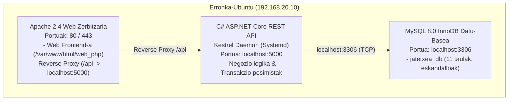
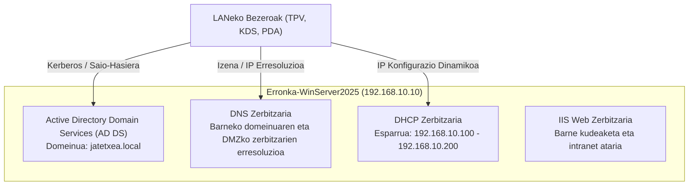

# Erronka 1 - Jatetxea Sare Sistema eta Aplikazioen Hedapena
## 03. Zerbitzarien Arkitektura eta Rolak

---

### 1. Ikuspegi Orokorra

Azpiegiturak bi zerbitzari nagusi integratzen ditu, bakoitzak bere sare-eremuan eginkizun zehatzak eta bereiziak betez:
1. **Erronka-Ubuntu (DMZ):** Zerbitzu publiko eta aplikazioen zerbitzaria (Web, API eta DB).
2. **Erronka-WinServer2025 (LAN):** Identitate, sare-azpiegitura eta barne kudeaketako zerbitzaria (Active Directory, DNS, DHCP, IIS).

---

### 2. Erronka-Ubuntu (DMZ Zerbitzaria)

Ubuntu zerbitzaria jatetxearen negozio-aplikazioak eta datu-basea exekutatzeko arduraduna da. DMZ gunean kokatuta dagoenez, kanpoko zein barneko bezeroen eskaerak jasotzen ditu.

#### 2.1. Zerbitzuen Xehetasunak:

| Zerbitzua | Teknologia | Ataka Lokala | Ataka Publikoa | Funtzioa |
| :--- | :--- | :---: | :---: | :--- |
| **Web Zerbitzaria** | Apache 2.4 + PHP 8.2 | `80`, `443` | `80`, `443` | Jatetxeko webgunea kudeatu (`web_php`) |
| **REST APIa** | .NET 10 ASP.NET Core | `5000` | `/api` proxya | Datuen transakzioak eta negozio logika |
| **Datu-Basea** | MySQL 8.0 Server | `3306` | - | Datu iraunkorrak, integritatea eta stock kontrola |
| **Urrutiko Sarbidea** | OpenSSH Server | `22` | Host: `2230` | Administrazio segurua kontsola bidez |

#### 2.2. Segurtasun Gogortzea (Hardening) Ubuntun:
* **UFW Suebakia:**
  * Portu publikoak: `80/tcp`, `443/tcp` (Web eta APIrako).
  * Portu administratiboak: `22/tcp` (LANeko administratzailearentzat bakarrik baimendua).
  * MySQL ataka (`3306`): **Localhost-era (`127.0.0.1`) bakarrik mugatuta**; inondik ere ez da onartzen kanpoko edo sareko konexio zuzenik MySQL-ra. Komunikazio guztia APIaren bitartez gauzatzen da.

---

### 3. Erronka-WinServer2025 (LAN Zerbitzaria)

Windows Server 2025 zerbitzaria barneko enpresa-ingurunearen bizkarrezurra da. Jatetxeko langileen segurtasuna, ekipoen autentifikazioa eta sarearen oinarrizko zerbitzuak kudeatzen ditu.

#### 3.1. Active Directory Domain Services (AD DS):
* **Baso eta Domeinuaren Izena:** `jatetxea.local`
* **NetBIOS Izena:** `JATETXEA`
* **Antolaketa Unitateen Egitura (OU Egitura):**
  * `OU=Jatetxea`
    * `OU=Langileak`:
      * `OU=Zerbitzariak`: Jangela eta terrazako zerbitzariak (TPV erabiltzaileak).
      * `OU=Sukaldariak`: Sukaldeko eta barrako langileak (KDS erabiltzaileak).
      * `OU=Administrazioa`: Kudeatzaileak eta sistemako administratzaileak.
    * `OU=Terminalak`:
      * `OU=TPV`: Jangela eta barrako kutxetako ekipoak.
      * `OU=KDS`: Sukaldeko ukipen-pantailak.
    * `OU=Taldeak`:
      * `GG_Zerbitzariak` (Talde Orokorra)
      * `GG_Sukaldariak` (Talde Orokorra)
      * `GG_Administratzaileak` (Talde Orokorra)

#### 3.2. DNS Zerbitzaria:
Domeinu-kontrolatzailearekin batera integratuta dago. Erregistro nagusiak:
* `dc1.jatetxea.local` -> `192.168.10.10` (Windows Server)
* `api.jatetxea.local` -> `192.168.20.10` (DMZko Ubuntu API zerbitzaria)
* `web.jatetxea.local` -> `192.168.20.10` (DMZko Ubuntu Web zerbitzaria)
* **Birbideratzaileak (Forwarders):** `1.1.1.1`, `8.8.8.8` (kanpoko Interneteko domeinuetarako).

#### 3.3. DHCP Zerbitzaria (LAN Esparrua):
* **Esparruaren Izena:** `Jatetxea-LAN`
* **IP Tartea:** `192.168.10.100` - `192.168.10.200`
* **Maskara:** `255.255.255.0` (`/24`)
* **DHCP Aukerak (Options):**
  * `003 Router (Atebidea):` `192.168.10.1` (OPNsense LAN IPa)
  * `006 DNS Zerbitzariak:` `192.168.10.10` (Windows Server DNS)
  * `015 DNS Domeinuaren Izena:` `jatetxea.local`
  * `051 Errentamendu-denbora (Lease Time):` 8 egun (ekipo finkoentzat) edo 8 ordu (mugikorrentzat).

#### 3.4. IIS (Internet Information Services):
* Barneko kudeaketa panel bat edo intranet zerbitzu bat hedatzeko erabiltzen da (adib. hornitzaileen fakturazioa edo barneko dokumentazioa).
* Portuak: `80` (HTTP) eta `443` (HTTPS).
