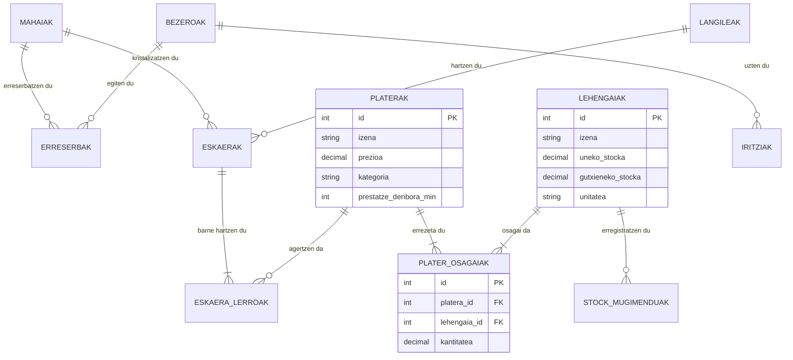
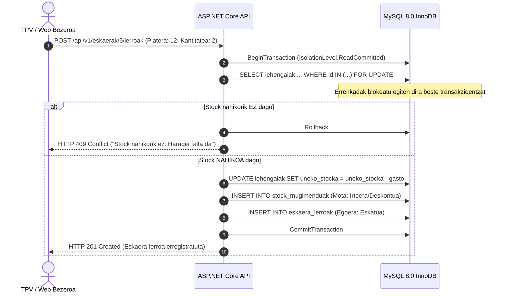

# Erronka 1 - Jatetxea Sare Sistema eta Aplikazioen Hedapena
## 04. Datu-Basea eta Backend API Hedapena

---

### 1. Datu-Basearen Arkitektura (MySQL 8.0 InnoDB)

Datu-basea jatetxearen datu erlazionalak eta transakzionalak kudeatzeko diseinatuta dago, ACID propietateak zorrotz betez.

* **Datu-Basearen Izena:** `jatetxea_db`
* **Motorra:** InnoDB (Transakzioak, gako arrotzak eta errenkaden blokeo pesimista onartzen ditu).
* **Karaktere-Jokoa:** `utf8mb4` eta `utf8mb4_0900_ai_ci` kolazioa.

#### 1.1. Taulen Egitura (11 Taula):



#### 1.2. Funtsezko Ikuspegiak (Views):
1. `v_erosi_beharreko_lehengaiak`: Gutxieneko stocketik behera dauden lehengaiak bistaratzen ditu erosketa-agindu automatikoak prestatzeko.
2. `v_plateren_stock_ahalmena`: Lehengai bakoitzaren stockaren arabera plater bakoitzetik gehienez zenbat anoa prestatu daitezkeen kalkulatzen du denbora errealean.
3. `v_balorazio_orokorrak`: Bezeroen batez besteko puntuazioa eta 0-5 izarren banaketa estatistikoa ematen du.

---

### 2. Transakzio Pesimistak eta Stock Deskontu Atomikoa

Sistema honek transakzio pesimistak erabiltzen ditu konkurrentzia-arazoak (Race Conditions) eta over-booking-ak saihesteko:

#### 2.1. Platerak Eskatzean Stock Deskontua (`POST /api/v1/eskaerak/{id}/lerroak`):


#### 2.2. Mahai Erreserben Blokeoa (`POST /api/v1/erreserbak`):
Mahaia txanda eta data berean birritan erreserbatzea ekiditeko, transakzioak `SELECT ... FOR UPDATE` egiten du `erreserbak` taulan. Gatazkarik badago, berehala `HTTP 409 Conflict` erantzuten dio bezeroari.

---

### 3. Backend REST API Hedapena (.NET 10 ASP.NET Core)

APIa C# .NET 10-en eraikita dago eta Ubuntu zerbitzarian daemon/zerbitzu iraunkor gisa hedatzen da.

#### 3.1. APIaren Argitalpena (Publish):
Proiektuaren iturburu-kodetik fitxategi bitarrak konpilatu eta ekoizpen karpetara ateratzen dira:
```bash
cd C:\Dev\GoierriEskola\1T_Jatetxea_erronka_agents\backend_api
dotnet publish -c Release -o /var/www/jatetxea_api
```

#### 3.2. Ekoizpen Konfigurazioa (`appsettings.Production.json`):
```json
{
  "Logging": {
    "LogLevel": {
      "Default": "Information",
      "Microsoft.AspNetCore": "Warning"
    }
  },
  "AllowedHosts": "*",
  "ConnectionStrings": {
    "Jatetxea": "Server=localhost;Port=3306;Database=jatetxea_db;Uid=jatetxea_user;Pwd=Errotagain169232$$;AllowUserVariables=True;Connection Timeout=5;"
  }
}
```

#### 3.3. Systemd Zerbitzua (`/etc/systemd/system/jatetxea-api.service`):
Zerbitzaria berrabiaraztean APIa automatikoki altxatzeko eta erortzen bada birabiarazteko:
```ini
[Unit]
Description=Jatetxea ASP.NET Core REST API Zerbitzua
After=network.target mysql.service

[Service]
WorkingDirectory=/var/www/jatetxea_api
ExecStart=/usr/bin/dotnet /var/www/jatetxea_api/Jatetxea.Api.dll
Restart=always
RestartSec=10
KillSignal=SIGINT
SyslogIdentifier=jatetxea-api
User=www-data
Environment=ASPNETCORE_ENVIRONMENT=Production
Environment=DOTNET_PRINT_TELEMETRY_MESSAGE=false
Environment=ASPNETCORE_URLS=http://localhost:5000

[Install]
WantedBy=multi-user.target
```

Zerbitzua gaitzeko eta abiarazteko komandoak:
```bash
sudo systemctl daemon-reload
sudo systemctl enable --now jatetxea-api.service
sudo systemctl status jatetxea-api.service
```

---

### 4. Apache Reverse Proxy Konfigurazioa

Apache 2.4 web zerbitzariak bezeroen eskaerak jasotzen ditu 80/443 portuetan, eta `/api` biderapena automatikoki Kestrel barneko portura (`http://localhost:5000/api`) berbideratzen du.

#### 4.1. Apache Moduluak Aktibatu:
```bash
sudo a2enmod proxy proxy_http headers rewrite
```

#### 4.2. VirtualHost Konfigurazioa (`/etc/apache2/sites-available/jatetxea.conf`):
```apache
<VirtualHost *:80>
    ServerName jatetxea.local
    ServerAdmin webmaster@jatetxea.local
    DocumentRoot /var/www/html/web_php

    # Web PHP Fitxategiak
    <Directory /var/www/html/web_php>
        Options -Indexes +FollowSymLinks
        AllowOverride All
        Require all granted
    </Directory>

    # Alderantzizko Proxya ASP.NET Core REST APIarentzat
    ProxyPreserveHost On
    ProxyPass /api http://127.0.0.1:5000/api
    ProxyPassReverse /api http://127.0.0.1:5000/api

    # Goiburu Seguruak
    Header always set X-Content-Type-Options "nosniff"
    Header always set X-Frame-Options "SAMEORIGIN"
    Header always set X-XSS-Protection "1; mode=block"

    ErrorLog ${APACHE_LOG_DIR}/jatetxea_error.log
    CustomLog ${APACHE_LOG_DIR}/jatetxea_access.log combined
</VirtualHost>
```

Gune berria aktibatu eta Apache berrabiarazi:
```bash
sudo a2dissite 000-default.conf
sudo a2ensite jatetxea.conf
sudo systemctl reload apache2
```
