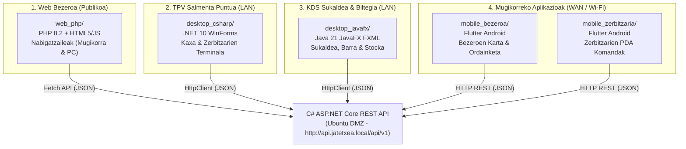

# Erronka 1 - Jatetxea Sare Sistema eta Aplikazioen Hedapena
## 05. Bezero Aplikazioak eta Plataformak

---

### 1. Plataforma Anitzeko Aurre-Maila (Multiplatform Stack)

Jatetxearen soluzioak 4 bezero-aplikazio mota barne hartzen ditu, bakoitza erabiltzaile profil eta gailu zehatz bati zuzendua:



---

### 2. Web Frontend-a (`web_php/`)

* **Xede-Hartzailea:** Jatetxeko bezeroak (etxetik edo mugikorretik).
* **Kokapena eta Exekuzioa:** Apache 2.4 zerbitzarian hedatuta Ubuntu zerbitzarian (DMZ).
* **Teknologiak:** PHP 8.2, HTML5 semantikoa, CSS3 sentikorra (Responsive) eta JavaScript Vanilla asinkronoa (Fetch API).
* **Ezaugarri Nagusiak:**
  1. **Karta Interaktiboa:** Platerak kategorien arabera (Sarrerakoak, Lehenak, Bigarrenak, Postreak, Edariak) eta alergenoen iragazkia.
  2. **Dinamismoa eta Stock Kontrola:** `GET /api/v1/platerak/erabilgarritasuna` kontsultatzen du asinkronoki; anoa erabilgarririk ez duten platerak automatikoki **"Agortua"** gisa bistaratzen ditu eta eskaerak desgaitu.
  3. **Mahai Erreserbak:** Egutegia, txandak (Bazkaria 1/2, Afaria 1/2) eta pertsona kopurua. Gatazka badago (`HTTP 409 Conflict`), mezu argi batekin adierazten du mahaia jada hartuta dagoela.
  4. **Iritziak eta Balorazioak:** Bezeroen 0-5 izarreko iritziak eta estatistika orokorrak erakusten ditu.

---

### 3. Desktop TPV Zerbitzaria (`desktop_csharp/`)

* **Xede-Hartzailea:** Jangela eta terrazako zerbitzariak eta kudeatzaileak.
* **Kokapena eta Exekuzioa:** LAN barruko Windows ekipoetan, Active Directory (`jatetxea.local`) domeinura atxikitako terminaletan.
* **Teknologiak:** C# .NET 10 Windows Forms, Tablet POS interfazea (1366x850 bereizmen optimizatua).
* **Ezaugarri Nagusiak:**
  1. **PIN bidezko Sarbide Azkarra:** Zerbitzari bakoitzak bere 4 digituko PIN bidez saioa hasten du (`POST /api/v1/langileak/login`). Lineaz kanpo badago, errore gorri batek APIaren deskonexioa jakinarazten du.
  2. **Mahaien Mapa Interaktiboa:** Jatetxeko mahai guztiak erakusten ditu guneen arabera (Jangela Nagusia, Terraza, Barra, VIP) kolore adierazgarriekin:
     * *Berdea:* Librea
     * *Gorria:* Okupatuta
     * *Laranja:* Eskaera bidean / Sukaldean
     * *Urdina:* Garbitzen
  3. **Mahai Berean Kontu Banatuak:** Mahaikide bakoitzak bere kontu propioa izan dezake (`1. Kontua`, `2. Kontua`).
  4. **Sukaldera Bidalketa:** Zai dauden platerak sukaldera bidaltzeko botoia ("SUKALDERA BIDALI").
  5. **Kobrantza eta Fakturazioa:** Kontua kobratzean, mahaia automatikoki "Garbitzen" egoerara pasatzen da mahai horretan beste kontu aktiborik geratzen ez denean.
* **Sare Konfigurazioa (`appsettings.json` edo `ApiService.cs`):**
  ```csharp
  private static readonly string BaseUrl = "http://api.jatetxea.local/api/v1";
  // OPNsense bidezko DMZ helbide zuzena: "http://192.168.20.10:5000/api/v1"
  ```

---

### 4. Desktop Sukaldea, Barra eta Biltegia (`desktop_javafx/`)

* **Xede-Hartzailea:** Sukaldariak (sukaldean), zerbitzariak (barran) eta biltegi-arduraduna.
* **Kokapena eta Exekuzioa:** Sukaldeko eta barrako ukipen-pantaila finkoetan (LAN sarea).
* **Teknologiak:** Java 17/21 LTS, JavaFX 21, FXML, CSS eta Maven. MVC arkitektura garbia.
* **Ezaugarri Nagusiak:**
  1. **Sukaldeko KDS (Kitchen Display System):** Sarrerako, lehen eta bigarren platerak denbora errealean jasotzen ditu. Sukaldariak plater bakoitzaren egoera aldatzen du klik bakarrarekin (`Zai` -> `Sukaldean` -> `Prestatua`).
  2. **Barrako BDS (Bar Display System):** Edariak eta kafeak bakarrik bistaratzen dituen pantaila bereizia (`Kategoria == 'Edaria'`).
  3. **Biltegi Kudeaketa eta Stock Alertak:** Lehengaien zerrenda osoa. Gutxieneko stocketik behera dauden lehengaiak gorriz nabarmentzen dira. Hornitzailearen albaranen sarrera berriak erregistratzen ditu (`POST /api/v1/lehengaiak/sarrera`).
  4. **Auto-Freskatzea:** 10 segundoro datuak automatikoki sinkronizatzen ditu APIarekin.
* **Sare Konfigurazioa (`ApiClient.java`):**
  ```java
  private static final String BASE_URL = "http://api.jatetxea.local/api/v1";
  ```

---

### 5. Mugikorreko Aplikazioak (`mobile_bezeroa/` eta `mobile_zerbitzaria/`)

* **Xede-Hartzailea:**
  * `mobile_bezeroa`: Kanpoko bezeroak (mahaian QR bidez edo etxetik eramateko eskatzeko).
  * `mobile_zerbitzaria`: Jatetxeko zerbitzariak (haririk gabeko PDA komanderoak).
* **Teknologiak:** Flutter (Dart), Android APK konpilazioa.
* **Zibersegurtasun Simulazio Aurreratua (`mobile_bezeroa`):**
  1. **PCI-DSS Maila 1 Estandarrak:** Datu sentikorrak (kreditu-txartelaren zenbakiak, CVVak) ez dira inoiz testu hutsean gordetzen; SHA-256 eta AES-256 bidezko tokenizazio kriptografikoa erabiltzen da (`tok_pci_aes256_...`).
  2. **Luhn Algoritmoa:** Kreditu txartelen zenbakien balidazio matematikoa bezeroaren gailuan bertan.
  3. **PSD2 / 3D Secure 2.0 Autentifikazioa:** SMS bidezko 6 digituko OTP autentifikazio modala banku-igorlearen segurtasuna simulatzeko.
  4. **Txartel Maskaratua:** Pantailan eta ordainagirietan azken lau digituak bakarrik bistaratzen dira (`**** **** **** 1234`).
* **Sare Konfigurazio Dinamikoa:**
  Aplikazioak sareko ezarpenen panela dauka (`ApiConfig`):
  * **Barneko Wi-Fi bidez (LAN):** `http://192.168.20.10:5000/api/v1`
  * **Kanpoko Internet bidez (WAN):** `http://<WAN_IP>:5000/api/v1` (OPNsense Port Forwarding bidez).
  * Integratutako osasun-proba (`checkHealth`) konexioa egiaztatzeko.
