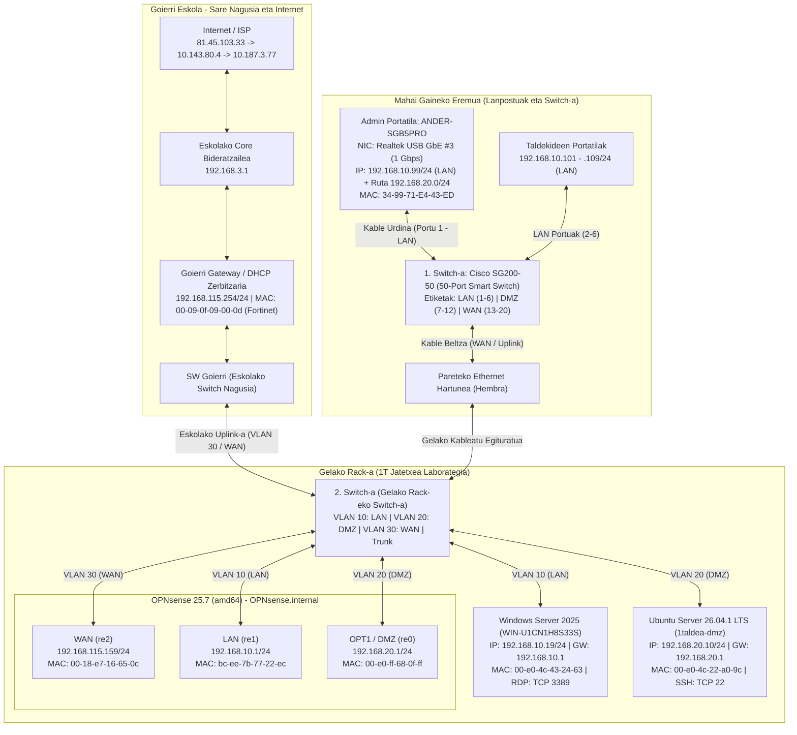

# Sare Fisikoaren Azterketa Osoa eta Topologia Dokumentazioa

Dokumentu honek Goierri Eskolako laborategi fisikoan eraikitako eta egiaztatutako sare-azpiegitura osoaren arkitektura, kableatua, helbideratzea, suebaki-arauak, sarbide-kredentzialak eta urruneko kudeaketa gida jasotzen ditu.

---

## 1. Sarearen Topologia Diagrama Profesionala (Egoera Erreala)



---

## 2. Sare Logikoa, VLANak eta IP Helbideratzea (Egiaztatua)

| Segmentua | VLAN ID | Azpisarea | Gateway | Gailu Aktiboak (IP eta MAC) |
| :--- | :--- | :--- | :--- | :--- |
| **WAN (Goierri Eskola)** | **VLAN 30** | `192.168.115.0/24` | `192.168.115.254` | • `192.168.115.254` — Fortinet Gateway/DHCP (`00-09-0f-09-00-0d`)<br>• `192.168.115.159` — OPNsense `WAN (re2)` (`00-18-e7-16-65-0c`) |
| **LAN (Barne Sarea)** | **VLAN 10** | `192.168.10.0/24` | `192.168.10.1` | • `192.168.10.1` — OPNsense `LAN (re1)` (`bc-ee-7b-77-22-ec`)<br>• `192.168.10.19` — Windows Server 2025 `WIN-U1CN1H8S33S` (`00-e0-4c-43-24-63`)<br>• `192.168.10.99` — Admin Portatila `ANDER-SGB5PRO` (`34-99-71-E4-43-ED`) |
| **DMZ (Zerbitzari Publikoa)** | **VLAN 20** | `192.168.20.0/24` | `192.168.20.1` | • `192.168.20.1` — OPNsense `OPT1 (re0)` (`00-e0-ff-68-0f-ff`)<br>• `192.168.20.10` — Ubuntu Server `1taldea-dmz` (`00-e0-4c-22-a0-9c`) |

---

## 3. Erabiltzaileak, Pasahitzak eta Urruneko Sarbidea

> [!CAUTION]
> Laborategi akademiko itxirako kredentzialak dira. Ekoizpenera pasatzean pasahitz guztiak aldatu eta SSH giltzak erabili behar dira.

| Zerbitzua / Ekipoa | Helbidea / Portua | Erabiltzailea | Pasahitza | Oharra |
| :--- | :--- | :--- | :--- | :--- |
| **OPNsense WebGUI** | `https://192.168.10.1` (`TCP 443`) | `root` | `opnsense` | LAN (`VLAN 10`) saretik soilik |
| **Windows Server 2025 (RDP)** | `192.168.10.19` (`TCP 3389`) | `WIN-U1CN1H8S33S\Administrador` | `2MG31taldea` | `mstsc` bidez (*Más opciones > Usar otra cuenta*) |
| **Ubuntu Server DMZ (SSH)** | `192.168.20.10` (`TCP 22`) | `taldea1` | `1Taldea1` | `ssh taldea1@192.168.20.10` |
| **Cisco SG200-50 Switch** | `http://192.168.1.254` (`TCP 80/443`) | `cisco` *(lehenetsia)* | `cisco` *(lehenetsia)* | VLAN 1 kudeaketa-atakatik |

---

## 4. Aplikatutako Suebaki-Arauak eta Konfigurazioak

### 4.1. OPNsense Suebaki-Arauak (`Firewall > Rules > OPT1`)
1. **1. Araua (Goian — Segurtasuna):** `Block` | `IPv4 *` | `Source: OPT1 net` | `Destination: LAN net` | Deskribapena: `Blokeatu DMZ -> LAN`.
2. **2. Araua (Behean — Internet):** `Pass` | `IPv4 *` | `Source: OPT1 net` | `Destination: * (any)` | Deskribapena: `Baimendu DMZ -> Internet`.
3. **LAN (`Firewall > Rules > LAN`):** `Default allow LAN to any` aktibo (LAN-etik DMZ-ra eta Internetera sarbide osoa).

### 4.2. Windows Server 2025 (`WIN-U1CN1H8S33S`)
- Sare estatikoa aplikatuta:
  ```powershell
  netsh interface ip set address name="Ethernet" static 192.168.10.19 255.255.255.0 192.168.10.1
  netsh interface ip set dns name="Ethernet" static 192.168.10.1
  ```
- Pasahitza ezarrita: `net user Administrador 2MG31taldea`
- Egiaztapena: `ping 8.8.8.8` -> `0% perdidos` (`15 ms`).

### 4.3. Ubuntu Server 26.04.1 LTS (`1taldea-dmz`)
- `openssh-server` instalatuta eta gaituta (`sudo systemctl enable --now ssh`).
- Netplan konfigurazioa (`/etc/netplan/00-installer-config.yaml`, `chmod 600`):
  ```yaml
  network:
    version: 2
    ethernets:
      enp1s0:
        dhcp4: false
        addresses:
          - 192.168.20.10/24
        routes:
          - to: default
            via: 192.168.20.1
        nameservers:
          addresses: [1.1.1.1, 192.168.20.1]
  ```
- Egiaztapena: `ifconfig` -> `enp1s0: 192.168.20.10 / 255.255.255.0`.

### 4.4. Admin Portatila (`ANDER-SGB5PRO`) eta Taldekideak
- Portatilaren `Ethernet 5` konfiguratuta (`192.168.10.99/24` + DMZ ibilbidea):
  ```powershell
  route add 192.168.20.0 mask 255.255.255.0 192.168.10.1
  ```
- Windows Terminal profila (`Erronka - Ubuntu (SSH)`): `ssh taldea1@192.168.20.10`.
- Taldekideentzat: mahai gaineko Cisco SG200-50 switch-eko `LAN` ataka libre batera konektatu eta IP estatikoak esleitu (`192.168.10.101`, `.102`, `.103`... maskara `255.255.255.0`, eta DMZ-rako `route add 192.168.20.0 mask 255.255.255.0 192.168.10.1`).

---

## 5. Interneterako Bideratze-Katea (`tracert -d 8.8.8.8`)

1. `192.168.115.254` (`<1 ms`) — Goierri Eskolako Fortinet pasabidea
2. `192.168.3.1` (`1 ms`) — Eskolako barne-bideratzailea
3. `10.187.3.77` (`2 ms`) — Operadorearen sarrera-lotura
4. `10.143.80.4` (`13 ms`) — Operadorearen core sarea
5. `81.45.103.33` (`14–47 ms`) — Internet irteera publikoa
