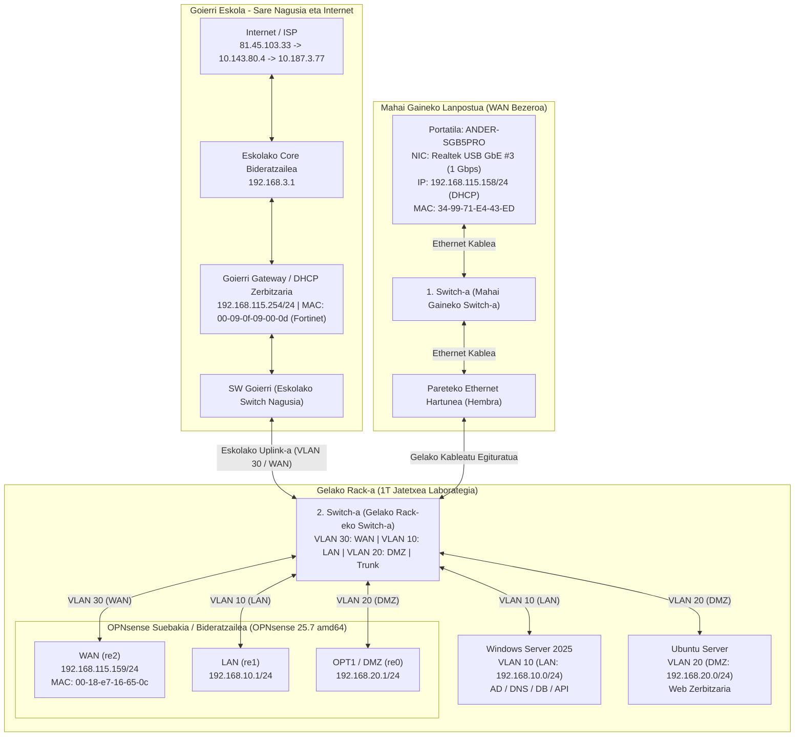

# Sare Fisikoaren Azterketa Osoa eta Topologia Dokumentazioa

Dokumentu honek Goierri Eskolako laborategi fisikoan une honetan muntatuta dagoen sare-azpiegitura errealaren azterketa teknikoa, gailuen inbentarioa, helbideratzea, trafiko-fluxuak eta arkitektura-diagrama profesionala jasotzen ditu.

---

## 1. Sarearen Topologia Diagrama Profesionala

Ondorengo diagramak konektibitate fisiko osoa (kableatua eta switch-ak) zein logikoa (VLANak, IP azpisareak eta bideratzea) erakusten ditu:

---

## 2. Geruza Fisikoaren eta Loturaren Azterketa (L1 / L2)

Konektibitate fisikoaren ibilbidea bi adar nagusitan banatzen da, gelako rack-eko switch-ean elkartzen direnak:

1. **Portatiletik Rack-era (WAN Sarbidea):**
   - `ANDER-SGB5PRO` portatila (`Realtek USB GbE Family Controller #3`, **1 Gbps**) Ethernet kable bidez **mahai gaineko lehenengo switch-era** konektatuta dago.
   - Mahai gaineko switch hori **pareteko Ethernet hartunera (hembra)** konektatuta dago.
   - Pareteko hartunetik kableatu egituratua **gelako rack-eko switch-era** iristen da (WAN / VLAN 30 portu-taldera).
2. **Eskolako Saretik Rack-era (Uplink Nagusia):**
   - Goierri Eskolako switch nagusia (`SW Goierri`) gelako rack-eko switch-eko **WAN (VLAN 30)** ataka-taldera konektatuta dago, laborategiari Interneterako irteera eta `192.168.115.0/24` sareko DHCP zerbitzua emanez.
3. **Rack Barruko Banaketa (Switch <-> Zerbitzariak eta Suebakia):**
   - Arbeleko eskemaren (`irudiak/sare_fisikoa.png`) arabera, gelako rack-eko switch-ak **3 portu-talde bereizi** (eta Trunk portu bat) ditu:
     - **WAN taldea (VLAN 30):** Eskolako Uplink-a, pareteko hartunetik datorren portatila, eta OPNsense-ren `WAN (re2)` interfazea.
     - **LAN taldea (VLAN 10):** OPNsense-ren `LAN (re1)` interfazea eta **Windows Server 2025**.
     - **DMZ taldea (VLAN 20):** OPNsense-ren `OPT1 (re0)` interfazea eta **Ubuntu Server**.

---

## 3. Sare Logikoa eta IP Helbideratzea (L3)

Zuzeneko diagnostikoetatik (`ipconfig`, `arp`, `tracert`) eta OPNsense kontsolako (`irudiak/opnsense.jpg`) zein arbeleko (`irudiak/sareak.png`) datuetatik jasotako helbideratze erreala:

| Sarea / Segmentua | VLAN ID | Azpisarea (CIDR) | Gateway / Bideratzailea | Gailuak eta IP Helbideak | Egoera / Oharra |
| :--- | :--- | :--- | :--- | :--- | :--- |
| **WAN (Goierri Eskola)** | **VLAN 30** | `192.168.115.0/24` | `192.168.115.254` (Fortinet) | • `192.168.115.158` — Portatila (`ANDER-SGB5PRO`, DHCP) • `192.168.115.159` — OPNsense `WAN (re2)` (DHCP) • `192.168.115.254` — Eskolako Gateway & DHCP | **Aktibo eta egiaztatuta** |
| **LAN (Barne Sarea)** | **VLAN 10** | `192.168.10.0/24` | `192.168.10.1` (`OPNsense re1`) | • `192.168.10.1` — OPNsense LAN Gateway / DHCP • Windows Server 2025 (DHCP edo `192.168.10.10`) | **Konfiguratuta rack-ean** |
| **DMZ (Zerbitzari Publikoa)** | **VLAN 20** | `192.168.20.0/24` | `192.168.20.1` (`OPNsense re0`) | • `192.168.20.1` — OPNsense OPT1 Gateway / DHCP • Ubuntu Server (DHCP edo `192.168.20.10`) | **Konfiguratuta rack-ean** |

---

## 4. Diagnostiko Errealaren Emaitzak (Portatiletik Egiaztatua)

Portatiletik egindako probek honako egoera erakutsi dute:

- **Portatilaren Interfaze Aktiboa (`Ethernet 5`):**
  - IPv4: `192.168.115.158` | Azpisare-maskara: `255.255.255.0`
  - Gateway eta DHCP zerbitzaria: `192.168.115.254`
  - DNS zerbitzariak: `1.1.1.1`, `1.0.0.1`
  - Lotura-abiadura: `1 Gbps` | MAC: `34-99-71-E4-43-ED`
- **ARP Taula (`192.168.115.0/24` domeinuan ikusgai):**
  - `192.168.115.254` -> `00-09-0f-09-00-0d` (Fortinet — Eskolako Gateway-a; `ping` erantzuna `<1 ms`, 0% galera).
  - `192.168.115.159` -> `00-18-e7-16-65-0c` (OPNsense WAN interfazea; L2 mailan ARP erantzuten du, baina L3 mailan ICMP `ping`-ak blokeatuta daude OPNsense-ren WAN suebakiaren arau lehenetsiagatik).
- **Interneterako Bideratzea (`tracert -d 8.8.8.8`):**
  1. `192.168.115.254` (`<1 ms`) — Goierri Eskolako sare-pasabidea
  2. `192.168.3.1` (`1 ms`) — Eskolako barne-bideratzailea
  3. `10.187.3.77` (`2 ms`) — Kanpoko lotura / operadorearen sarea
  4. `10.143.80.4` (`13 ms`) — Operadorearen core sarea
  5. `81.45.103.33` (`14–47 ms`) — Internet irteera publikoa

---

## 5. Segurtasun Analisia eta Aurreko Planarekiko Desberdintasunak

### 5.1. Portatilaren Kokapenaren Inplikazioak (WAN Segmentua)
Portatila `192.168.115.0/24` sarean (WAN) konektatuta dagoenez, **kanpoko sare baten posizio berean** dago OPNsense-rekiko:
- **Ikusgarritasuna:** Portatilak L2 mailan OPNsense-ren WAN (`192.168.115.159`) eta eskolako gateway-a (`192.168.115.254`) ikusten ditu, eta Internetera irteera zuzena du.
- **Isolamendua:** OPNsense-k ez du baimenduko WAN-etik (`192.168.115.158`) LAN-era (`192.168.10.0/24`) edo OPNsense WebGUI-ra (`https://192.168.10.1`) zuzenean sartzea, Port Forwarding (NAT) edo WAN arau espliziturik sortzen ez bada.
- **Kudeaketarako Gomendioa:** OPNsense administratzeko (`https://192.168.10.1`) edo Windows Server 2025-era sartzeko, portatila VLAN 10 (LAN) ataka batera konektatu behar da; DMZ zerbitzuak (Ubuntu Web) probatzeko, berriz, WAN-etik (`192.168.115.159`) NAT bidezko atzipena (80/443 portuak) konfiguratu behar da.

### 5.2. Hasierako Dokumentazioaren eta Muntaketa Errealaren Arteko Aldeak

| Ezaugarria | Hasierako Plana (`01`-`04` karpetak) | Muntaketa Erreala (Rack & Arbelak) |
| :--- | :--- | :--- |
| **OPNsense Konexioa** | *Router-on-a-Stick* (Trunk bakarra `Gig0/1`-era) | **3 NIC fisiko bereizi** (`re2` WAN, `re1` LAN, `re0` OPT1/DMZ) |
| **VLAN 30** | `WIFI_BEZEROAK` (`192.168.30.0/24`) | **WAN / Goierri Eskola** (`192.168.115.0/24`) |
| **LAN & DMZ IP Banaketa** | IP estatiko finkoak (`.10`, `.20`, `.30`...) | OPNsense-k **DHCP** aktibatuta du LAN (`re1`) eta DMZ (`re0`) sareetarako |
| **Switch Kudeaketa** | VLAN 99 (`192.168.99.0/24`) | Oraingoz VLAN 10, 20 eta 30 erabiltzen ari dira rack-eko switch-ean |
