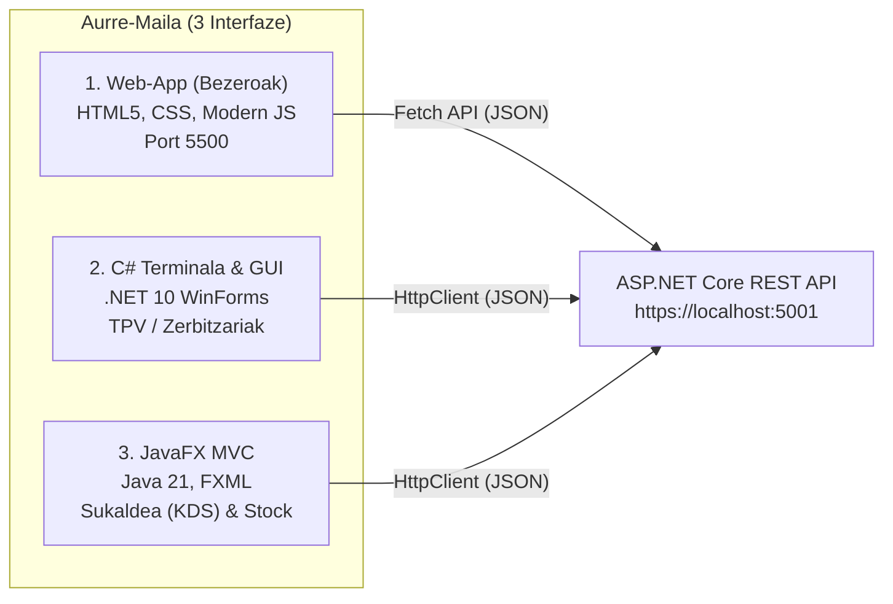

# Aurre-Maila: Bezero eta Langile Interfazeak (Web, C#, JavaFX)

Aurre-mailak hiru aplikazio ezberdin barneratzen ditu, bakoitzak jatetxearen behar eta erabiltzaile profil jakin bati erantzuteko:

---

## 1. Web-App (Bezeroen Erreserbak eta Karta)
- **Teknologia:** HTML5 semantikoa, CSS garbia (Responsive, Mobile-first), JavaScript modernoa (Fetch API, Async/Await).
- **Funtzioak:** Karta interaktiboa, alergenoen iragazkia, mahai-erreserba automatikoak.
- **Stockarekiko lotura:** `v_plateren_stock_ahalmena` kontsultatu eta anoak 0 dituzten platerak automatikoki **"Agortua"** gisa erakutsi (ezingo da eskatu).

---

## 2. C# .NET 10 Mahaigainekoa (TPV & Administrazioa)
- **Teknologia:** C# .NET 10 WinForms edo WPF.
- **Funtzioak:** Salmenta Puntuko Terminala (TPV/POS), mahaien mapa koloreduna, kontuak itxi eta fakturak sortu, Soft/Hard Delete eta Restore eragiketak kudeatzaileentzat.
- **Abiarazte-moduak:** `--gui` (interfaze grafikoa) edo `--cli` (diagnostikoa eta estres probak).

---

## 3. JavaFX MVC Mahaigainekoa (Sukaldeko KDS eta Biltegia)
- **Teknologia:** Java 21+, JavaFX, FXML, MVC arkitektura garbia (`Model`, `View`, `Controller`).
- **Oinarria:** `0488-Interfazeen garapena` ikasgaiko estandarrak.
- **Funtzioak:**
  - Sukalderako eskaeren txartelak (KDS - Kitchen Display System) denbora errealean.
  - **Biltegi Kudeaketa:** Lehengaien zerrenda, kolore gorriz gutxieneko stocketik behera daudenak, eta **"Erosketa Zerrenda Sortu"** botoia (`v_erosi_beharreko_lehengaiak` bidez).
  - Hornitzailearen albaranen bidez lehengaiak biltegian sartzeko inprimakia.
