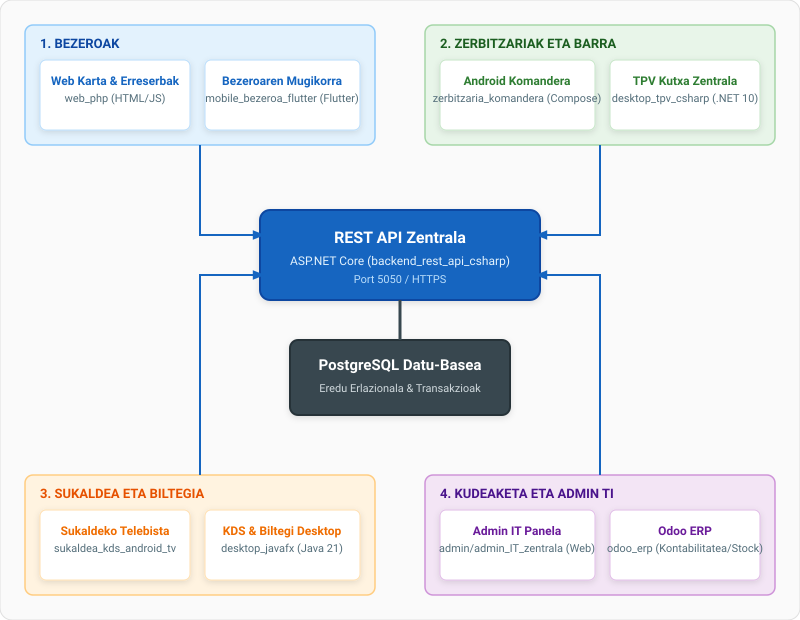

# Jatetxearen Kudeaketa Integrala: Proiektuaren Proposamena eta Eragileak

## 1. Proiektuaren Helburua eta Ikuspegi Orokorra

Dokumentu honek Jatetxearen Erronka Integraleko proposamen arkitektonikoa eta funtzionala laburbiltzen du. Soluzio honen helburua jatetxe baten eguneroko jardun osoa digitalizatzea eta automatizatzea da, bezeroak erreserba egiten duen unetik hasi eta hornitzaileen stocka kudeatu edota fakturazioa burutu arte.

Informazio guztia zentralizatuta dago backend API baten bidez (ASP.NET Core REST API), datu-base sendo baten gainean (PostgreSQL), eragiketa-fluxu bakoitzari dagokion interfaze espezifikoa eskainiz.

---

## 2. Eragileak (Rolak) eta Bakoitzaren Aplikazioak

Jatetxearen ekosisteman 6 erabiltzaile-rol nagusi identifikatu dira:

| Rola / Erabiltzailea        | Erabilitako Aplikazioak                                                                       | Plataforma / Teknologia                                             | Funtzio Nagusiak                                                                                                                   |
| :-------------------------- | :-------------------------------------------------------------------------------------------- | :------------------------------------------------------------------ | :--------------------------------------------------------------------------------------------------------------------------------- |
| **Bezeroak**                | Web-App (`web_php` / HTML-JS)Mugikorreko App-a (`mobile_bezeroa`)                             | Web (HTML5/JS/PHP)Android / iOS (Flutter)                           | Karta kontsultatu, alergenoen iragazketa, mahai erreserbak egin, auto-eskaerak bideratu eta faktura ikusi.                         |
| **Zerbitzariak (Jantokia)** | Komandera Mugikorra (`zerbitzaria_komandera_android`)Komandera Flutter (`mobile_zerbitzaria`) | Android Natiboa (Jetpack Compose)Multiplataforma (Flutter)          | Mahaien mapa eta okupazioa kudeatu, komandak jaso mahai ondoan, eskaerak sukaldera bidali eta kobraketak bideratu.                 |
| **Sukaldariak**             | Sukaldeko KDS Telebista (`sukaldea_kds_android_tv`)KDS Mahaigainekoa (`desktop_javafx`)       | Android TV (Leanback / Compose)Desktop (Java 21, JavaFX)            | Sukaldeko pantaila handian komandak denbora errealean jaso, plateren egoerak eguneratu (Prestatzen, Prest) eta lehengaiak gastatu. |
| **Barrakoa (Kutxazaina)**   | TPV Salmenta Puntua (`desktop_csharp`)                                                        | Windows Desktop (.NET 10 WinForms/WPF)                              | Barran zuzeneko salmentak erregistratu, tiketak eta fakturak inprimatu, kontuak kobratu eta mahaien egoera globala ikusi.          |
| **Biltegikoak**             | Biltegi Kudeatzailea (`desktop_javafx`)ERP Kudeaketa (`odoo_erp`)                             | Desktop (JavaFX MVC)Web ERP (Odoo)                                  | Lehengaien stocka kontrolatu, gutxieneko stock alertak aztertu, hornitzaileen albaranak jaso eta erosketa-zerrendak sortu.         |
| **Admin TI / Zuzendaritza** | TI Panela (`admin_IT_zentrala`)ERP / Finantzak (`odoo_erp`)Zentral API (`backend_api`)        | Web Dashboard (Angular / React / HTML)Odoo ERPASP.NET Core REST API | Langileen altak/bajak, baimenak (RBAC), azpiegitura birtualaren monitorizazioa, salmenta txostenak eta segurtasun-kopiak.          |

---

## 3. Aplikazioen Deskribapena

### 3.1. Bezeroen Interfazeak

- **Web-App (`01_aplikazioak/web_php`):** Jatetxearen atari publikoa. Bezeroak mahai-erreserbak egiteko aukera du, eguneko menua eta karta ikusi eta alergenoen araberako iragazketa egiteko. Stockik ez duten platerak automatikoki agortu gisa agertzen dira.
- **Mugikorreko Aplikazioa (`01_aplikazioak/mobile_bezeroa`):** Flutter bidez garatua, bezeroak bere gailutik mahai gaineko QR kodea eskaneatu eta eskaerak zuzenean bideratzeko aukera ematen du.

### 3.2. Zerbitzarien eta Jantokiaren Interfazeak

- **Komandera Android Natiboa (`01_aplikazioak/zerbitzaria_komandera_android`):** Jetpack Compose bidez sortua, telefono zein tablet tamainetara egokitzen den interfaze modernoa. Zerbitzariak mahaien egoera ikus dezake (Libre, Okupatua, Eskaerarekin), komandak platerka jaso, oharrak gehitu (adib. haragia puntuan) eta eskaera sukaldera igorri.
- **Multiplataforma Komandera (`01_aplikazioak/mobile_zerbitzaria`):** Flutter bidez egindako komandera alternatiboa.

### 3.3. Barrako eta Salmenta Puntuko Interfazea

- **C# .NET 10 Desktop TPV (`01_aplikazioak/desktop_csharp`):** Barran kokatutako ukipen-pantailarako terminal sendoa. Mahai bakoitzeko kontua ixtea, faktura zatituak kudeatzea, txartel/eskudiruzko kobraketak egitea eta eguneko itxiera ekonomikoa (Z kaxa) burutzea ahalbidetzen du.

### 3.4. Sukaldeko Interfazeak (KDS - Kitchen Display System)

- **Android TV KDS (`01_aplikazioak/sukaldea_kds_android_tv`):** Sukaldeko horman kokatutako telebista edo pantaila handirako pentsatua. Sartzen diren komandak txartel moduan bistaratzen ditu, lehentasunaren arabera ordenatuta eta denbora-markekin.
- **JavaFX KDS eta Biltegia (`01_aplikazioak/desktop_javafx`):** MVC arkitekturako mahaigaineko aplikazioa. Sukaldariek komandak ikusi eta "Prestatzen" edo "Bukatua" markatu ditzakete bertatik.

### 3.5. Biltegiko Interfazea

- **JavaFX Biltegi Modulua (`01_aplikazioak/desktop_javafx`):** Jatetxeko despentsa eta hozkailuetako stock errealaren jarraipena. Gutxieneko stocketik behera dauden lehengaiak gorriz nabarmentzen ditu eta hornitzaileentzako erosketa-proposamena automatikoki kalkulatzen du.
- **Odoo ERP integrazioa (`01_aplikazioak/odoo_erp`):** Erosketa-eskaera ofizialak, albaranak eta hornitzaileen fakturen kontabilitatea kudeatzeko.

### 3.6. Administrazioa eta TI Kudeaketa

- **Admin IT Zentrala (`01_aplikazioak/admin_IT_zentrala`):** Sistemaren administratzailearentzako kontrol-panela. Langileen kudeaketa (rolak, baimenak, PINak), jatetxeko gailuen monitorizazioa eta azpiegitura-zerbitzuen ikuskaritza ahalbidetzen ditu.
- **Backend REST API (`01_aplikazioak/backend_api`):** Aplikazio guztiei zerbitzua ematen dien nukleoa. Datu-basearekiko transakzio seguruak bermatzen ditu (stock deskontua, eskaera egoerak, balidazioak).

---

## 4. Azpiegitura Birtuala eta Segurtasuna

Proiektu honek bere azpiegitura birtual propioa du (`02_azpiegitura_birtuala/`), sare mailan isolamendu zorrotza bermatzen duena:

- **OPNsense Firewall:** Sareak segmentatzen ditu (Bezeroen Wi-Fi publikoa, Langileen sarea, eta Zerbitzarien DMZ / IT kudeaketa).
- **Docker Edukiontziak:** Sukaldeko zerbitzuak, APIa eta datu-basea modu arin eta errepikagarrian hedatzeko.
- **Active Directory / LDAP / RBAC:** Erabiltzaile bakoitzak bere profilari dagozkion datuak bakarrik ikus ditzakeela ziurtatuz.
