# 1T Jatetxea - Sistemaren Klase Diagrama Osoa (UML Class Diagram)

Dokumentu honek **1T Jatetxea Kudeaketa Sistema Osoaren Klase Diagrama (UML Class Diagram)** jasotzen du. Arkitektura modularra, 3 mailako egitura (Datu-basea, REST API zerbitzari zentrala, eta bezero-aplikazio anitzak: Admin Desktop, Sukaldea KDS, Barra BDS, Biltegia Stock, C# TPV eta Android Apps) eta domeinuko entitate guztien arteko erlazioak definitzen ditu.

---

## 1. Klase Diagrama Orokorra (Mermaid UML)

```mermaid
classDiagram
    direction TB

    %% ==========================================
    %% 1. DOMEINU ENTITATEAK / DATU-EREDUAK
    %% ==========================================
    class Langilea {
        +int id
        +string erabiltzailea
        +string izena
        +string abizena
        +string nanDni
        +string emaila
        +string telefonoa
        +string rola
        +string saila
        +string kargua
        +string pasahitzaHash
        +bool aktibo
        +bool ezabatua
        +getIzenOsoa() string
        +getInitialak() string
        +isManager() bool
    }

    class LangileKontratua {
        +int id
        +int langileaId
        +string kontratuZenbakia
        +string mota
        +string lanJarduna
        +DateTime hasieraData
        +DateTime amaieraData
        +decimal soldataGordina
        +string lanpostua
    }

    class LangileFitxaketa {
        +int id
        +int langileaId
        +DateTime sarreraData
        +DateTime irteeraData
        +decimal lanOrduak
        +string metodoa
        +string egoera
    }

    class LangileBaja {
        +int id
        +int langileaId
        +string mota
        +DateTime hasieraData
        +DateTime amaieraData
        +int egunKopurua
        +string egoera
    }

    class Mahaia {
        +int id
        +int zenbakia
        +int edukiera
        +string kokapena
        +string egoera
        +bool ezabatua
        +isLibre() bool
        +aldatuEgoera(string) void
    }

    class Erreserba {
        +int id
        +int mahaiaId
        +int bezeroaId
        +string bezeroIzena
        +string bezeroTelefonoa
        +int pertsonaKopurua
        +DateTime data
        +string txanda
        +string egoera
    }

    class Bezeroa {
        +int id
        +string izena
        +string abizena
        +string telefonoa
        +string emaila
        +int fidelizazioPuntuak
    }

    class Iritzia {
        +int id
        +int bezeroaId
        +int balorazioa
        +string testua
        +DateTime data
    }

    class Platera {
        +int id
        +string izena
        +string deskribapena
        +string kategoria
        +decimal prezioa
        +string alergenoak
        +bool aktibo
        +bool ezabatua
    }

    class Lehengaia {
        +int id
        +string izena
        +string unitatea
        +decimal unekoStocka
        +decimal gutxienekoStocka
        +decimal kostuUnitarioa
        +string hornitzailea
        +bool isStockAlerta() bool
    }

    class PlaterOsagaia {
        +int plateraId
        +int lehengaiaId
        +decimal kantitatea
        +string unitatea
    }

    class StockMugimendua {
        +int id
        +int lehengaiaId
        +string mota
        +decimal kantitatea
        +string albarana
        +DateTime data
        +string arrazoia
    }

    class Eskaera {
        +int id
        +int mahaiaId
        +int langileaId
        +string egoera
        +decimal guztira
        +DateTime sortzeData
        +bool ezabatua
        +kalkulatuGuztira() decimal
        +aldatuEgoera(string) void
    }

    class EskaeraLerroa {
        +int id
        +int eskaeraId
        +int plateraId
        +int kantitatea
        +decimal prezioUnitarioa
        +string egoera
        +string oharrak
        +getSubtotala() decimal
    }

    class Ordainketa {
        +int id
        +int eskaeraId
        +int fakturaId
        +string tiketZenbakia
        +string mota
        +decimal zenbatekoa
        +string operazioKodea
        +string egoera
        +DateTime data
    }

    class Faktura {
        +int id
        +int eskaeraId
        +string fakturaZenbakia
        +string mota
        +string azpimota
        +string kontzeptua
        +string hornitzailea
        +string hornitzaileCif
        +string bezeroNif
        +string bezeroIzena
        +string bezeroHelbidea
        +decimal oinarriZergagarria
        +decimal bezEhunekoa
        +decimal bezZenbatekoa
        +decimal guztira
        +string ordainketaMetodoa
        +string egoera
        +DateTime data
        +kalkulatuBez() void
    }

    %% ==========================================
    %% 2. BACKEND / KONTROLADOREAK (ASP.NET Core)
    %% ==========================================
    class BaseApiKontroladorea {
        #IConfiguration _config
        #SortuKonexioaAsync() MySqlConnection
        #Success(data) IActionResult
        #SuccessList(datalist) IActionResult
        #CreatedResult(data) IActionResult
        #NotFoundError(detail) IActionResult
        #BadRequestError(message) IActionResult
    }

    class FakturakController {
        +LortuGuztiak(mota, egoera) Task~IActionResult~
        +LortuIdBidez(id) Task~IActionResult~
        +LortuFinantzaLaburpena() Task~IActionResult~
        +Sortu(dto) Task~IActionResult~
        +EguneratuEgoera(id, dto) Task~IActionResult~
        +Ezabatu(id, hard) Task~IActionResult~
    }

    class EskaerakController {
        +LortuGuztiak() Task~IActionResult~
        +Sortu(dto) Task~IActionResult~
        +EguneratuEgoera(id, dto) Task~IActionResult~
    }

    class LangileakController {
        +LortuGuztiak() Task~IActionResult~
        +SaioaHasi(dto) Task~IActionResult~
        +Sortu(dto) Task~IActionResult~
    }

    class LehengaiakController {
        +LortuGuztiak() Task~IActionResult~
        +ErosketaSarrera(dto) Task~IActionResult~
        +LortuAlertak() Task~IActionResult~
    }

    class MahaiakController {
        +LortuGuztiak() Task~IActionResult~
        +AldatuEgoera(id, dto) Task~IActionResult~
    }

    class AplikazioMonitoreZerbitzua {
        -ConcurrentDictionary Apps
        +IdentifikatuAplikazioa(context) string
        +ErregistratuEskaera(appId, ip, bidea) void
        +ErregistratuErabiltzailea(appId, izena) void
        +LortuEgoeraLaburpena() object
    }

    %% ==========================================
    %% 3. ADMIN DESKTOP JAVA (JavaFX Kudeaketa)
    %% ==========================================
    class ApiBezeroa {
        -string baseUrl
        -HttpClient httpClient
        +checkHealth() ApiHealth
        +login(erab, pass) KudeatzaileErabiltzailea
        +getFakturak(mota) List~Faktura~
        +getFinantzaLaburpena() FinantzaLaburpena
        +sortuFaktura(body) void
        +aldatuFakturaEgoera(id, egoera) void
    }

    class DiseinuNagusiaKontrolagailua {
        -ApiBezeroa apiClient
        -KudeatzaileSaioa session
        +showDashboard() void
        +showStaff() void
        +showMenu() void
        +showIngredients() void
        +showTables() void
        +showInvoices() void
    }

    class FakturakKontrolagailua {
        -ApiBezeroa apiClient
        -ObservableList masterList
        +refresh() void
        +saveInvoice() void
        +markAsPaid() void
        +markAsCancelled() void
    }

    %% ==========================================
    %% 4. MAHAIGEINEKO / LANGILEEN BEZEROAK
    %% ==========================================
    class ApiZerbitzua {
        -string BASE_URL
        -HttpClient bezeroa
        +egiaztatuOsasuna() HealthResult
        +lortuLangileak() List~Langilea~
        +saioaHasi(erab, pin) LoginErantzuna
        +lortuEskaeraAktiboak() List~Eskaera~
        +lortuLehengaiak() List~Lehengaia~
    }

    class BaseLoginController {
        #ApiZerbitzua api
        #Langilea aukeratutakoLangilea
        +kargatuLangileak() void
        +onLoginClick() void
    }

    %% ==========================================
    %% ERLAZIOAK (RELATIONSHIPS)
    %% ==========================================
    %% Giza Baliabideak
    Langilea "1" *-- "0..*" LangileKontratua : dauka
    Langilea "1" *-- "0..*" LangileFitxaketa : erregistratzen du
    Langilea "1" *-- "0..*" LangileBaja : eskatzen du
    Langilea "1" --> "0..*" Eskaera : kudeatzen du

    %% Eskaerak, Mahaiak eta Bezeroak
    Mahaia "1" o-- "0..*" Eskaera : esleitzen da
    Mahaia "1" o-- "0..*" Erreserba : erreserbatzen du
    Bezeroa "1" --> "0..*" Erreserba : egiten du
    Bezeroa "1" --> "0..*" Iritzia : idazten du

    %% Eskaerak eta Lerroak (Konposizioa)
    Eskaera "1" *-- "1..*" EskaeraLerroa : osatzen du
    Platera "1" <-- "0..*" EskaeraLerroa : erreferentziatzen du

    %% Errezetak eta Lehengaiak
    Platera "1" *-- "1..*" PlaterOsagaia : osagaiak ditu
    Lehengaia "1" <-- "0..*" PlaterOsagaia : erabiltzen da
    Lehengaia "1" *-- "0..*" StockMugimendua : mugimenduak ditu

    %% Fakturazioa eta Ordainketak (1:1 eta 1:N)
    Eskaera "0..1" <-- "1" Faktura : sortzen da
    Faktura "1" *-- "0..*" Ordainketa : ordaintzen du
    Eskaera "1" *-- "0..*" Ordainketa : zuzenean ordaindua

    %% Backend eta Zerbitzuak
    BaseApiKontroladorea <|-- FakturakController
    BaseApiKontroladorea <|-- EskaerakController
    BaseApiKontroladorea <|-- LangileakController
    BaseApiKontroladorea <|-- LehengaiakController
    BaseApiKontroladorea <|-- MahaiakController

    FakturakController ..> Faktura : kudeatzen du
    EskaerakController ..> Eskaera : kudeatzen du
    LehengaiakController ..> Lehengaia : kudeatzen du

    %% Frontend Arkitektura
    DiseinuNagusiaKontrolagailua --> ApiBezeroa : erabiltzen du
    DiseinuNagusiaKontrolagailua ..> FakturakKontrolagailua : nabigatzen du
    FakturakKontrolagailua --> ApiBezeroa : deitzen du
    FakturakKontrolagailua ..> Faktura : bistaratzen du

    BaseLoginController --> ApiZerbitzua : erabiltzen du
```

---

## 2. Arkitekturaren Mailak eta Klaseen Deskribapena

### A. Datu-eredu Nagusiak (Domain Models)
1. **Faktura**: Salmenta eta erosketa fakturak kudeatzen dituen entitate zentrala. Oinarri zergagarria, BEZ mota (%10, %21), guztizkoa, ordainbidea eta egoera gordetzen ditu.
2. **Eskaera & EskaeraLerroa**: Jatetxeko komanda osoa eta plater bakoitzaren egoera (Irekia, Sukaldean, Prestatua, Zerbitzatua, Kobratua).
3. **Platera & Lehengaia & PlaterOsagaia**: Errezeta eta eskandailuen egitura. Plater bakoitzak behar dituen lehengaiak definitzen ditu.
4. **Langilea, Kontratua, Fitxaketa & Baja**: Giza baliabideen eta segurtasunaren kudeaketa integrala.
5. **Mahaia & Erreserba**: Aretoaren denbora errealeko kontrola.

### B. REST API Zerbitzari Maila (ASP.NET Core)
- **BaseApiKontroladorea**: Erantzun estandarizatuak (`ApiResponse<T>`, `ApiError`) eta datu-base konexioak kudeatzen dituen klase abstraktua.
- **FakturakController**: Finantzen, salmenta eta hornitzaile-gastuen endpoint guztiak (`/api/v1/fakturak`, `/api/v1/fakturak/laburpena`).
- **AplikazioMonitoreZerbitzua**: Konektatutako bezeroak (Admin, Sukaldea, Barra, Biltegia, Jangela) denbora errealean monitorizatzeko zerbitzua.

### C. Mahaigaineko Kudeaketa (Admin JavaFX)
- **ApiBezeroa**: HTTP/2 bezero modernoa JSON komunikazio asinkronorako.
- **DiseinuNagusiaKontrolagailua & FakturakKontrolagailua**: Kudeatzailearen lan-eremua, irabazi/gastuen finantza-panela eta fakturen sorkuntza.

---

## 3. Erlazio Mota Nagusiak (UML Semantika)

- **Konposizioa (`*--`)**: Bizitza-ziklo lotua duten elementuak (adibidez, `Eskaera` ezabatzean bere `EskaeraLerroa` guztiak desagertzen dira; `Platera` eta bere `PlaterOsagaia`).
- **Agregazioa (`o--`)**: Bizitza-ziklo independentea duten elementuak (adibidez, `Mahaia` existitzen jarraitzen du `Eskaera` bukatu ondoren ere).
- **Herentzia (`<|--`)**: Kontroladore guztiek `BaseApiKontroladorea` hedatzen dute DRY printzipioa betez.
- **Mendekotasuna (`..>`)**: Zerbitzuek eta bezeroek datu-ereduak erabiltzen dituzte trukeetarako.
