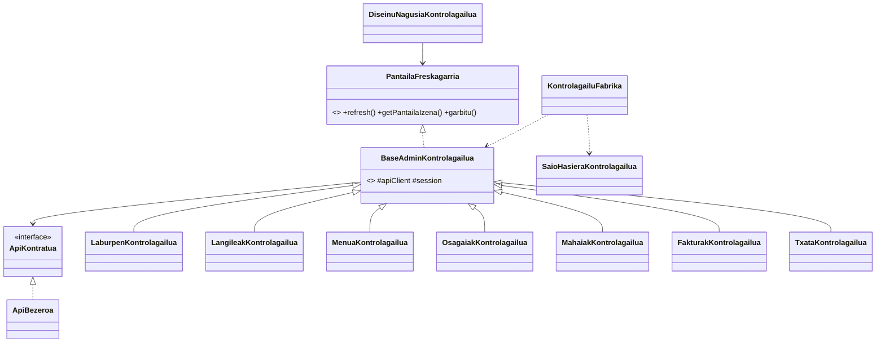
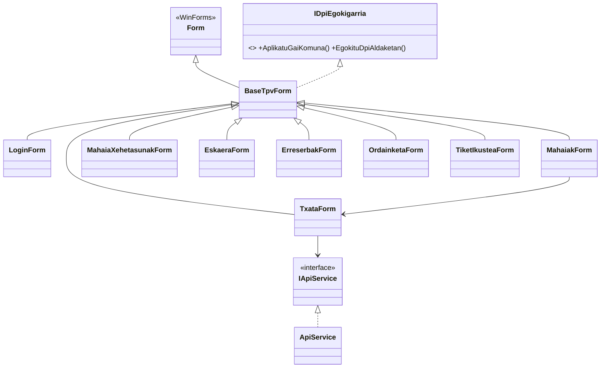

# 1T Jatetxea - Sistemaren Klase Diagrama Osoa (UML Class Diagram)

Dokumentu honek **1T Jatetxea Kudeaketa Sistema Osoaren Klase Diagrama (UML Class Diagram)** jasotzen du. Arkitektura modularra, 3 mailako egitura (Datu-basea, REST API zerbitzari zentrala, eta bezero-aplikazio anitzak: Admin Desktop, Sukaldea KDS, Barra BDS, Biltegia Stock, C# TPV eta Android Apps) eta domeinuko entitate guztien arteko erlazioak definitzen ditu.

---

## 1. Klase Diagrama Orokorra (Mermaid UML)

```mermaid
classDiagram
    direction TB

    %% ==========================================
    %% 1. GIZA BALIABIDEAK ETA LANGILEAK
    %% ==========================================
    class Langilea {
        + id: int
        + erabiltzailea: string
        + izena: string
        + abizena: string
        + nanDni: string
        + emaila: string
        + telefonoa: string
        + rola: string
        + saila: string
        + kargua: string
        + pasahitzaHash: string
        + aktibo: bool
        + ezabatua: bool
        +getIzenOsoa() string
        +getInitialak() string
        +isManager() bool
        +egiaztatuPin(pin: string) bool
        +aldatuAktibo(egoera: bool) void
    }

    class LangileKontratua {
        + id: int
        + langileaId: int
        + kontratuZenbakia: string
        + mota: string
        + lanJarduna: string
        + hasieraData: DateTime
        + amaieraData: DateTime?
        + soldataGordina: decimal
        + lanpostua: string
        +isIndarrean() bool
        +kalkulatuHilekoSoldataGarbia() decimal
        +lortuIraupenaHilabeteetan() int
    }

    class LangileFitxaketa {
        + id: int
        + langileaId: int
        + sarreraData: DateTime
        + irteeraData: DateTime?
        + lanOrduak: decimal
        + metodoa: string
        + egoera: string
        +kalkulatuLanOrduak() decimal
        +amaituTxanda(irteera: DateTime) void
        +isIreki() bool
    }

    class LangileBaja {
        + id: int
        + langileaId: int
        + mota: string
        + hasieraData: DateTime
        + amaieraData: DateTime?
        + egunKopurua: int
        + egoera: string
        +isAktibo() bool
        +kalkulatuEgunak() int
        +itxiBaja(altaData: DateTime) void
    }

    %% ==========================================
    %% 2. ARETOA, MAHAIAK, ERRESERBAK ETA BEZEROAK
    %% ==========================================
    class Mahaia {
        + id: int
        + zenbakia: int
        + edukiera: int
        + kokapena: string
        + egoera: string
        + ezabatua: bool
        +isLibre() bool
        +aldatuEgoera(berria: string) void
        +okupatu() void
        +askatu() void
    }

    class Erreserba {
        + id: int
        + mahaiaId: int
        + bezeroaId: int?
        + bezeroIzena: string
        + bezeroTelefonoa: string
        + pertsonaKopurua: int
        + data: DateTime
        + txanda: string
        + egoera: string
        +konfirmatu() void
        +ezeztatu() void
        +esleituMahaia(mahaiaId: int) void
        +isGaurkoa() bool
    }

    class Bezeroa {
        + id: int
        + izena: string
        + abizena: string
        + telefonoa: string
        + emaila: string
        + fidelizazioPuntuak: int
        +getIzenOsoa() string
        +gehituPuntuak(kopurua: int) void
        +erabiliPuntuak(kopurua: int) bool
    }

    class Iritzia {
        + id: int
        + bezeroaId: int
        + balorazioa: int
        + testua: string
        + data: DateTime
        +getIzarrak() string
        +isPositiboa() bool
    }

    %% ==========================================
    %% 3. ESKAERAK, FAKTURAK ETA FINANTZAK
    %% ==========================================
    class Eskaera {
        + id: int
        + mahaiaId: int
        + langileaId: int
        + egoera: string
        + guztira: decimal
        + sortzeData: DateTime
        + ezabatua: bool
        +kalkulatuGuztira() decimal
        +aldatuEgoera(berria: string) void
        +gehituLerroa(lerroa: EskaeraLerroa) void
        +kenduLerroa(lerroId: int) void
        +itxiEskaera() void
    }

    class EskaeraLerroa {
        + id: int
        + eskaeraId: int
        + plateraId: int
        + kantitatea: int
        + prezioUnitarioa: decimal
        + egoera: string
        + oharrak: string
        +getSubtotala() decimal
        +aldatuEgoera(berria: string) void
        +isSukaldean() bool
        +isZerbitzatuta() bool
    }

    class Ordainketa {
        + id: int
        + eskaeraId: int
        + fakturaId: int?
        + tiketZenbakia: string
        + mota: string
        + zenbatekoa: decimal
        + operazioKodea: string
        + egoera: string
        + data: DateTime
        +prozesatuOrdainketa() bool
        +inprimatuTiketa() string
        +ezeztatuOrdainketa() void
    }

    class Faktura {
        + id: int
        + eskaeraId: int?
        + fakturaZenbakia: string
        + mota: string
        + azpimota: string
        + kontzeptua: string
        + hornitzailea: string
        + hornitzaileCif: string
        + bezeroNif: string
        + bezeroIzena: string
        + bezeroHelbidea: string
        + oinarriZergagarria: decimal
        + bezEhunekoa: decimal
        + bezZenbatekoa: decimal
        + guztira: decimal
        + ordainketaMetodoa: string
        + egoera: string
        + data: DateTime
        +kalkulatuBez() void
        +kalkulatuGuztira() decimal
        +markatuOrdainduta() void
        +isSalmenta() bool
        +isErosketa() bool
        +sortuPDF() byte[]
    }

    %% ==========================================
    %% 4. SUKALDEA, KARTA ETA STOCK BILTEGIA
    %% ==========================================
    class Platera {
        + id: int
        + izena: string
        + deskribapena: string
        + kategoria: string
        + prezioa: decimal
        + alergenoak: string
        + aktibo: bool
        + ezabatua: bool
        +kalkulatuKostua(osagaiak: List) decimal
        +aldatuAktibo(egoera: bool) void
        +dituAlergenoa(alergenoa: string) bool
    }

    class PlaterOsagaia {
        + plateraId: int
        + lehengaiaId: int
        + kantitatea: decimal
        + unitatea: string
        +kalkulatuKostua(kostuUnitarioa: decimal) decimal
    }

    class Lehengaia {
        + id: int
        + izena: string
        + unitatea: string
        + unekoStocka: decimal
        + gutxienekoStocka: decimal
        + kostuUnitarioa: decimal
        + hornitzailea: string
        +isStockAlerta() bool
        +eguneratuStocka(kantitatea: decimal, sarrera: bool) void
        +kalkulatuBalioTotala() decimal
    }

    class StockMugimendua {
        + id: int
        + lehengaiaId: int
        + mota: string
        + kantitatea: decimal
        + albarana: string
        + data: DateTime
        + arrazoia: string
        +isSarrera() bool
        +isIrteera() bool
        +lortuXehetasunak() string
    }

    %% ==========================================
    %% 5. REST API ZERBITZARIA (ASP.NET CORE C# CONTROLLERS & SERVICES)
    %% ==========================================
    class BaseApiKontroladorea {
        # _config: IConfiguration
        +SortuKonexioaAsync() Task<MySqlConnection~
        +Success(data: object) IActionResult
        +SuccessList(datalist: IEnumerable) IActionResult
        +CreatedResult(data: object) IActionResult
        +NotFoundError(detail: string) IActionResult
        +BadRequestError(message: string) IActionResult
        +ConflictError(message: string) IActionResult
        +ServerError(message: string) IActionResult
    }

    class FakturakController {
        +LortuGuztiak(mota, egoera) Task~IActionResult~
        +LortuIdBidez(id: int) Task~IActionResult~
        +LortuFinantzaLaburpena() Task~IActionResult~
        +Sortu(dto: FakturaSortuDto) Task~IActionResult~
        +EguneratuEgoera(id: int, dto: FakturaEgoeraDto) Task~IActionResult~
        +Ezabatu(id: int, hard: bool) Task~IActionResult~
    }

    class EskaerakController {
        +LortuGuztiak(egoera, mahaiaId) Task~IActionResult~
        +LortuIdBidez(id: int) Task~IActionResult~
        +Sortu(dto: EskaeraSortuDto) Task~IActionResult~
        +EguneratuEgoera(id: int, dto: EskaeraEgoeraDto) Task~IActionResult~
        +BidaliSukaldera(id: int) Task~IActionResult~
        +EzabatuPlaterLerroa(lerroId: int) Task~IActionResult~
    }

    class LangileakController {
        +LortuGuztiak(rola: string) Task~IActionResult~
        +SaioaHasi(dto: SaioHasiDto) Task~IActionResult~
        +Sortu(dto: LangileSortuDto) Task~IActionResult~
        +Eguneratu(id: int, dto: LangileEguneratuDto) Task~IActionResult~
        +FitxaketaErregistratu(dto: FitxaketaDto) Task~IActionResult~
    }

    class LehengaiakController {
        +LortuGuztiak() Task~IActionResult~
        +ErosketaSarrera(dto: ErosketaDto) Task~IActionResult~
        +LortuAlertak() Task~IActionResult~
        +LortuMugimenduak(lehengaiaId: int) Task~IActionResult~
    }

    class MahaiakController {
        +LortuGuztiak() Task~IActionResult~
        +LortuIdBidez(id: int) Task~IActionResult~
        +AldatuEgoera(id: int, dto: MahaiEgoeraDto) Task~IActionResult~
        +LortuMahaiarenEskaeraAktiboa(id: int) Task~IActionResult~
    }

    class AplikazioMonitoreZerbitzua {
        - _apps: ConcurrentDictionary
        +IdentifikatuAplikazioa(context: HttpContext) string
        +ErregistratuEskaera(appId, ip, endpoint) void
        +ErregistratuErabiltzailea(appId, izena) void
        +LortuEgoeraLaburpena() object
        +GarbituKonexioZaharrak() void
    }

    %% ==========================================
    %% 6. BEZERO APLIKAZIOAK (JAVAFX ADMIN & TERMINALAK)
    %% ==========================================
    class ApiBezeroa {
        - baseUrl: string
        - httpClient: HttpClient
        +checkHealth() ApiHealth
        +login(erab: string, pass: string) KudeatzaileErabiltzailea
        +getFakturak(mota, egoera) List~Faktura~
        +getFinantzaLaburpena() FinantzaLaburpena
        +sortuFaktura(faktura: Faktura) void
        +aldatuFakturaEgoera(id, egoera) void
        +getStaff() List~Langilea~
        +getMenuItems() List~Platera~
        +getIngredients() List~Lehengaia~
    }

    class DiseinuNagusiaKontrolagailua {
        - apiClient: ApiBezeroa
        - session: KudeatzaileSaioa
        +showDashboard() void
        +showStaff() void
        +showMenu() void
        +showIngredients() void
        +showTables() void
        +showInvoices() void
        +handleLogout() void
    }

    class FakturakKontrolagailua {
        - apiClient: ApiBezeroa
        - masterList: ObservableList<Faktura>
        +initialize() void
        +refresh() void
        +filterByType(mota: string) void
        +filterByStatus(egoera: string) void
        +saveInvoice() void
        +markAsPaid() void
        +markAsCancelled() void
        +updateKpiCards(laburpena) void
    }

    class ApiZerbitzua {
        - BASE_URL: string
        - bezeroa: HttpClient
        +egiaztatuOsasuna() HealthResult
        +lortuLangileak(rola: string) List~Langilea~
        +saioaHasi(erab, pin) LoginErantzuna
        +lortuEskaeraAktiboak() List~Eskaera~
        +eguneratuLerroEgoera(lerroId, egoera) bool
        +lortuLehengaiak() List~Lehengaia~
    }

    class BaseLoginController {
        # api: ApiZerbitzua
        # aukeratutakoLangilea: Langilea
        +kargatuLangileak() void
        +onLangileaSelected(langilea) void
        +onPinDigit(digitoa: int) void
        +onClearPin() void
        +onLoginClick() void
    }

    %% ==========================================
    %% ERLAZIOAK (RELATIONSHIPS)
    %% ==========================================
    Langilea "1" *-- "0..*" LangileKontratua : dauka
    Langilea "1" *-- "0..*" LangileFitxaketa : erregistratzen du
    Langilea "1" *-- "0..*" LangileBaja : eskatzen du
    Langilea "1" --> "0..*" Eskaera : kudeatzen du

    Mahaia "1" o-- "0..*" Eskaera : esleitzen da
    Mahaia "1" o-- "0..*" Erreserba : erreserbatzen du
    Bezeroa "1" --> "0..*" Erreserba : egiten du
    Bezeroa "1" --> "0..*" Iritzia : idazten du

    Eskaera "1" *-- "1..*" EskaeraLerroa : osatzen du
    Platera "1" <-- "0..*" EskaeraLerroa : erreferentziatzen du

    Platera "1" *-- "1..*" PlaterOsagaia : osagaiak ditu
    Lehengaia "1" <-- "0..*" PlaterOsagaia : erabiltzen da
    Lehengaia "1" *-- "0..*" StockMugimendua : mugimenduak ditu

    Eskaera "0..1" <-- "1" Faktura : sortzen da
    Faktura "1" *-- "0..*" Ordainketa : ordaintzen du
    Eskaera "1" *-- "0..*" Ordainketa : zuzenean ordaindua

    BaseApiKontroladorea <|-- FakturakController
    BaseApiKontroladorea <|-- EskaerakController
    BaseApiKontroladorea <|-- LangileakController
    BaseApiKontroladorea <|-- LehengaiakController
    BaseApiKontroladorea <|-- MahaiakController

    FakturakController ..> Faktura : kudeatzen du
    EskaerakController ..> Eskaera : kudeatzen du
    LehengaiakController ..> Lehengaia : kudeatzen du

    DiseinuNagusiaKontrolagailua --> ApiBezeroa : erabiltzen du
    DiseinuNagusiaKontrolagailua ..> FakturakKontrolagailua : nabigatzen du
    FakturakKontrolagailua --> ApiBezeroa : deitzen du
    FakturakKontrolagailua ..> Faktura : bistaratzen du

    BaseLoginController --> ApiZerbitzua : erabiltzen du
```

---

## 2. Arkitekturaren Mailak eta Klaseen Deskribapena

### A. Datu-eredu Nagusiak (Domain Models)
1. **Faktura**: Salmenta eta erosketa fakturak kudeatzen dituen entitate zentrala. Oinarri zergagarria, BEZ mota (%10, %21), guztizkoa, ordainbidea eta egoera gordetzen ditu.
2. **Eskaera & EskaeraLerroa**: Jatetxeko komanda osoa eta plater bakoitzaren egoera (Irekia, Sukaldean, Prestatua, Zerbitzatua, Kobratua).
3. **Platera & Lehengaia & PlaterOsagaia**: Errezeta eta eskandailuen egitura. Plater bakoitzak behar dituen lehengaiak definitzen ditu.
4. **Langilea, Kontratua, Fitxaketa & Baja**: Giza baliabideen eta segurtasunaren kudeaketa integrala.
5. **Mahaia & Erreserba**: Aretoaren denbora errealeko kontrola.

### B. REST API Zerbitzari Maila (ASP.NET Core)
- **BaseApiKontroladorea**: Erantzun estandarizatuak (`ApiResponse<T>`, `ApiError`) eta datu-base konexioak kudeatzen dituen klase abstraktua.
- **FakturakController**: Finantzen, salmenta eta hornitzaile-gastuen endpoint guztiak (`/api/v1/fakturak`, `/api/v1/fakturak/laburpena`).
- **AplikazioMonitoreZerbitzua**: Konektatutako bezeroak (Admin, Sukaldea, Barra, Biltegia, Jangela) denbora errealean monitorizatzeko zerbitzua.

### C. Mahaigaineko Kudeaketa (Admin JavaFX)
- **ApiBezeroa**: HTTP/2 bezero modernoa JSON komunikazio asinkronorako.
- **DiseinuNagusiaKontrolagailua & FakturakKontrolagailua**: Kudeatzailearen lan-eremua, irabazi/gastuen finantza-panela eta fakturen sorkuntza.

---

## 3. Erlazio Mota Nagusiak (UML Semantika)

- **Konposizioa (`*--`)**: Bizitza-ziklo lotua duten elementuak (adibidez, `Eskaera` ezabatzean bere `EskaeraLerroa` guztiak desagertzen dira; `Platera` eta bere `PlaterOsagaia`).
- **Agregazioa (`o--`)**: Bizitza-ziklo independentea duten elementuak (adibidez, `Mahaia` existitzen jarraitzen du `Eskaera` bukatu ondoren ere).
- **Herentzia (`<|--`)**: Kontroladore guztiek `BaseApiKontroladorea` hedatzen dute DRY printzipioa betez.
- **Mendekotasuna (`..>`)**: Zerbitzuek eta bezeroek datu-ereduak erabiltzen dituzte trukeetarako.

---

## 4. Sistemako Klase eta Metodo Guztien Zerrenda eta Azalpen Osoa

Jarraian, sistemako klase bakoitzean txertatutako **metodo guztien zerrenda zehatza** aurkezten da, bakoitzaren itzulera mota eta azalpen funtzionalarekin:

### 1. GIZA BALIABIDEAK ETA LANGILEAK

| Klasea | Metodoa eta Parametroak | Itzulerako Datu-Mota | Azalpena eta Helburua |
| :--- | :--- | :--- | :--- |
| **Langilea** | `getIzenOsoa()` | `string` | Langilearen izen-abizen osoa kateatuta itzultzen du bistaratzeko. |
| **Langilea** | `getInitialak()` | `string` | Avatarretan eta zerrendetan bistaratzeko inicialak sortzen ditu (adib. 'JD'). |
| **Langilea** | `isManager()` | `bool` | Langileak kudeatzaile edo admin baimenak dituen egiaztatzen du. |
| **Langilea** | `egiaztatuPin(pin: string)` | `bool` | Saioa hastean sartutako 4 digituko PIN zenbakia egiaztatzen du. |
| **Langilea** | `aldatuAktibo(egoera: bool)` | `void` | Langilearen egoera aldatzen du (aktibo / baja / desgaituta). |
| **LangileKontratua** | `isIndarrean()` | `bool` | Kontratua gaur egungo datan indarrean dagoen egiaztatzen du. |
| **LangileKontratua** | `kalkulatuHilekoSoldataGarbia()` | `decimal` | Kenkari fiskal estimatuak aplikatuz hileko soldata garbia kalkulatzen du. |
| **LangileKontratua** | `lortuIraupenaHilabeteetan()` | `int` | Kontratuaren iraupena hilabetetan itzultzen du. |
| **LangileFitxaketa** | `kalkulatuLanOrduak()` | `decimal` | Sarrera eta irteera arteko ordu errealak kalkulatzen ditu. |
| **LangileFitxaketa** | `amaituTxanda(irteera: DateTime)` | `void` | Txandaren amaiera erregistratzen du eta orduak ixten ditu. |
| **LangileFitxaketa** | `isIreki()` | `bool` | Fitxaketa oraindik amaitu gabe dagoen aztertzen du. |
| **LangileBaja** | `isAktibo()` | `bool` | Baja medikoa une honetan aktibo dagoen egiaztatzen du. |
| **LangileBaja** | `kalkulatuEgunak()` | `int` | Bajaren iraupen egun osoak kalkulatzen ditu. |
| **LangileBaja** | `itxiBaja(altaData: DateTime)` | `void` | Mediku-alta jasotzean baja ixten du. |

### 2. ARETOA, MAHAIAK, ERRESERBAK ETA BEZEROAK

| Klasea | Metodoa eta Parametroak | Itzulerako Datu-Mota | Azalpena eta Helburua |
| :--- | :--- | :--- | :--- |
| **Mahaia** | `isLibre()` | `bool` | Mahaia libre dagoen eta bezero berriak har ditzakeen egiaztatzen du. |
| **Mahaia** | `aldatuEgoera(berria: string)` | `void` | Mahaiaren egoera aldatzen du (Libre, Okupatuta, Erreserbatuta). |
| **Mahaia** | `okupatu()` | `void` | Mahaia okupatuta egoerara pasatzen du bezeroak esertzean. |
| **Mahaia** | `askatu()` | `void` | Mahaia libre egoerara bueltatzen du kontua ordaintzean. |
| **Erreserba** | `konfirmatu()` | `void` | Erreserba baieztatu egoerara pasatzen du. |
| **Erreserba** | `ezeztatu()` | `void` | Bezeroak deitzean erreserba baliogabetzen du. |
| **Erreserba** | `esleituMahaia(mahaiaId: int)` | `void` | Erreserbari aretoko mahai jakin bat esleitzen dio. |
| **Erreserba** | `isGaurkoa()` | `bool` | Erreserba gaurko datari dagokion egiaztatzen du. |
| **Bezeroa** | `getIzenOsoa()` | `string` | Bezeroaren izen eta abizena kateatuta itzultzen du. |
| **Bezeroa** | `gehituPuntuak(kopurua: int)` | `void` | Erosketarekin fidelizazio puntu berriak gehitzen ditu. |
| **Bezeroa** | `erabiliPuntuak(kopurua: int)` | `bool` | Puntuak deskontuengatik trukatzen ditu baldin eta nahikoa saldo badu. |
| **Iritzia** | `getIzarrak()` | `string` | Balorazio zenbakiduna izar formatu grafikoan itzultzen du (adib. '★★★★☆'). |
| **Iritzia** | `isPositiboa()` | `bool` | Balorazioa 4 edo 5 izarrekoa den aztertzen du iritzi positiboak nabarmentzeko. |

### 3. ESKAERAK, FAKTURAK ETA FINANTZAK

| Klasea | Metodoa eta Parametroak | Itzulerako Datu-Mota | Azalpena eta Helburua |
| :--- | :--- | :--- | :--- |
| **Eskaera** | `kalkulatuGuztira()` | `decimal` | Lerro guztien azpitotalak batzen ditu eskaeraren zenbateko osoa kalkulatuz. |
| **Eskaera** | `aldatuEgoera(berria: string)` | `void` | Eskaeraren egoera aldatzen du (Irekia, Sukaldean, Prestatua, Zerbitzatua, Kobratua). |
| **Eskaera** | `gehituLerroa(lerroa: EskaeraLerroa)` | `void` | Plater berri bat gehitzen dio eskaerari. |
| **Eskaera** | `kenduLerroa(lerroId: int)` | `void` | Plater lerro bat ezabatu eta stocka berreskuratzen du. |
| **Eskaera** | `itxiEskaera()` | `void` | Eskaera kobratu eta itxi egiten du. |
| **EskaeraLerroa** | `getSubtotala()` | `decimal` | Kantitatea bider prezio unitarioa kalkulatzen du. |
| **EskaeraLerroa** | `aldatuEgoera(berria: string)` | `void` | Plateraren egoera eguneratzen du (Eskatua, Sukaldean, Prestatua, Zerbitzatua). |
| **EskaeraLerroa** | `isSukaldean()` | `bool` | Platera sukaldean prestatzen ari den egiaztatzen du. |
| **EskaeraLerroa** | `isZerbitzatuta()` | `bool` | Platera mahaira zerbitzatu den egiaztatzen du. |
| **Ordainketa** | `prozesatuOrdainketa()` | `bool` | Ordainketa transakzioa (eskudirua, txartela, bizum) balidatu eta burutzen du. |
| **Ordainketa** | `inprimatuTiketa()` | `string` | TPVrako tiket sinplifikatuaren testua prestatzen du. |
| **Ordainketa** | `ezeztatuOrdainketa()` | `void` | Ordainketa baliogabetu eta egoera ezeztatzat jotzen du. |
| **Faktura** | `kalkulatuBez()` | `void` | Oinarri zergagarriari dagokion BEZ zenbatekoa kalkulatzen du (%10 edo %21). |
| **Faktura** | `kalkulatuGuztira()` | `decimal` | Oinarria eta BEZ zenbatekoa batuz guztirakoa kalkulatzen du. |
| **Faktura** | `markatuOrdainduta()` | `void` | Faktura ordaindutzat markatzen du finantza erregistroan. |
| **Faktura** | `isSalmenta()` | `bool` | Bezeroen salmenta-faktura den egiaztatzen du (diru-sarrera). |
| **Faktura** | `isErosketa()` | `bool` | Hornitzaileen gastu-faktura den egiaztatzen du (gastua). |
| **Faktura** | `sortuPDF()` | `byte[]` | Fakturaren legezko formatu inprimagarria sortzen du. |

### 4. SUKALDEA, KARTA ETA STOCK BILTEGIA

| Klasea | Metodoa eta Parametroak | Itzulerako Datu-Mota | Azalpena eta Helburua |
| :--- | :--- | :--- | :--- |
| **Platera** | `kalkulatuKostua(osagaiak: List)` | `decimal` | Errezetako lehengaien kostu unitarioen bidez plateraren eskandalloa kalkulatzen du. |
| **Platera** | `aldatuAktibo(egoera: bool)` | `void` | Platera kartan eskuragarri edo desgaituta ezartzen du. |
| **Platera** | `dituAlergenoa(alergenoa: string)` | `bool` | Platerak alergeno jakin bat (glutena, laktosa...) duen egiaztatzen du. |
| **PlaterOsagaia** | `kalkulatuKostua(kostuUnitarioa: decimal)` | `decimal` | Osagai honen errezetako zatiaren kostu partziala kalkulatzen du. |
| **Lehengaia** | `isStockAlerta()` | `bool` | Uneko stocka gutxieneko muga baino baxuagoa den aztertzen du alerta aktibatzeko. |
| **Lehengaia** | `eguneratuStocka(kantitatea: decimal, sarrera: bool)` | `void` | Kontsumo edo erosketengatik uneko stocka handitu edo txikitzen du. |
| **Lehengaia** | `kalkulatuBalioTotala()` | `decimal` | Biltegiko stockaren balio ekonomiko osoa kalkulatzen du. |
| **StockMugimendua** | `isSarrera()` | `bool` | Hornitzailearen albaranezko sarrera den egiaztatzen du. |
| **StockMugimendua** | `isIrteera()` | `bool` | Sukaldeko kontsumo edo hondakin irteera den egiaztatzen du. |
| **StockMugimendua** | `lortuXehetasunak()` | `string` | Mugimenduaren auditoretza testua sortzen du. |

### 5. REST API ZERBITZARIA (ASP.NET CORE C# CONTROLLERS & SERVICES)

| Klasea | Metodoa eta Parametroak | Itzulerako Datu-Mota | Azalpena eta Helburua |
| :--- | :--- | :--- | :--- |
| **BaseApiKontroladorea** | `SortuKonexioaAsync()` | `Task<MySqlConnection>` | MySQL datu-basearekin konexio asinkrono segurua sortzen eta irekitzen du. |
| **BaseApiKontroladorea** | `Success(data: object)` | `IActionResult` | HTTP 200 OK erantzun estandarra itzultzen du 'ApiResponse' objektuan bilduta. |
| **BaseApiKontroladorea** | `SuccessList(datalist: IEnumerable)` | `IActionResult` | Zerrendentzako HTTP 200 OK formatua itzultzen du. |
| **BaseApiKontroladorea** | `CreatedResult(data: object)` | `IActionResult` | Baliabide berri bat sortu denean HTTP 201 Created erantzuna itzultzen du. |
| **BaseApiKontroladorea** | `NotFoundError(detail: string)` | `IActionResult` | Baliabidea aurkitu ez denean HTTP 404 errore formatua itzultzen du. |
| **BaseApiKontroladorea** | `BadRequestError(message: string)` | `IActionResult` | Eskaera edo balidazio okerretan HTTP 400 errore mezua itzultzen du. |
| **BaseApiKontroladorea** | `ConflictError(message: string)` | `IActionResult` | Egoera talka dagoenean (adib. platerak dituen mahaia libre jartzean) HTTP 409 itzultzen du. |
| **BaseApiKontroladorea** | `ServerError(message: string)` | `IActionResult` | Salbuespen eta ustekabeko errore orokorretan HTTP 500 itzultzen du. |
| **FakturakController** | `LortuGuztiak(mota, egoera)` | `Task<IActionResult>` | Fakturen zerrenda orokorra lortzen du aukerako mota eta egoera iragazkiekin. |
| **FakturakController** | `LortuIdBidez(id: int)` | `Task<IActionResult>` | Faktura baten datu osoak eskuratzen ditu ID bakarraren bidez. |
| **FakturakController** | `LortuFinantzaLaburpena()` | `Task<IActionResult>` | Salmentak, gastuak, irabazi garbia eta BEZ saldoa kalkulatzen dituen kudeatzailearen endpoint-a. |
| **FakturakController** | `Sortu(dto: FakturaSortuDto)` | `Task<IActionResult>` | Salmenta edo gastu faktura berria sortzen du BEZ-a automatikoki kalkulatuz. |
| **FakturakController** | `EguneratuEgoera(id: int, dto: FakturaEgoeraDto)` | `Task<IActionResult>` | Fakturaren ordainketa egoera aldatzen du (Ordaindua, Zain, Ezeztatua). |
| **FakturakController** | `Ezabatu(id: int, hard: bool)` | `Task<IActionResult>` | Faktura bat ezabatu edo baliogabetzen du soft delete bidez. |
| **EskaerakController** | `LortuGuztiak(egoera, mahaiaId)` | `Task<IActionResult>` | Eskaera aktibo guztien zerrenda lortzen du iragazki bidez. |
| **EskaerakController** | `LortuIdBidez(id: int)` | `Task<IActionResult>` | Eskaera baten eta bere plater lerro guztien xehetasunak eskuratzen ditu. |
| **EskaerakController** | `Sortu(dto: EskaeraSortuDto)` | `Task<IActionResult>` | Mahai baterako eskaera eta plater berriak sortzen ditu eta stocka erreserbatzen du. |
| **EskaerakController** | `EguneratuEgoera(id: int, dto: EskaeraEgoeraDto)` | `Task<IActionResult>` | Eskaeraren egoera orokorra aldatzen du (Sukaldean, Prestatua, Zerbitzatua). |
| **EskaerakController** | `BidaliSukaldera(id: int)` | `Task<IActionResult>` | Eskaera eta bere plater guztiak sukaldeko KDS pantailara bidaltzen ditu. |
| **EskaerakController** | `EzabatuPlaterLerroa(lerroId: int)` | `Task<IActionResult>` | Sukaldera bidali gabeko plater bat ezabatu eta lehengaien stocka berreskuratzen du. |
| **LangileakController** | `LortuGuztiak(rola: string)` | `Task<IActionResult>` | Langile aktiboen zerrenda itzultzen du rolen arabera iragazita. |
| **LangileakController** | `SaioaHasi(dto: SaioHasiDto)` | `Task<IActionResult>` | PIN edo kredentzial bidezko langilearen saio-hasiera balidatzen du. |
| **LangileakController** | `Sortu(dto: LangileSortuDto)` | `Task<IActionResult>` | Langile berria erregistratzen du sisteman. |
| **LangileakController** | `Eguneratu(id: int, dto: LangileEguneratuDto)` | `Task<IActionResult>` | Langilearen datuak, rola edo kontaktua eguneratzen ditu. |
| **LangileakController** | `FitxaketaErregistratu(dto: FitxaketaDto)` | `Task<IActionResult>` | Langilearen sarrera/irteera fitxaketa erregistratzen du. |
| **LehengaiakController** | `LortuGuztiak()` | `Task<IActionResult>` | Biltegiko osagai eta stock datu guztiak lortzen ditu. |
| **LehengaiakController** | `ErosketaSarrera(dto: ErosketaDto)` | `Task<IActionResult>` | Hornitzailearen albarana erregistratu eta stocka gehitzen du. |
| **LehengaiakController** | `LortuAlertak()` | `Task<IActionResult>` | Gutxieneko muga azpiko stock alerten zerrenda eskaintzen du. |
| **LehengaiakController** | `LortuMugimenduak(lehengaiaId: int)` | `Task<IActionResult>` | Lehengaiaren stock mugimenduen historikoa itzultzen du. |
| **MahaiakController** | `LortuGuztiak()` | `Task<IActionResult>` | Aretoetako mahai guztien egoera denbora errealean itzultzen du. |
| **MahaiakController** | `LortuIdBidez(id: int)` | `Task<IActionResult>` | Mahai jakin baten informazio zehatza eskuratzen du. |
| **MahaiakController** | `AldatuEgoera(id: int, dto: MahaiEgoeraDto)` | `Task<IActionResult>` | Mahaiaren egoera aldatzen du (platerik ez dagoela egiaztatuz). |
| **MahaiakController** | `LortuMahaiarenEskaeraAktiboa(id: int)` | `Task<IActionResult>` | Mahai horretan uneko irekitako eskaera aktiboa lortzen du. |
| **AplikazioMonitoreZerbitzua** | `IdentifikatuAplikazioa(context: HttpContext)` | `string` | HTTP goiburuen eta portuen bidez eskaera egin duen aplikazioa detektatzen du. |
| **AplikazioMonitoreZerbitzua** | `ErregistratuEskaera(appId, ip, endpoint)` | `void` | Aplikazioaren azken eskaera, data eta IP helbidea erregistratzen ditu. |
| **AplikazioMonitoreZerbitzua** | `ErregistratuErabiltzailea(appId, izena)` | `void` | Terminal horretan konektatuta dagoen langilearen izena lotzen du. |
| **AplikazioMonitoreZerbitzua** | `LortuEgoeraLaburpena()` | `object` | Terminaleko kontsolan agertzen den egoera txostena prestatzen du. |
| **AplikazioMonitoreZerbitzua** | `GarbituKonexioZaharrak()` | `void` | 60 segundotan deirik egin ez duten aplikazioak deskonektatutzat jotzen ditu. |

### 6. BEZERO APLIKAZIOAK (JAVAFX ADMIN & TERMINALAK)

| Klasea | Metodoa eta Parametroak | Itzulerako Datu-Mota | Azalpena eta Helburua |
| :--- | :--- | :--- | :--- |
| **ApiBezeroa** | `checkHealth()` | `ApiHealth` | REST APIaren egoera eta konektagarritasuna egiaztatzen ditu. |
| **ApiBezeroa** | `login(erab: string, pass: string)` | `KudeatzaileErabiltzailea` | Kudeatzailearen autentifikazioa burutzen du. |
| **ApiBezeroa** | `getFakturak(mota, egoera)` | `List<Faktura>` | APIari fakturen zerrenda eskatzen dio asinkronoki. |
| **ApiBezeroa** | `getFinantzaLaburpena()` | `FinantzaLaburpena` | KPI finantzarioen laburpen globala eskuratzen du. |
| **ApiBezeroa** | `sortuFaktura(faktura: Faktura)` | `void` | Faktura berria APIan erregistratzeko eskaera bidaltzen du. |
| **ApiBezeroa** | `aldatuFakturaEgoera(id, egoera)` | `void` | Faktura baten egoera eguneratzen du APIan. |
| **ApiBezeroa** | `getStaff()` | `List<Langilea>` | Langileen zerrenda kargatzen du kudeaketa panelera. |
| **ApiBezeroa** | `getMenuItems()` | `List<Platera>` | Kartako plater guztien zerrenda eskuratzen du. |
| **ApiBezeroa** | `getIngredients()` | `List<Lehengaia>` | Biltegiko lehengaien zerrenda eskuratzen du. |
| **DiseinuNagusiaKontrolagailua** | `showDashboard()` | `void` | Aginte-panel orokorra (KPIak eta laburpena) bistaratzen du. |
| **DiseinuNagusiaKontrolagailua** | `showStaff()` | `void` | Langileen eta kontratuen kudeaketa pantaila kargatzen du. |
| **DiseinuNagusiaKontrolagailua** | `showMenu()` | `void` | Kartako plateren eta errezeten eskandallo pantaila kargatzen du. |
| **DiseinuNagusiaKontrolagailua** | `showIngredients()` | `void` | Biltegiko lehengaien eta stock mugimenduen pantaila irekitzen du. |
| **DiseinuNagusiaKontrolagailua** | `showTables()` | `void` | Aretoaren eta mahaien kontrol pantaila kargatzen du. |
| **DiseinuNagusiaKontrolagailua** | `showInvoices()` | `void` | Fakturen eta kontu finantzarioen atal berria kargatzen du. |
| **DiseinuNagusiaKontrolagailua** | `handleLogout()` | `void` | Uneko saioa itxi eta login pantailara itzultzen da. |
| **FakturakKontrolagailua** | `initialize()` | `void` | Taula, zutabeak eta gertaera-entzuleak konfiguratzen ditu. |
| **FakturakKontrolagailua** | `refresh()` | `void` | Fakturak eta finantza-laburpeneko 4 KPI txartelak birkargatzen ditu asinkronoki. |
| **FakturakKontrolagailua** | `filterByType(mota: string)` | `void` | Fakturak motaren arabera iragazten ditu (Guztiak, Salmentak, Erosketak). |
| **FakturakKontrolagailua** | `filterByStatus(egoera: string)` | `void` | Fakturak egoeraren arabera iragazten ditu (Ordaindua, Zain, Ezeztatua). |
| **FakturakKontrolagailua** | `saveInvoice()` | `void` | Formularioan sartutako datuekin faktura berria balidatu eta sortzen du. |
| **FakturakKontrolagailua** | `markAsPaid()` | `void` | Hautatutako faktura ordaindutzat markatzen du. |
| **FakturakKontrolagailua** | `markAsCancelled()` | `void` | Hautatutako faktura ezeztatutzat markatzen du. |
| **FakturakKontrolagailua** | `updateKpiCards(laburpena)` | `void` | KPI txarteletako zenbatekoak formatu monetarioan bistaratzen ditu. |
| **ApiZerbitzua** | `egiaztatuOsasuna()` | `HealthResult` | Terminaletik APIaren osasun egoera kontsultatzen du. |
| **ApiZerbitzua** | `lortuLangileak(rola: string)` | `List<Langilea>` | Terminalerako baimendutako langileen zerrenda lortzen du (Sukaldariak, Tabernariak, Biltegikoak). |
| **ApiZerbitzua** | `saioaHasi(erab, pin)` | `LoginErantzuna` | Terminalean PIN bidezko saio-hasiera balidatzen du. |
| **ApiZerbitzua** | `lortuEskaeraAktiboak()` | `List<Eskaera>` | KDS/BDS pantailetarako sukaldeko eta barrako eskaerak lortzen ditu. |
| **ApiZerbitzua** | `eguneratuLerroEgoera(lerroId, egoera)` | `bool` | Plater baten prestaketa egoera aldatzen du. |
| **ApiZerbitzua** | `lortuLehengaiak()` | `List<Lehengaia>` | Biltegiko terminalerako lehengaiak eta stockak eskuratzen ditu. |
| **BaseLoginController** | `kargatuLangileak()` | `void` | Langileen txartelak eta avatarrak kargatzen ditu sareta grafikoan. |
| **BaseLoginController** | `onLangileaSelected(langilea)` | `void` | Langile bat hautatzean PIN sartzeko teklatua gaitzen du. |
| **BaseLoginController** | `onPinDigit(digitoa: int)` | `void` | Teklatu numerikoan digitua sakatzean PINera gehitzen du. |
| **BaseLoginController** | `onClearPin()` | `void` | Sartutako PIN zenbakia garbitzen du. |
| **BaseLoginController** | `onLoginClick()` | `void` | PINa egiaztatu eta dagokion lan-pantaila nagusia kargatzen du. |

---

## 5. Gerente Aplikazioa (JavaFX 21 MVC + OOP) eta TPV Aplikazioa (C# .NET 10 WinForms)

`klase_diagrama.drawio` fitxategiak **3 orri** ditu orain:
1. `1T Jatetxea - Klase Diagrama Osoa` (Domeinua + REST APIa + Ikuspegi orokorra)
2. `Gerente Aplikazioa (JavaFX MVC)` — `ApiKontratua` (`interface`), `ApiBezeroa`, `ApiSalbuespena extends IOException`, `KontrolagailuFabrika implements Callback`, `EkintzaAsinkronoak` + `CheckedSupplier<T>`, `PantailaFreskagarria` (`interface`), `BaseAdminKontrolagailua` (`abstract`), 8 kontroladoreak (`TxataKontrolagailua` barne) eta modeloak (`TxatMezua`, `TxatEgoera`, `Langilea.txataAktibo`).
3. `TPV Aplikazioa (C# WinForms)` — `IApiService` (`interface`), `ApiService`, `IDpiEgokigarria` (`interface`), `BaseTpvForm : Form`, 8 pantaila nagusiak (`TxataForm` barne), 3 modalak, UI motorra (`Theme`, `UiPerf`, `ProductImageCache`) eta DTOak.

### 5.1. Gerente JavaFX (`admin_desktop_java`) OOP eta MVC Diagrama

### 5.2. TPV C# (`desktop_tpv_csharp`) OOP Diagrama

