# Enpresa Kudeaketa Sistemak (ERP-CRM) — 1T Jatetxea S.L.
## Odoo 17 Community ERP: Langileak (`Employees / HR`) Moduluaren Inplantazio, Pertsonalizazio eta Erabilera Txosten Osoa

**Ikastetxea:** Goierri Eskola (Ordizia, Gipuzkoa) — 2. Mailako Erronka Integratua (2025-2026)  
**Enpresa / Proiektua:** 1T Jatetxea S.L. — *Osteria & Parrilla Italo-Euskalduna* (`IFZ: ESB20987654`)  
**Taldea:** 1. Taldea — Ander Urien Telleria (IT Lead), Julen Aguado Fernández, Iker Araujo Dominguez, Aratz Huegun Flores  
**Aukeratutako ERP Sistema:** Odoo 17.0 Community Edition (On-Premise Docker)  
**Aukeratutako Modulu Nagusia:** **Langileak (`hr` — Employees)** eta Giza Baliabideen ekosistema integratua (`hr_contract`, `hr_attendance`, `hr_holidays`, `hr_skills`, `hr_org_chart`, `jatetxea_hr`)  
**Odoo ERP & Web Portala:** `http://localhost:8070`  
**Proiektuaren Kode Karpeta:** `01_aplikazioak/admin/odoo_erp/`

---

## Aurkibidea

1. [Aukeratutako Modulua eta Talde Koordinazioa](#1-aukeratutako-modulua-eta-talde-koordinazioa)
2. [ERP-CRM Aukeren Azterketa, Konparaketa eta Justifikazioa](#2-erp-crm-aukeren-azterketa-konparaketa-eta-justifikazioa)
3. [Odoo 17 Instalazio Mota, Lizentzia Mota eta Hedapen Prozesua](#3-odoo-17-instalazio-mota-lizentzia-mota-eta-hedapen-prozesua)
4. [1T Jatetxearen Marka Identitatea, Logoa eta Web Portala (`http://localhost:8070/`)](#4-1t-jatetxearen-marka-identitatea-logoa-eta-web-portala-httplocalhost8070)
5. [Langileak (`Employees`) Moduluaren Erabileraren Arrazoiketa](#5-langileak-employees-moduluaren-erabileraren-arrazoiketa)
6. [Moduluaren Erabilpen Erreala: Kasu Praktikoak, Datu Errealak eta Pantaila-Argazkiak](#6-moduluaren-erabilpen-erreala-kasu-praktikoak-datu-errealak-eta-pantaila-argazkiak)
7. [Inplementatutako Fitxategiak, Modulu Pertsonalizatua eta Automatizazioa](#7-inplementatutako-fitxategiak-modulu-pertsonalizatua-eta-automatizazioa)
8. [Ebaluazio-Errubrikaren Betetze-Matrizea](#8-ebaluazio-errubrikaren-betetze-matrizea)

---

## 1. Aukeratutako Modulua eta Talde Koordinazioa

Erronkako *Enpresa Kudeaketa Sistemak* (`enpresa_kudeaketa_sistemak_egin_beharrak.png`) atalerako, **1. Taldeak (1T Jatetxea S.L.)** aukeratutako modulu nagusia **Langileak (`hr` — Employees)** da. Hautaketa gainontzeko taldeekin koordinatuta egin da, **beste talde batekin errepikatuta egon ez dadin**.

Langileen kudeaketa errealista eta integrala eskaintzeko, `hr` modulu nagusia Odooren Giza Baliabideen (HR) azpimodulu ofizialekin eta gure `jatetxea_hr` modulu pertsonalizatuarekin uztartu dugu:

| Modulua | Mota | Funtzioa 1T Jatetxea S.L.-n |
| :--- | :--- | :--- |
| **`hr` (Employees / Langileak)** | Modulu Nagusia (Odoo Core) | 15 langileen fitxa osoak, profil-argazki errealistak, 6 sailen hierarkia, lanpostuak, datu pribatuak (helbidea, NAN, GS, IBAN, larrialdi-kontaktua, ikasketak, egoera zibila). |
| **`hr_org_chart`** | Azpimodulua (Odoo Core) | Enpresaren organigrama interaktiboa, Zuzendari Nagusitik (CEO) sail bakoitzeko langileetaraino. |
| **`hr_skills`** | Azpimodulua (Odoo Core) | Langileen Curriculuma (37 CV lerro: esperientzia, ikasketak, ziurtagiriak) eta gaitasunen matrizea (79 erregistro). |
| **`hr_contract`** | Azpimodulua (Odoo Core) | 15 lan-kontratu aktibo, soldata gordinak, kontratu-motak (mugagabea, lanaldi osoa, asteburuko partziala) eta Gipuzkoako Ostalaritza Hitzarmeneko klausulak. |
| **`hr_attendance`** | Azpimodulua (Odoo Core) | Eguneroko sarrera-irteeren 53 fitxaketa erreal, lan-orduen kalkulua eta 4 digituko TPV/Kiosk PIN bateratuak (`0001`–`5003`). |
| **`hr_holidays`** | Azpimodulua (Odoo Core) | 2026ko 23 opor-egunen esleipena, IT prestakuntza-egunak, onartutako oporrak/mediku-bajak eta onartzeko zain dauden eskaerak. |
| **`jatetxea_hr` (`v17.0.2.0.0`)** | Modulu Pertsonalizatua | 1T Jatetxearen datu-karga, T1 v2.0 diseinu-sistema (SCSS/QWeb), logo korporatiboa eta Web Portalaren pertsonalizazioa. |

---

## 2. ERP-CRM Aukeren Azterketa, Konparaketa eta Justifikazioa

Odoo 17 hautatu aurretik, merkatuko ERP-CRM soluzio nagusiak aztertu eta konparatu ditugu, 15 langileko ostalaritza-enpresa ertain-txiki baten eta gure IT azpiegituraren (Docker, Linux/Windows zerbitzariak, VLAN 10, ASP.NET Core REST API, MySQL) beharretara ondoen egokitzen dena aukeratzeko.

### 2.1 ERP-CRM Soluzioen Konparaketa-Taula

| Irizpidea | **Odoo 17 Community** | **Dolibarr ERP/CRM** | **ERPNext (Frappe)** | **SAP Business One** | **Microsoft Dynamics 365** |
| :--- | :--- | :--- | :--- | :--- | :--- |
| **Lizentzia Mota** | Open Source (**LGPL-3**) | Open Source (GPL-3) | Open Source (GPL-3) | Jabeduna (Komertziala) | Jabeduna (SaaS harpidetza) |
| **Lizentzia Kostua** | **0 €** (Community) | 0 € (Core) | 0 € (Self-hosted) | Oso altua (1.500–3.000 €/erab.) | Altua (65–180 €/erab./hil) |
| **Arkitektura / Stack** | Python 3 + **PostgreSQL 15** + OWL JS | PHP + MySQL/MariaDB | Python + MariaDB + Redis | C++/Java + SAP HANA / SQL Server | .NET + Azure Cloud |
| **Docker Hedapena** | **Bikaina** (irudi ofizial arina) | Ona | Konplexua (edukiontzi asko) | Mugatua / Zaila ETEtan | Hodeia soilik (SaaS) |
| **HR / Langileak Modulua** | **Oso osoa**: Fitxak, Organigrama, CV/Gaitasunak, Kontratuak, Fitxaketak, Bajak | Oinarrizkoa (funtzio asko ordainpeko gehigarrietan) | Oso ona, baina UI trinkoagoa | Indartsua baina zurruna | Oso ona, kostu oso altuarekin |
| **Pertsonalizazioa** | **Oso altua** (Addons Python/XML/SCSS propioak) | Ertaina (PHP moduluak) | Altua (Frappe Framework) | Garestia (aholkulari ziurtatuak) | Garestia (Power Platform) |
| **API / Integrazioa** | **XML-RPC eta JSON-RPC** natiboak (`sync_mysql_to_odoo.py`) | REST API | REST API | Service Layer / DI API | Dataverse / Graph API |
| **UI / UX Modernotasuna** | **Bikaina** (Kanban, Zerrenda, Hierarkia, Egutegia) | Zaharkitua / Klasikoa | Modernoa baina konplexuagoa | Korporatibo klasikoa | Modernoa |
| **Komunitatea eta Euskarria** | Munduko Open Source ERP handiena | Handia (batez ere Frantzia/Espainia) | Hazten ari da | Enpresa handiak | Enpresa ertain-handiak |

### 2.2 Aukeraketaren Justifikazioa: Zergatik Odoo 17 Community?

1. **Kostu-Eraginkortasuna (0 € Lizentzia):** 15 langileko ostalaritza-ETE batentzat SAP Business One edo Dynamics 365 bezalako lizentzia-kostuak ez dira bideragarriak. Odoo 17 Community-k erabiltzaile-kopuru mugagabea eskaintzen du kosturik gabe.
2. **HR Ekosistema Osoa Kaxatik Aterata:** Dolibarr-ek ez bezala, Odoo 17-k natiboki integratzen ditu `Employees`, `Org Chart`, `Skills/Resume`, `Contracts`, `Attendances` eta `Time Off`, ostalaritzako txanda, kontratu eta baimenen kudeaketa osoa ahalbidetuz.
3. **Docker Hedapen Garbia eta Isolatua:** `odoo:17.0` + `postgres:15-alpine` irudi ofizialek `1T_Jatetxea_Erronka_Zentrala` azpiegituran (VLAN 10) modu seguru eta erreproduzigarrian hedatzeko aukera ematen dute, Windows-eko zerbitzu lokalekin portu-talkarik sortu gabe (`8070 -> 8069`).
4. **Pertsonalizazio eta Integrazio Gaitasuna:** Gure `jatetxea_hr` modulu propioa garatu dugu (T1 v2.0 diseinu-sistemarekin eta datu-kargarekin), eta XML-RPC API bidez MySQL `jatetxea_db` datu-basearekin sinkronizazioa presta daiteke (`sync_mysql_to_odoo.py`).

---

## 3. Odoo 17 Instalazio Mota, Lizentzia Mota eta Hedapen Prozesua

### 3.1 Instalazio Mota: On-Premise Docker Compose

Odoo hedatzeko aukera nagusien alderaketa:

| Hedapen Mota | Deskribapena | Gure Erronkarako Egokia? |
| :--- | :--- | :--- |
| **Odoo Online (SaaS)** | Odooren hodeian ostatatua. Ez du modulu pertsonalizaturik (`jatetxea_hr`) onartzen. | Ez (ezin da gure modulua kargatu ezta VLAN 10ean integratu). |
| **Odoo.sh (PaaS)** | Hodeiko garapen-plataforma, Enterprise ordainpeko lizentzia derrigorrezkoa. | Ez (kostu komertziala). |
| **On-Premise Natiboa** | Windows/Linux zerbitzarian zuzenean instalatua (`odoo-server-17.0`). Menpekotasun eta portu-talkak sor ditzake. | Bigarren mailako aukera. |
| **On-Premise Docker Compose (Aukeratua)** | Edukiontzi isolatuak (`odoo:17.0` + `postgres:15-alpine`), bolumen iraunkorrekin (`odoo_postgres_data`, `odoo_web_data`). | **BAI — Arkitektura ofizial hautatua.** |

**Arkitektura Teknikoa:**
* **PostgreSQL 15 dedikatua:** Odoo-k **PostgreSQL** datu-basea eskatzen du bere ORM-rako (`jatetxea_odoo`, `5432` ataka). Jatetxearen aplikazio bezeroek (Web PHP, C# TPV, JavaFX KDS, Flutter) MySQL (`jatetxea_db:3308`) erabiltzen duten bitartean, bi sistemak paraleloan eta koordinatuan funtzionatzen dute.
* **Portuen Banaketa (`8070:8069`):** Host makinan Windows-eko aurreko proba-zerbitzua `8069` atakan egon zitekeenez, 1T Jatetxearen Odoo 17 edukiontzi ofiziala **`8070` atakan** argitaratu da.
* **Muntaketak (`docker-compose.yml`):**
  * `./config/odoo.conf:/etc/odoo/odoo.conf:ro`
  * `./addons:/mnt/extra-addons`
  * `odoo_web_data:/var/lib/odoo` eta `odoo_postgres_data:/var/lib/postgresql/data` (datuen iraunkortasunerako).

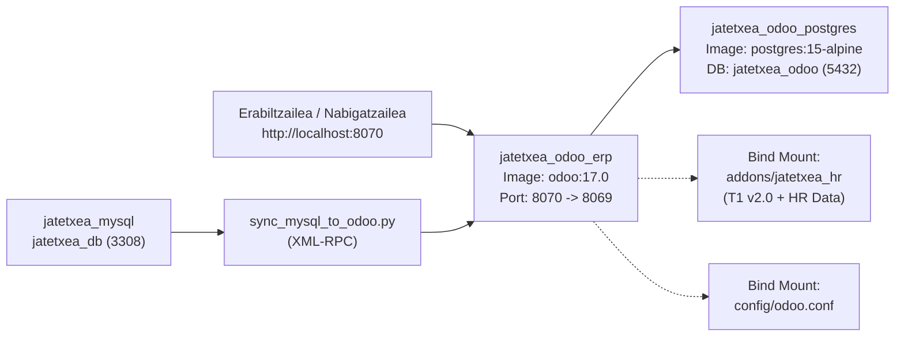

### 3.2 Lizentzia Mota: LGPL-3 (Odoo 17 Community)

* **Odoo 17 Community Edition** **GNU Lesser General Public License v3.0 (LGPL-3)** lizentziapean dago.
* **Abantailak:**
  * Erabilera komertzialerako **%100 doakoa**, erabiltzaile-kopuru mugagabearekin (15 langile + Superadmin kontua kosturik gabe).
  * Iturburu-kode irekia, auditoria eta segurtasun-berrikuspena ahalbidetuz.
  * Gure `jatetxea_hr` modulu pertsonalizatua ere **LGPL-3** lizentziarekin garatu da (`__manifest__.py`).
* **Community vs Enterprise:** Enterprise edizioak erabiltzaile bakoitzeko hileko harpidetza ordainpekoa du (`Odoo Proprietary License v1.0`). 1T Jatetxea S.L.-ren Langileak moduluaren eskakizun guztiak (%100) Community edizioarekin bete dira.

### 3.3 Instalazioaren eta Hedapenaren Argazkiak Azalpenekin

#### 1. Urratsa: Docker Edukiontzien Hedapena eta Admin IT Zentralaren Egiaztapena
`docker-compose.yml` eta `scripts/abiarazi_odoo.ps1` bidez `jatetxea_odoo_erp` (`127.0.0.1:8070`) eta `jatetxea_odoo_postgres` (`127.0.0.1:5432`) abiarazi dira VLAN 10 sarean. Admin IT Zentralean bi zerbitzuak **ONLINE** ageri dira (1–3 ms latentziarekin):

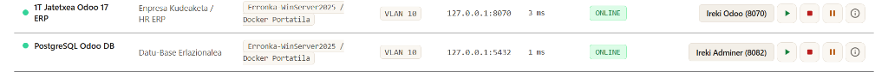

#### 2. Urratsa: `jatetxea_hr` Modulu Pertsonalizatuaren Instalazioa
`/mnt/extra-addons/jatetxea_hr` bolumenean muntatutako **`1T Jatetxea - Giza Baliabideak, Langile Kudeaketa eta Marka Identitatea`** (`v17.0.2.0.0`) modulua Odoo Apps-en instalatu da bere logo ofizialarekin (`static/description/icon.png`), HR menpekotasun guztiekin batera:

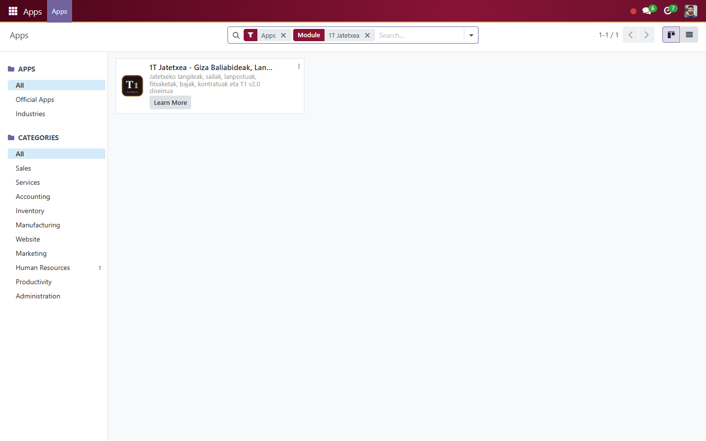

#### 3. Urratsa: Saio-Hasiera Segurua (`http://localhost:8070/web/login`)
15 langileek beren `res.users` kontua dute (`kredentzialak_zentrala.md` matrizearen arabera: HR Kudeatzaileak, IT Administratzaileak eta Langileak). Login pantaila 1T Jatetxearen irudi korporatiboarekin eta logo ofizialarekin egokitu da:

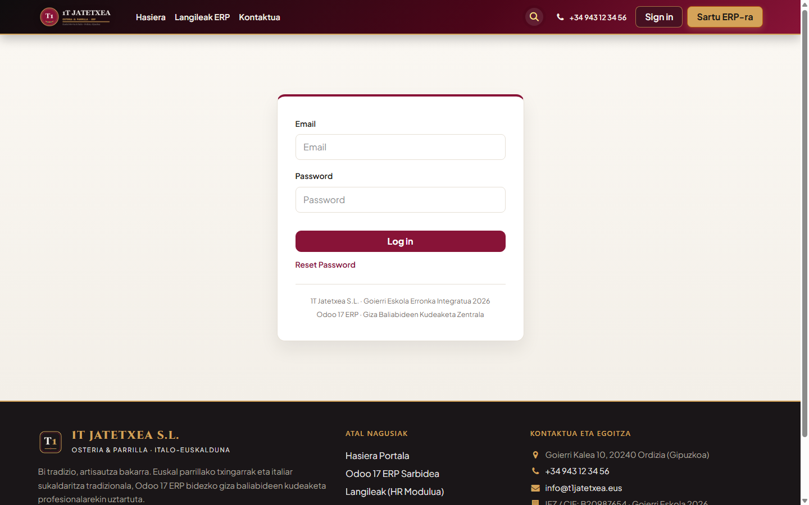

---

## 4. 1T Jatetxearen Marka Identitatea, Logoa eta Web Portala (`http://localhost:8070/`)

Odoo 17 Web Portala (`http://localhost:8070/`) eta ERP Backend-a **T1 Jatetxea v2.0 — Warm Hospitality Light & Evening Espresso Dark** estilo diseinu gidarekin (`01_DISEINU_SISTEMA_ETA_KOLOREAK.md` eta `web_php_bezeroak/assets/css/base.css`) guztiz lerrokatu dira:

* **Logo Korporatiboa eta Favicona:** Lehenetsitako `YourLogo` eta `+1 555-555-5556` telefonoa kendu dira. `res.company` (`1T Jatetxea S.L.`, IFZ `ESB20987654`, `Goierri Kalea 10, 20240 Ordizia`, `+34 943 12 34 56`, `info@t1jatetxea.eus`), `website` eta `jatetxea_hr` ikonoan 1T Jatetxearen logo ofizialak ezarri dira (`t1_logo_official.png`, `t1_logo_header_dark.png`, `t1_favicon.png`).
* **Kolore Paleta Ofiziala (`jatetxea_theme.scss` eta `jatetxea_backend.scss`):**
  * **Chianti & Ardo Gorria (`#881337`)** eta **Erromatar Borgoina (`#4C0519`)**: Goiburuak, Odoo Backend nabigazio-barra, botoi nagusiak eta Hero gradientea.
  * **Antique Gold (`#D4A359` / `#FDE68A`)**: Goiburu eta oineko ertz urreztatua, CTA botoi nagusia (`Sartu Odoo ERP Sisteman`) eta nabigazio-azentuak.
  * **Warm Hospitality Light (`#FAF7F2` / `#FFFFFF` / `#E6DFD5`)**: Eduki-atalak, KPI zerrenda eta txartelak.
  * **Evening Espresso Dark (`#0F0D0E` / `#1A1618`)**: Goiburua, Hero hondoa eta Oina (Footer) Ordiziako egoitzaren datuekin.
* **Tipografia Ofiziala:** `Cinzel` (tituluak eta KPIak), `Plus Jakarta Sans` (UI eta gorputza) eta `JetBrains Mono` (etiketa teknikoak).
* **UTF-8 eta Euskara:** Aurreko `€"` karaktere-akatsa zuzendu eta nabigazio-menuak euskaratu dira (`Hasiera`, `Langileak ERP`, `Kontaktua`, `Sartu ERP-ra`).

#### Web Portalaren Hasiera-Orria (Hero + KPI Adierazleak)
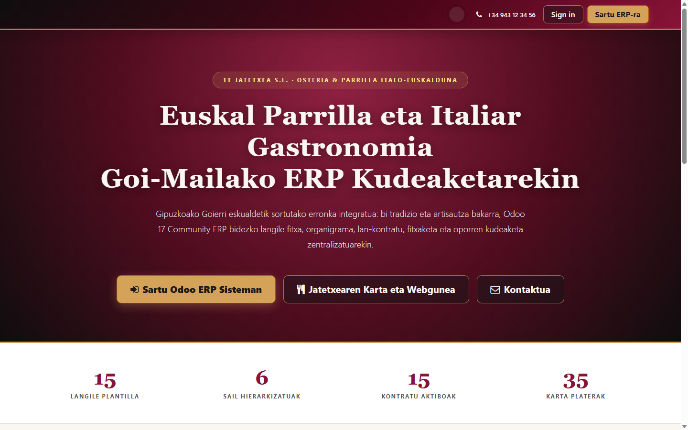

#### Web Portalaren 6 Sail Integratuen Ikuspegia
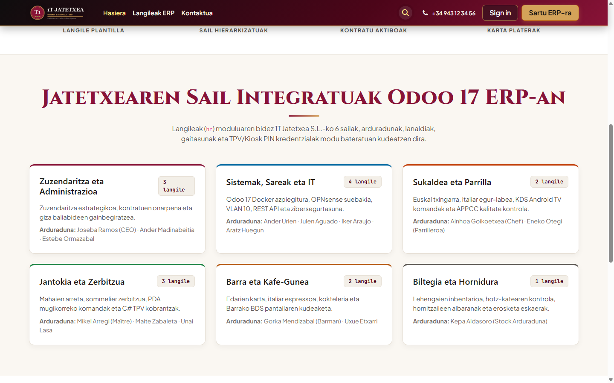

---

## 5. Langileak (`Employees`) Moduluaren Erabileraren Arrazoiketa

1T Jatetxea S.L. bezalako ostalaritza-negozio batean, pertsonen kudeaketa eguneroko eragiketen bihotza da. **Langileak (`hr`)** modulua honako behar zehatz hauei erantzuteko inplementatu dugu:

1. **Langileen Espediente Digital Bateratua:** 15 langileen datu profesionalak zein pribatuak (helbideak, NAN, Gizarte Segurantza, nominetarako IBAN kontuak, larrialdi-kontaktuak, ibilgailuen matrikulak eta ikasketak) leku seguru bakarrean zentralizatzea.
2. **6 Sailen Hierarkia eta Aginte-Katea:** Zuzendaritza Nagusitik (`Joseba Ramos`) 5 sail operatiboetako arduradun eta langileetarainoko egitura argitzea, opor eta fitxaketa onarpenak automatikoki dagokion arduradunari bideratzeko.
3. **Ziurtagirien eta Gaitasunen Jarraipena:** Ostalaritzan derrigorrezkoak diren *Elikagai-Manipulatzailea*, *APPCC*, *Lehen Sorospenak*, *Sommelier* eta hizkuntza-mailak (Euskara, Gaztelania, Ingelesa, Italiera, Frantsesa) kontrolatzea.
4. **Lan-Kontratuak eta Ostalaritzako Txandak:** Gipuzkoako Ostalaritza Hitzarmeneko kontratu mugagabeak, lanaldi osoak (40h) eta asteburuko errefortzu partzialak (20h — Unai Lasa) kudeatzea.
5. **Legezko Lanaldi-Erregistroa eta TPV/Kiosk PIN Bateratua:** Langile bakoitzaren 4 digituko PIN ofiziala (`kredentzialak_zentrala.md`: `0001`–`5003`) eta Badge kodea (`1TJ-EMP-001`..`015`) Odoon integratzea, eguneroko fitxaketak eta aparteko orduak neurtzeko.
6. **Oporren eta Lan-Bajen Plangintza:** Zerbitzu-txandak hutsik gera ez daitezen, 2026ko 23 opor-egunen saldoa, gaixotasun-bajak eta prestakuntza-egunak modu gardenean kudeatzea.

---

## 6. Moduluaren Erabilpen Erreala: Kasu Praktikoak, Datu Errealak eta Pantaila-Argazkiak

### 6.1 Plantillaren Laburpen Taula (15 Langile Erreal)

| Badge ID | Langilea | Saila | Lanpostua | TPV/Kiosk PIN | Kontratua / Soldata | Herria (Gipuzkoa) |
| :--- | :--- | :--- | :--- | :---: | :--- | :--- |
| `1TJ-EMP-001` | **Joseba Ramos** | Zuzendaritza eta Administrazioa | Zuzendari Nagusia (CEO) | `5002` | Mugagabea · 3.200 €/hil | Ordizia (1 km) |
| `1TJ-EMP-002` | **Ander Madinabeitia** | Zuzendaritza eta Administrazioa | Zuzendaria (Eragiketak eta HR) | `5001` | Mugagabea · 3.200 €/hil | Beasain (4 km) |
| `1TJ-EMP-003` | **Estebe Ormazabal** | Zuzendaritza eta Administrazioa | Zuzendaria (Finantzak) | `5003` | Mugagabea · 3.200 €/hil | Lazkao (5 km) |
| `1TJ-EMP-004` | **Ander Urien Telleria** | Sistemak, Sareak eta IT | IT Lead / FullStack Arkitektoa | `0001` | Mugagabea · 2.850 €/hil | Ordizia (2 km) |
| `1TJ-EMP-005` | **Julen Aguado Fernández** | Sistemak, Sareak eta IT | Sare eta Suebaki Administratzailea | `0002` | Mugagabea · 2.700 €/hil | Beasain (4 km) |
| `1TJ-EMP-006` | **Iker Araujo Dominguez** | Sistemak, Sareak eta IT | Sistemen eta Birtualizazio Ingeniaria | `0003` | Mugagabea · 2.700 €/hil | Urretxu (14 km) |
| `1TJ-EMP-007` | **Aratz Huegun Flores** | Sistemak, Sareak eta IT | Zibersegurtasun Teknikaria | `0004` | Mugagabea · 2.750 €/hil | Tolosa (15 km) |
| `1TJ-EMP-008` | **Ainhoa Goikoetxea** | Sukaldea | Chef Burua / Sukaldari Nagusia | `3001` | Mugagabea · 2.500 €/hil | Idiazabal (8 km) |
| `1TJ-EMP-009` | **Eneko Otegi** | Sukaldea | Bigarren Sukaldaria / Parrilleroa | `3002` | Mugagabea · 1.950 €/hil | Segura (10 km) |
| `1TJ-EMP-010` | **Mikel Arregi** | Jantokia eta Zerbitzua | Maître / Zerbitzari Burua | `1001` | Mugagabea · 2.100 €/hil | Ordizia (1 km) |
| `1TJ-EMP-011` | **Maite Zabaleta** | Jantokia eta Zerbitzua | Jantokiko Zerbitzaria | `1002` | Lanaldi Osoa · 1.400 €/hil | Zaldibia (6 km) |
| `1TJ-EMP-012` | **Unai Lasa** | Jantokia eta Zerbitzua | Jantokiko Zerbitzaria (Asteburuak) | `1003` | Partziala 20h · 950 €/hil | Ataun (9 km) |
| `1TJ-EMP-013` | **Gorka Mendizabal** | Barra eta Kafe-Gunea | Barman / Barrako Arduraduna | `2001` | Mugagabea · 1.850 €/hil | Ormaiztegi (7 km) |
| `1TJ-EMP-014` | **Uxue Etxarri** | Barra eta Kafe-Gunea | Barrako Zerbitzaria | `2002` | Mugagabea · 1.600 €/hil | Itsasondo (5 km) |
| `1TJ-EMP-015` | **Kepa Aldasoro** | Biltegia eta Hornidura | Biltegi eta Stock Arduraduna | `4001` | Mugagabea · 1.800 €/hil | Legazpi (17 km) |

---

### 6.2 1. Kasua: Langileen Kanban Ikuspegia, Argazki Errealistak eta 6 Sail Independenteak

Langile bakoitzak bere argazki fotografiko errealista du (Ander Urien Telleriaren argazki erreala barne, bai `hr.employee`-n bai `res.users` erabiltzaile-profilean sinkronizatua), etiketa operatiboekin (*Sukaldea*, *Elikagai-Manipulatzailea*, *Lehen Sorospenak*, *IT Admin*, *HR Kudeatzailea*, txandak). Ezkerreko panelean enpresako **6 sail funtzional independenteak** maila berean ageri dira (`Barra eta Kafe-Gunea [2]`, `Biltegia eta Hornidura [1]`, `Jantokia eta Zerbitzua [3]`, `Sistemak, Sareak eta IT [4]`, `Sukaldea [2]`, `Zuzendaritza eta Administrazioa [3]`), eta aginte-katea `Org Chart` bidez bereizita kudeatzen da:

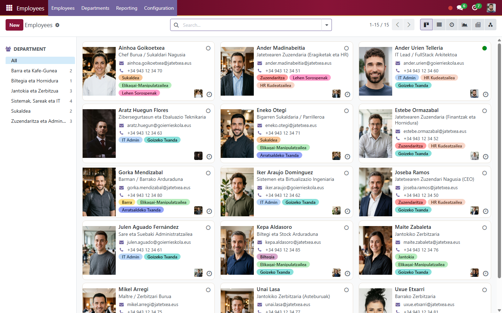

Sailen kudeaketa-panelean (`Departments`) sail bakoitzeko langile-kopurua eta zain dauden eskaerak zuzenean bistaratzen dira (adib. `Biltegia eta Hornidura`: *1 Time Off Requests*):

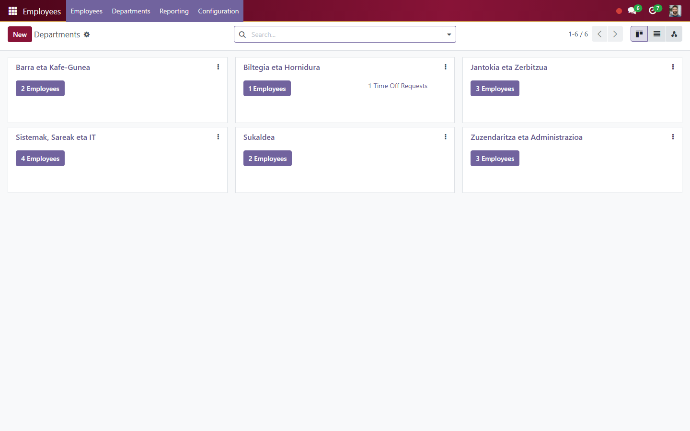

---

### 6.3 2. Kasua: Organigrama Hierarkiko Interaktiboa (`Org Chart`)

`hr_org_chart` ikuspegiak aginte-kate osoa erakusten du: **Joseba Ramos (CEO)** gailurrean, eta haren azpian **Ander Madinabeitia** (Sukaldea, Jantokia eta Barra), **Ander Urien Telleria** (IT Taldeko 3 ingeniariak) eta **Estebe Ormazabal** (Biltegia):

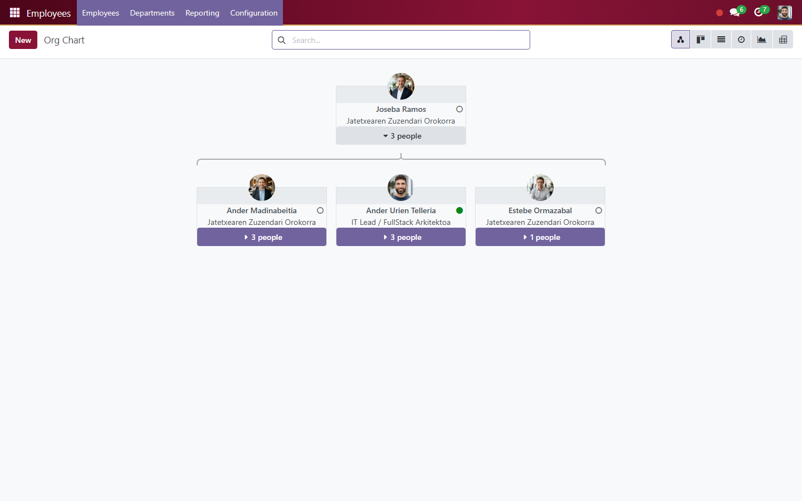

---

### 6.4 3. Kasua: Langile Fitxa Osoa (Ainhoa Goikoetxea — Chef Burua)

15 langile guztien 4 fitxak %100ean datu errealekin beteta daude (guztira **37 CV lerro** eta **79 gaitasun**):

1. **Resume (CV eta Gaitasunak):** Esperientzia profesionala, ikasketak (*Basque Culinary Center*), APPCC ziurtagiria eta gaitasun-mailak (*Euskara %100*, *Gaztelania %100*, *Italiera %85*, *Euskal Parrilla %100*, *Italiar Labea %100*, *APPCC %100*):

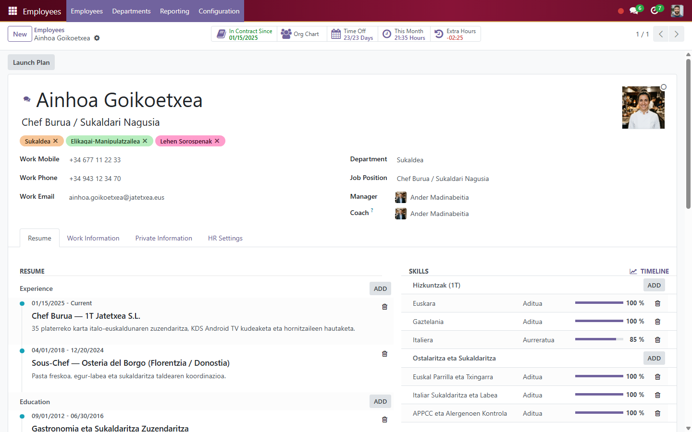

2. **Work Information (Lan Informazioa eta Talde Organigrama):** Enpresaren egoitza (`1T Jatetxea S.L., Goierri Kalea 10, 20240 Ordizia`), lan-kokaleku zehatza (`Sukalde Nagusia eta Euskal Parrilla`), onarpen-arduraduna (`Ander Madinabeitia`) eta eskuinaldean organigrama osoa (`Joseba Ramos -> Ander Madinabeitia -> Ainhoa Goikoetxea -> Eneko Otegi`):

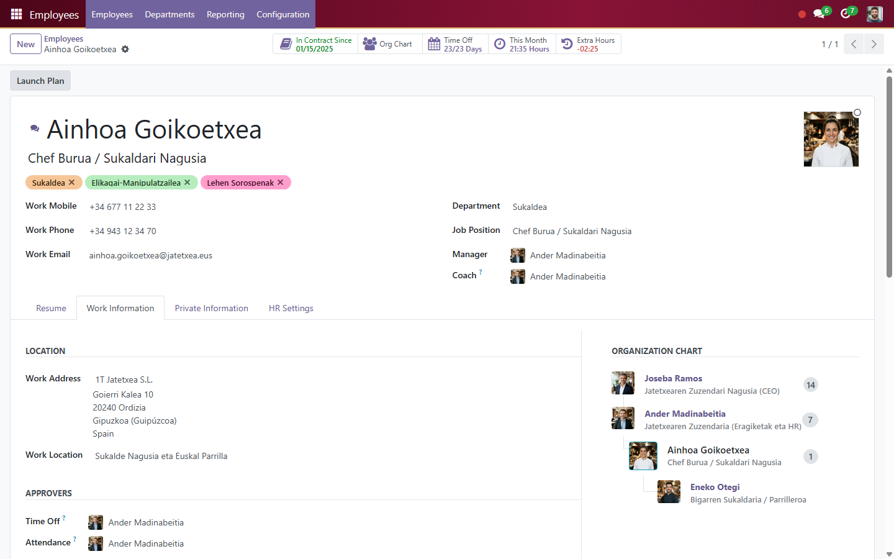

3. **Private Information (Datu Pribatuak, Bankua, Larrialdia eta Ikasketak):** Helbide pribatua (`Kale Nagusia 31, 2.B, 20213 Idiazabal, Gipuzkoa`), email eta telefono pribatua, **Kutxabank IBAN** (`ES33 2095 5044 80 9102345608`), egoera zibila (`Married`, ezkontidea `Iñigo Larrañaga`, seme-alaba 1), lantokirako distantzia (`8 km`), matrikula (`5512 KTR`), larrialdi-kontaktua (`Jon Goikoetxea`), ikasketak, NAN (`72548905E`) eta Gizarte Segurantza (`20/10891432/41`):

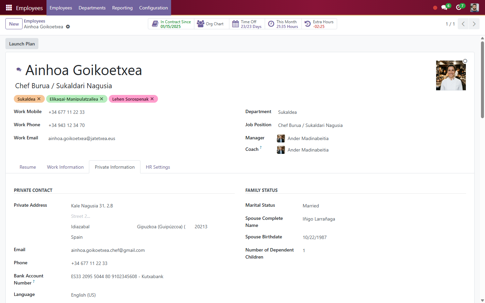

4. **HR Settings (Erabiltzailea, TPV/Kiosk PIN eta Badge ID):** Lotutako Odoo erabiltzailea, **PIN Code `3001`** (KDS/TPV sistemarekin bateratua) eta **Badge ID `1TJ-EMP-008`**:

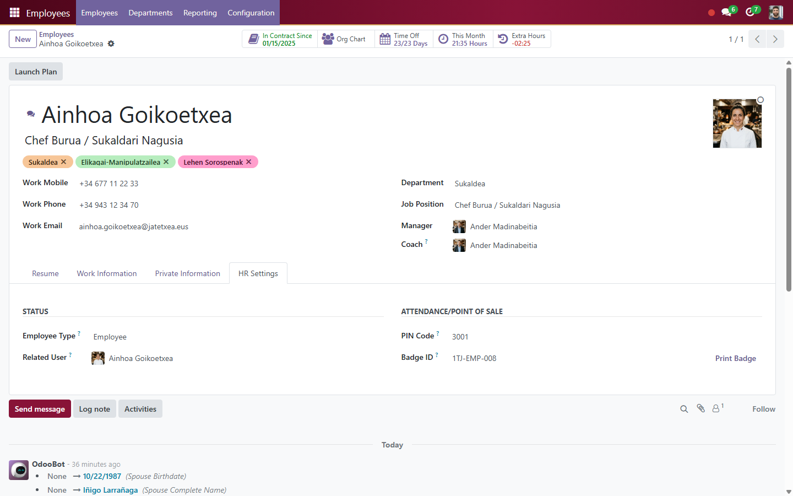

---

### 6.5 4. Kasua: 15 Lan-Kontratu Aktiboak (`hr_contract`)

Langile guztiek kontratu aktiboa (`Running`) dute, bakoitzak bere erreferentzia ofizialarekin (`KONT-2026-IT01` .. `KONT-2026-ZUZ03`), kontratu-motarekin (`Permanent`, `Full-Time`, `Part-Time`) eta lanaldiarekin (`Lanaldi Osoa 40h`, `Ostalaritza 40h`, `Lanaldi Partziala 20h`):

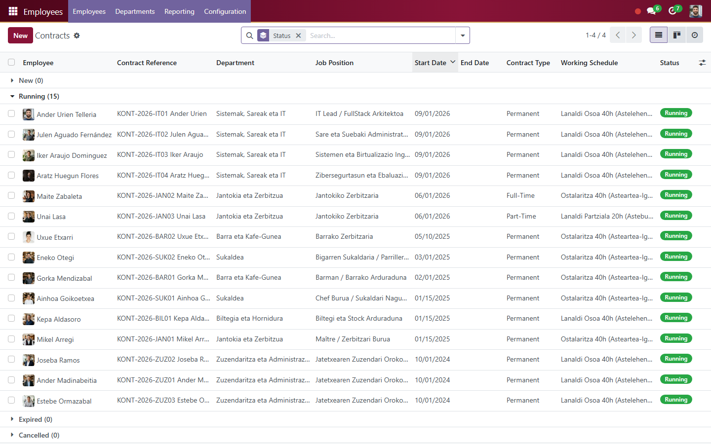

---

### 6.6 5. Kasua: Azken Asteko 53 Fitxaketak (`hr_attendance`)

Azaroaren 20tik 26ra bitarteko **53 sarrera-irteera erreal** erregistratu dira 15 langileentzat, lan egindako orduen eta aparteko orduen (`Over Time`) kalkulu automatikoarekin:

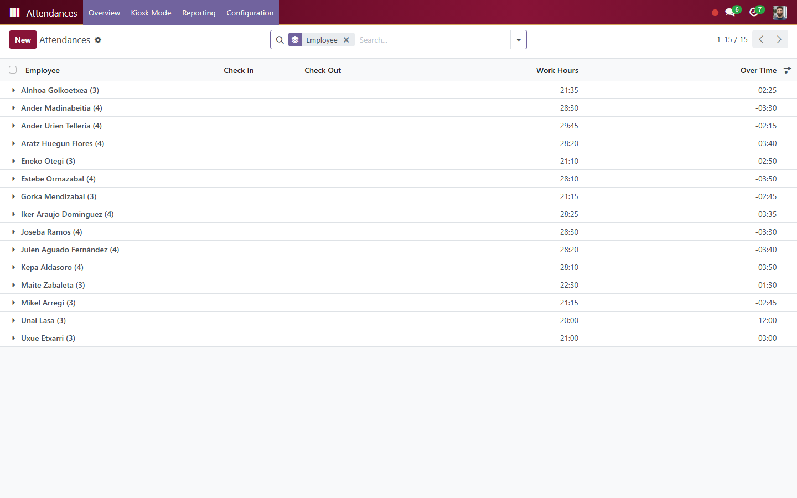

---

### 6.7 6. Kasua: 2026ko Oporrak, Mediku-Bajak eta Prestakuntza (`hr_holidays`)

15 langileei 2026ko **23 opor-egun** esleitu zaizkie eta IT taldeari **5 prestakuntza-egun**. 4 eskaera erreal kudeatzen dira:
* **Kepa Aldasoro (`To Approve`):** Abenduko zubiko opor-eskaera (abenduak 7–11, 5 egun — Zuzendaritzak *Approve / Refuse* egiteko prest).
* **Iker Araujo Dominguez (`Approved`):** Proxmox & Docker Segurtasun Prestakuntza (azaroak 19, egun 1).
* **Maite Zabaleta (`Approved`):** Urteko Oporrak (azaroak 10–13, 4 egun).
* **Eneko Otegi (`Approved`):** Gripe Arrunta — Mediku Baja (`Sick Time Off`, azaroak 2–5, 4 egun).

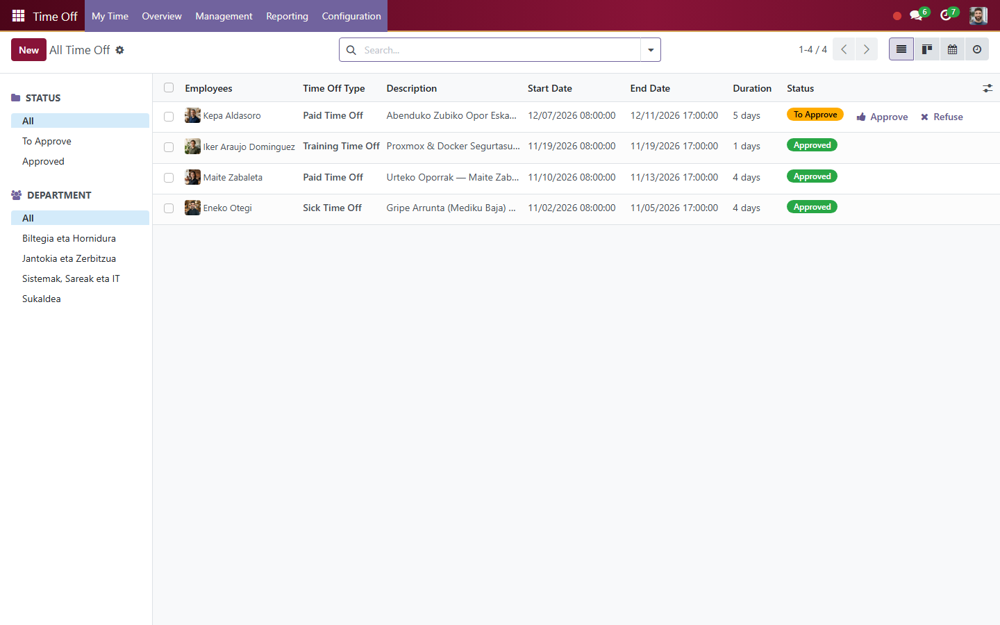

---

## 7. Inplementatutako Fitxategiak, Modulu Pertsonalizatua eta Automatizazioa

Proiektuaren erreproduzigarritasuna bermatzeko, konfigurazio osoa kode gisa gordeta dago `01_aplikazioak/admin/odoo_erp/` karpetan:

```text
01_aplikazioak/admin/odoo_erp/
├── docker-compose.yml                         # Odoo 17 + PostgreSQL 15 definizioa (8070:8069)
├── config/odoo.conf                           # Odoo konfigurazioa (jatetxea_odoo, extra-addons)
├── addons/jatetxea_hr/                        # 1T Jatetxea modulu pertsonalizatua (v17.0.2.0.0)
│   ├── __manifest__.py                        # LGPL-3, menpekotasunak eta assets bundles
│   ├── data/                                  # hr_department_data.xml, hr_job_data.xml, hr_employee_data.xml, hr_contract_data.xml
│   ├── views/website_templates.xml            # Google Fonts (Cinzel/Plus Jakarta Sans) eta Login marka
│   └── static/
│       ├── description/icon.png               # 1T Jatetxea aplikazio-ikonoa
│       └── src/
│           ├── img/                           # t1_logo_official.png, t1_logo_header_dark.png, t1_favicon.png + avatars/emp_21..35.png
│           └── scss/                          # jatetxea_theme.scss (Web Portala) eta jatetxea_backend.scss (ERP)
├── data/                                      # CSV babes-kopiak (01_departamentuak .. 06_bajak)
├── scripts/
│   ├── abiarazi_odoo.ps1                      # Edukiontziak abiarazteko PowerShell scripta
│   ├── konfiguratu_odoo_osoa.py               # ORM bidezko konfigurazio integral idempotentea
│   └── sync_mysql_to_odoo.py                  # MySQL -> Odoo XML-RPC sinkronizatzailea
└── docs/                                      # Dokumentazioa eta 15 pantaila-argazkiak
```

**Konfigurazioa edozein unetan berriro aplikatzeko komandoak:**
```powershell
docker exec jatetxea_odoo_erp odoo -c /etc/odoo/odoo.conf -d jatetxea_odoo -u jatetxea_hr --stop-after-init --no-http
docker cp .\01_aplikazioak\admin\odoo_erp\scripts\konfiguratu_odoo_osoa.py jatetxea_odoo_erp:/tmp/konfiguratu_odoo_osoa.py
docker exec jatetxea_odoo_erp sh -c "odoo shell -c /etc/odoo/odoo.conf -d jatetxea_odoo --no-http < /tmp/konfiguratu_odoo_osoa.py"
docker restart jatetxea_odoo_erp
```

---

## 8. Ebaluazio-Errubrikaren Betetze-Matrizea

`enpresa_kudeaketa_sistemak_egin_beharrak.png` taulako eskakizun guztien egiaztapena:

| Noiz konprobatu | Zer konprobatu | Egoera | Ebidentzia txosten honetan |
| :--- | :--- | :---: | :--- |
| **Dokumentuan** | Aukeratutako modulua adierazita dago eta ez dago beste talde batekin errepikatuta | **BETETA** | 1. Atala: **Langileak (`hr` — Employees)** eta HR azpimoduluak (1. Taldeari esleituta). |
| **Dokumentuan** | ERP-CRM aukerak aztertu eta konparatu dituzte, eta aukeraketa justifikatu dute | **BETETA** | 2. Atala: Odoo 17 vs Dolibarr vs ERPNext vs SAP B1 vs Dynamics 365 taula eta justifikazioa. |
| **Aplikazioa erakustean** | Odooren instalazioa zuzen egin dute (Windows edo Linux zerbitzarian) | **BETETA** | `jatetxea_odoo_erp` (`:8070`) + `jatetxea_odoo_postgres` (`:5432`) Docker-en ONLINE. |
| **Dokumentuan** | Instalazio mota eta lizentzia mota azalduta daude; instalazio argazkiak azalpenekin | **BETETA** | 3. Atala: On-Premise Docker Compose + LGPL-3 Community azalpena eta instalazio argazkiak (`00`, `03`, `14`). |
| **Aplikazioa erakustean** | Odook ongi funtzionatzen du | **BETETA** | `http://localhost:8070/` (T1 v2.0 diseinua + logo ofiziala) eta `/web` backend-a egiaztatuta. |
| **Dokumentuan** | Aukeratutako moduluaren erabilera arrazoitu dute (zertarako erabili duten) | **BETETA** | 5. Atala: 6 arrazoi operatibo, legal eta antolakuntzazkoak 1T Jatetxea S.L.-rako. |
| **Aplikazioa erakustean eta dokumentuan** | Moduluaren erabilpena adibideekin justifikatu dute; aurkezpenean eta dokumentuan datu "errealak" ikusten dira | **BETETA** | 6. Atala: 15 langile (argazki errealistekin), 6 sail, organigrama, 79 gaitasun, 37 CV lerro, 15 kontratu, 53 fitxaketa, 4 opor/baja eskaera eta 15 pantaila-argazki erreal. |
