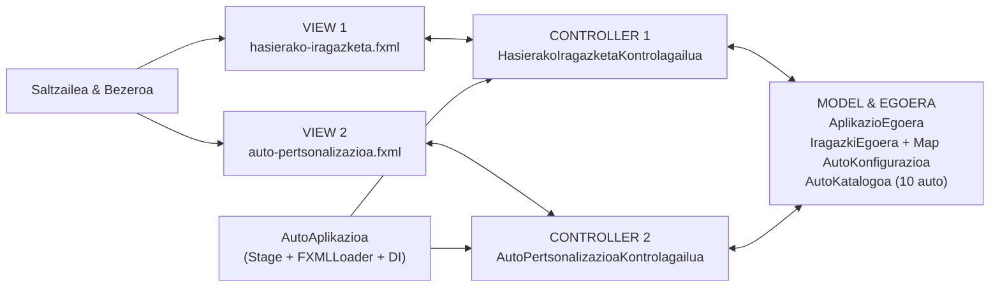

# E3 — Auto Kontzesionarioko Interfazeen Diseinua eta Garapena (JavaFX 21 + Scene Builder)

**Modulua:** 0488 · Interfazeen Garapena (Goierri Eskola — DAM)  
**Ariketa:** [E3_1_zatia.png](E3_1_zatia.png) (1. eta 2. interfazeak) eta [E3_2_zatia.png](E3_2_zatia.png) (taldekideen diseinuen ebaluazioa)  
**Proiektuaren kokapena (IntelliJ IDEA + Maven + JavaFX 21):** [auto_kontzesionarioa_javafx/](auto_kontzesionarioa_javafx/pom.xml)  
**Teknologiak:** Java 21, JavaFX `21.0.6` (`javafx-controls`, `javafx-fxml`), Scene Builder (FXML deklaratiboa + CSS), JUnit 5.

---

## 1. Aplikazioaren Helburua eta Testuingurua

**Goierri Motors · Auto Aholkularia** mahaigaineko aplikazioa da, kontzesionarioko **saltzaileak eta bezeroak pantaila bera elkarrekin begiratuz** erabiltzeko pentsatua. Bi interfaze lotu eta guztiz funtzional garatu dira:

1. **1. Interfazea — Hasierako iragazketa** ([hasierako-iragazketa.fxml](auto_kontzesionarioa_javafx/src/main/resources/eus/goierri/autoak/fxml/hasierako-iragazketa.fxml)): Bezeroak oraindik ez daki zein auto nahi duen; bere beharrak edozein ordenatan adierazten ditu (erabilera, erregaia, aurrekontua, plazak/ateak/karrozeria, nahi edo baztertu nahi dituen markak) eta katalogoa denbora errealean murrizten da.
2. **2. Interfazea — Autoaren xehetasunak eta pertsonalizazioa** ([auto-pertsonalizazioa.fxml](auto_kontzesionarioa_javafx/src/main/resources/eus/goierri/autoak/fxml/auto-pertsonalizazioa.fxml)): Auto bat aukeratzean, informazio tekniko osoa, irudiak eta **aukeraketa-panela** (`Accordion`) agertzen dira. Aldaketa bakoitzean **azken prezioa** berehala eguneratzen da, eta 1. pantailara itzul daiteke **aurreko aukeraketak galdu gabe**.

---

## 2. MVC Arkitektura eta Proiektuaren Egitura (IntelliJ IDEA)

`MVC_ETA_JAVAFX_PANE_LABURPENA.pdf` dokumentuko 3 geruzako patroiari jarraituz antolatu da proiektua:

| Karpeta / Fitxategia | Geruza | Zeregina |
|---|---|---|
| `resources/.../fxml/hasierako-iragazketa.fxml` | **View (1. pantaila)** | 1. interfazearen egitura bisuala (Scene Builder-ekin % 100 editagarria). |
| `resources/.../fxml/auto-pertsonalizazioa.fxml` | **View (2. pantaila)** | 2. interfazearen egitura bisuala (`Accordion`, `TitledPane`, `StackPane`, `GridPane`). |
| `resources/.../css/autoak.css` | **View (Estiloa)** | Kolore-paleta (60–30–10), pilulak, txartelak, 3 egoeratako marka-botoiak eta prezio-panela. |
| `resources/.../img/*.png` | **View (Irudiak)** | 5 karrozeria-irudi (`suv`, `trinkoa`, `berlina`, `familiarra`, `furgoneta`) Scene Builder-en bertan ikusgai. |
| `controller/HasierakoIragazketaKontrolagailua.java` | **Controller 1** | Iragazki guztien logika, 3 egoeratako marka-hautaketa, txip aktiboak eta txartel-sareta dinamikoa. |
| `controller/AutoPertsonalizazioaKontrolagailua.java` | **Controller 2** | Motor/kolore/akabera/gehigarrien kudeaketa, kolore-aurrebista, ezaugarri teknikoak eta azken prezioa. |
| `model/Autoa.java`, `AutoKatalogoa.java` | **Model** | 10 auto erreal, motorrak, koloreak, barruko akaberak eta ekipamendu gehigarriak (`record`). |
| `model/IragazkiEgoera.java`, `AutoKonfigurazioa.java`, `AplikazioEgoera.java` | **Model (Egoera)** | Bi pantailen arteko egoera-iraunkortasuna: 1. pantailara itzultzean ez dira iragazkiak ezta autoen konfigurazioak galtzen. |
| `Abiarazlea.java`, `AutoAplikazioa.java` | **Abiarazlea** | `Stage` (`setMinWidth(1000)`, `setMinHeight(680)`, `setMaximized(true)`) eta pantailen arteko nabigazioa. |

---

## 3. Erabilitako JavaFX Pane-ak eta Justifikazio Teknikoa

Bi pantailetan `MVC_ETA_JAVAFX_PANE_LABURPENA.pdf` dokumentuko **6 urrezko arau responsive-ak** bete dira (inoiz ez da `AnchorPane` finkorik erabili, leihoa `1000×680`-tik `4K`-ra egokitu dadin).

### 3.1. 1. Interfazea: Hasierako iragazketa (`hasierako-iragazketa.fxml`)

| Eremua | Erabilitako Pane / Edukiontzia | Zergatik aukeratu da? |
|---|---|---|
| **Erroa (Root)** | **`BorderPane`** | Pantaila 3 zona argitan banatzen du: `TOP` (goiburu finkoa), `LEFT` (iragazki-panela, `350px`) eta `CENTER` (auto-sortak soberako espazio guztia hartzen du). |
| **Goiburua (`TOP`)** | **`HBox`** (`HBox.hgrow="ALWAYS"`) | Marka, titulua, urrats-adierazlea (*stepper*) eta *"Hutsetik hasi"* botoia horizontalki lerrokatzen ditu. |
| **Iragazki-panela (`LEFT`)** | **`ScrollPane`** (`fitToWidth="true"`) + **`VBox`** | Iragazki asko daudenez (5 bloke), pantaila txikietan ere bertikalki korritu daiteke ezer moztu gabe. |
| **Erabilera / Erregaia / Markak / Txip aktiboak** | **`FlowPane`** (`hgap="8"`, `vgap="8"`) | Flexbox estiloko egokitzapena: botoi/txip bakoitzak bere zabalera hartzen du eta lekua bukatzean automatikoki hurrengo lerrora pasatzen da. |
| **Ezaugarri orokorrak** | **`GridPane`** (`ColumnConstraints` % 44 / % 56) | Etiketak (`Pertsonak`, `Ate kopurua`, `Karrozeria`) 0. zutabean eta `ComboBox` kontrolak 1. zutabean ezin hobeto lerrokatuta, zabalerara eskalatuz. |
| **Auto-sortaren zerrenda (`CENTER`)** | **`VBox`** + **`ScrollPane`** (`fitToWidth="true"`) + **`FlowPane`** | Auto-txartelak (`300px`) errenkadatan antolatzen ditu; leihoa zabaltzean 3 edo 4 zutabe agertzen dira automatikoki, eta estutzean 2 zutabetara egokitzen da. |

#### 1. Interfazeak betetzen dituen eskakizun guztiak (`E3_1_zatia.png`):
- **Erabilera modua:** `Hiria`, `Familia`, `Bidaiak`, `Lana` (`ToggleButton` pilula anitzak).
- **Erregaia / Motor mota:** `Gasolina`, `Diesela`, `Hibridoa`, `Elektrikoa` (`ToggleButton` pilula anitzak).
- **Aurrekontu-tartea:** `minPriceSlider` eta `maxPriceSlider` sinkronizatuak (`15.000 € – 70.000 €`), gutxienekoa gehienekoa baino handiagoa izatea galaraziz.
- **Ezaugarri orokorrak:** `Pertsona kopurua`, `Ate kopurua` eta `Karrozeria mota` (`ComboBox`).
- **Marka nahi edo baztertu:** 3 egoeratako marka-botoi intuitiboak — **1 klik = `✓ Nahi` (berdea)**, **2 klik = `✕ Baztertu` (gorria)**, **3 klik = Neutrala (grisa)**.
- **Edozein ordenatan aldatu, kendu edo hutsetik hasi:** Goialdeko `activeFiltersPane`-n iragazki aktibo bakoitzak bere `✕` botoia du banaka kentzeko, eta goiko eskuinean **`Hutsetik hasi`** botoia dago guztia garbitzeko.
- **Denbora errealeko zerrenda:** Edozein kontrol ukitu bezain laster `refreshResults()` exekutatzen da eta kontagailua (`X / 10 auto`) + txartel-sareta eguneratzen dira.

---

### 3.2. 2. Interfazea: Autoaren pertsonalizazioa eta aukeraketa panela (`auto-pertsonalizazioa.fxml`)

| Eremua | Erabilitako Pane / Edukiontzia | Zergatik aukeratu da? |
|---|---|---|
| **Erroa (Root)** | **`BorderPane`** | `TOP` (itzuli botoia + titulua + stepper), `CENTER` (autoaren aurrebista eta fitxa teknikoa) eta `RIGHT` (aukeraketa-panela + azken prezioa). |
| **Autoaren showroom aurrebista (`CENTER`)** | **`StackPane`** | Geruzak Z ardatzean pilatzen ditu: atzean kolore-markoa (`Rectangle`), erdian autoaren irudia (`ImageView`), eta aurrean aukerako informazio-gainjartzea (`Barrualdea` edo `Neurriak & Espazioa` ikusteko). |
| **Ezaugarri teknikoen fitxa (`CENTER`)** | **`GridPane`** (4 `ColumnConstraints` × % 25) | `POTENTZIA`, `KONTSUMOA`, `NEURRIAK` eta `MALETATEGIA` 4 KPI kutxa simetrikotan lerrokatzen ditu, zabalera osoan banatuta. |
| **Aukeraketa panela (`RIGHT`)** | **`VBox`** + **`Accordion`** + 4 **`TitledPane`** | Eskakizunak berak dio: *"ez du esan nahi aldiro aukera guztiak ikusi behar direnik, batzuk ezkutatuta egon daitezke"*. `Accordion`-ek atal bat zabalik mantentzen du aldi berean karga kognitiboa murriztuz, eta itxitako `TitledPane`-en izenburuetan hautatutako laburpena erakusten du (`2. Kanpoko kolorea · Gorri Chianti`). |
| **Koloreen laginak (`TitledPane 2`)** | **`FlowPane`** | Kolore-txartelak (`Circle` + izena + `+€`) sareta garbian biltzen ditu. |
| **Azken prezioaren barra finkoa (`RIGHT` behean)** | **`VBox`** (`styleClass="price-summary-box"`) | `Accordion`-ak `VBox.vgrow="ALWAYS"` duenez, azken prezioa **beti ikusgai** geratzen da behealdean, scroll egin beharrik gabe. |

#### 2. Interfazeak betetzen dituen eskakizun guztiak (`E3_1_zatia.png`):
- **Informazio osoa:** Potentzia (`CV`), kontsumoa (`L/100km` edo `kWh/100km`), neurriak (`L×Z×A mm`), maletategia (`L`), deskribapena, erabilerak eta 3 ikuspegi bisual (`Kanpoaldea`, `Barrualdea`, `Neurriak & Espazioa`).
- **Bertsioak / Motorrak:** `RadioButton` (`ToggleGroup`) aukera bakoitzaren **prezio, kontsumo eta potentziarekin**; hautatzean fitxa teknikoko potentzia eta kontsumoa ere aldatzen dira!
- **Kanpoko kolorea eta barruko akabera:** Zuzeneko kolore-aurrebista (markoa, itzala, kolore-zirkuluak eta barrualdeko ikuspegia).
- **Ekipamendu gehigarria:** `CheckBox` zerrenda bakoitzaren deskribapen eta prezioarekin (`GPS`, `Teilatu panoramikoa`, `360° Kamera`, `Eserleku berotuak`, `Soinu Premium`, `ADAS`).
- **Azken prezioa denbora errealean:** Oinarria + Motorra + Kolorea + Barrualdea + Gehigarriak berehala birkalkulatzen dira.
- **Hasierako sortara itzuli aukeraketak galdu gabe:** `← Itzuli auto-sortara` sakatzean `AplikazioEgoera`-k mantentzen ditu bai 1. pantailako iragazkiak, bai konfiguratutako autoen `AutoKonfigurazioa` (eta 1. pantailan `"Pertsonalizatua"` txapa eta prezio pertsonalizatua agertzen zaizkio!).

---

## 4. UX, Nielsen eta Gestalt Oinarrien Justifikazioa

Saltzaileak eta bezeroak **pantaila bera elkarrekin** ikusten dutenez, argitasun bisuala eta zuzeneko feedbacka funtsezkoak dira:

- **Nielsen H1 (Egoeraren ikusgarritasuna):** Goiko *stepper*-ak uneoro adierazten du zein fasetan gauden (`1. Hasierako iragazketa → 2. Pertsonalizazioa`); kontagailuak (`X / 10 auto`), txip aktiboek eta beheko `AZKEN PREZIOA` koadro ilunak berehalako feedbacka (< 0,1s) ematen dute.
- **Nielsen H3 (Kontrola eta askatasuna):** Iragazkiak edozein ordenatan aldatu, txipetatik `✕` batekin banaka kendu edo `Hutsetik hasi` botoiarekin garbi daitezke; 2. pantailan `← Itzuli auto-sortara` eta `Berrezarri aukerak` beti daude eskura.
- **Nielsen H5 (Erroreen prebentzioa):** Aurrekontu-sliderrek automatikoki eragozten dute `Min > Max` egoera; 0 emaitza daudenean pantailak irtenbidea eskaintzen du (*"Iragazki guztiak garbitu"* botoia — H9 ere betez).
- **Nielsen H8 (Diseinu minimalista):** `Accordion` + `TitledPane`-ri esker ez da pantaila aukera guztiekin asetzen; behar den atala soilik zabaltzen da bezeroarekin hizketan ari garen bitartean.
- **Gestalt arauak:**
  - **G1 Hurbiltasuna:** Iragazki bakoitzaren izenburua bere kontrolen gainean dago (`spacing=8`), blokeen artean `Separator` eta `spacing=16` jarriz.
  - **G2 Antzekotasuna:** Ekintza nagusi guztiak urdinak dira (`.primary-button`), erregai-txapak berdeak, marka nahiak berdeak (`✓`) eta baztertuak gorriak (`✕`).
  - **G3 Eskualde komuna:** Auto bakoitza `.car-card` txartel zurian doa hondo gris leunaren (`#F4F6F9`) gainean, eta prezio-laburpena koadro ilunean (`.price-summary-box`).
  - **Irudia eta funtsa:** `Showroom` aurrebista-kutxak eta beheko prezio-koadro ilunak kontraste handiz nabarmentzen dituzte bezeroaren bi interes-gune nagusiak (autoa eta azken prezioa).

---

## 5. Nola Ireki eta Moldatu IntelliJ IDEA eta Scene Builder-en

1. **IntelliJ IDEA-n ireki:**
   - `File → Open...` → hautatu `05_erronka_egin_beharrak\interfaze_garapena\E3\auto_kontzesionarioa_javafx\pom.xml` (*Open as Project*).
   - Project SDK gisa hautatu **Java 21** (`jbr-21`).
2. **Scene Builder-ekin moldatu:**
   - Egin eskuineko klika [hasierako-iragazketa.fxml](auto_kontzesionarioa_javafx/src/main/resources/eus/goierri/autoak/fxml/hasierako-iragazketa.fxml) edo [auto-pertsonalizazioa.fxml](auto_kontzesionarioa_javafx/src/main/resources/eus/goierri/autoak/fxml/auto-pertsonalizazioa.fxml) fitxategian → **Open In SceneBuilder**.
   - Kontrol guztiak JavaFX estandarrak direnez eta `autoak.css` + `img/*.png` erlatiboki lotuta daudenez, aurrebista osoa ikusiko duzu (`Preview → Show Preview in Window / Ctrl+P` probatzeko!).
   - *Kontuz:* `fx:id` eta `onAction="#..."` izenak mantendu kontroladorearekin lotura ez hausteko.
3. **Exekutatu:**
   - Klik bikoitza [hasi_auto_aplikazioa.bat](auto_kontzesionarioa_javafx/hasi_auto_aplikazioa.bat) fitxategian, edo terminalean `.\mvnw.cmd javafx:run` / IntelliJ-ko `Abiarazlea.main()`.

---

## 6. E3 - 2. Zatia Prestatzeko Txantiloia ([E3_2_zatia.png](E3_2_zatia.png))

2. zatian taldekideen diseinuak aztertzeko, txantiloi hau erabil dezakezu taldekide bakoitzeko:

| Taldekidea | Diseinatutako Interfazea | Diseinuko 3 puntu fuerte | Diseinuko 3 hobetzeko alderdi |
|---|---|---|---|
| **1. Taldekidea** | *(1. edo 2. interfazea)* | 1. *(adib. Hierarkia bisuala / Gestalt)* 2. *(adib. Pane responsive aukeraketa)* 3. *(adib. Feedback azkarra / Nielsen H1)* | 1. *(adib. Kontrastea WCAG AA)* 2. *(adib. Fitts-en legea botoien tamainan)* 3. *(adib. Egoera gordetzea itzultzean)* |
| **2. Taldekidea** | *(1. edo 2. interfazea)* | 1. ... 2. ... 3. ... | 1. ... 2. ... 3. ... |
| **3. Taldekidea** | *(1. edo 2. interfazea)* | 1. ... 2. ... 3. ... | 1. ... 2. ... 3. ... |
