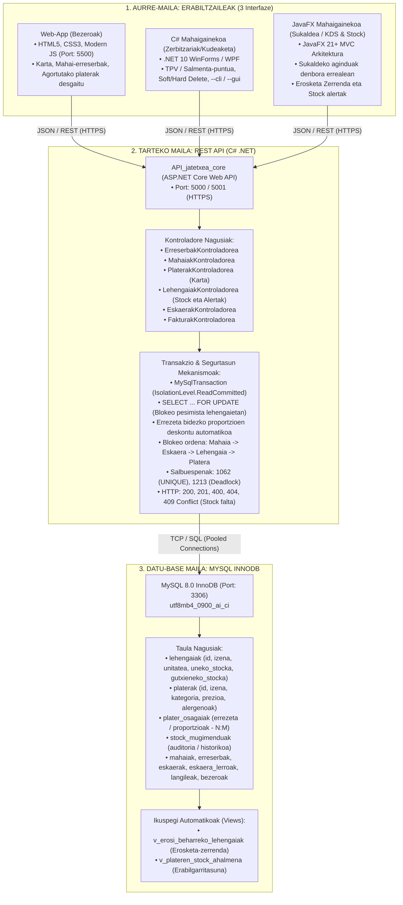

# Jatetxearen Kudeaketa Sistema: 3 Mailako Arkitektura eta IA Agenteekin Garatzeko Gida Integrala (v2.0)

Dokumentu honek zehazten du nola diseinatu, egituratu eta garatu **Jatetxe baten Kudeaketa Sistema Osoa** 3 mailako arkitekturan oinarrituta, **Lehengaien Stock Kontrol automatikoa (Errezetak/Eskandalloak)** eta **IA Agente Kolaboratzaileak** erabiliz.

Metodologia honek bat egiten du **"Desagertuko dira programatzaileak?"** printzipioekin (*"Aldaketa txikiak, egiaztapen jarraituak"*) eta Antigravity plataformako agente-egiturarekin.

---

## 1. 3 Mailako Sistemaren Arkitektura



---

## 2. Datu-Basearen Egitura Osoa (`espezifikazioak/datu_basea_schema.sql`)

Datu-basearen eskema berrituak funtzionalitate hauek bermatzen ditu:
1. **`lehengaiak`**: Biltegiko osagai guztiak beren neurri-unitatearekin (`kg`, `g`, `l`, `ml`, `unitatea`).
2. **`plater_osagaiak`**: Errezeta bakoitzaren proportzioak (`Txuleta Errea` = `1.0 kg Okela` + `0.05 l Olio`).
3. **`stock_mugimenduak`**: Deskontu guztien eta albaranen sarreren auditoria.
4. **`v_erosi_beharreko_lehengaiak`**: Stocka gutxienekoaren azpitik duten lehengaiak automatikoki zerrendatzeko.
5. **`v_plateren_stock_ahalmena`**: Biltegiko osagaien arabera plater bakoitzetik zenbat anoa egin daitezkeen unean-unean kalkulatzeko.

---

## 3. Martxan Jartzea Docker Compose bidez

Proiektuaren erroan `docker-compose.yml` fitxategia sortu da. Agindu bakar batekin MySQL 8.0 datu-basea eta eskema osoa automatikoki martxan jartzeko:

```bash
docker compose up -d
```
