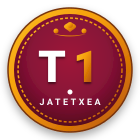
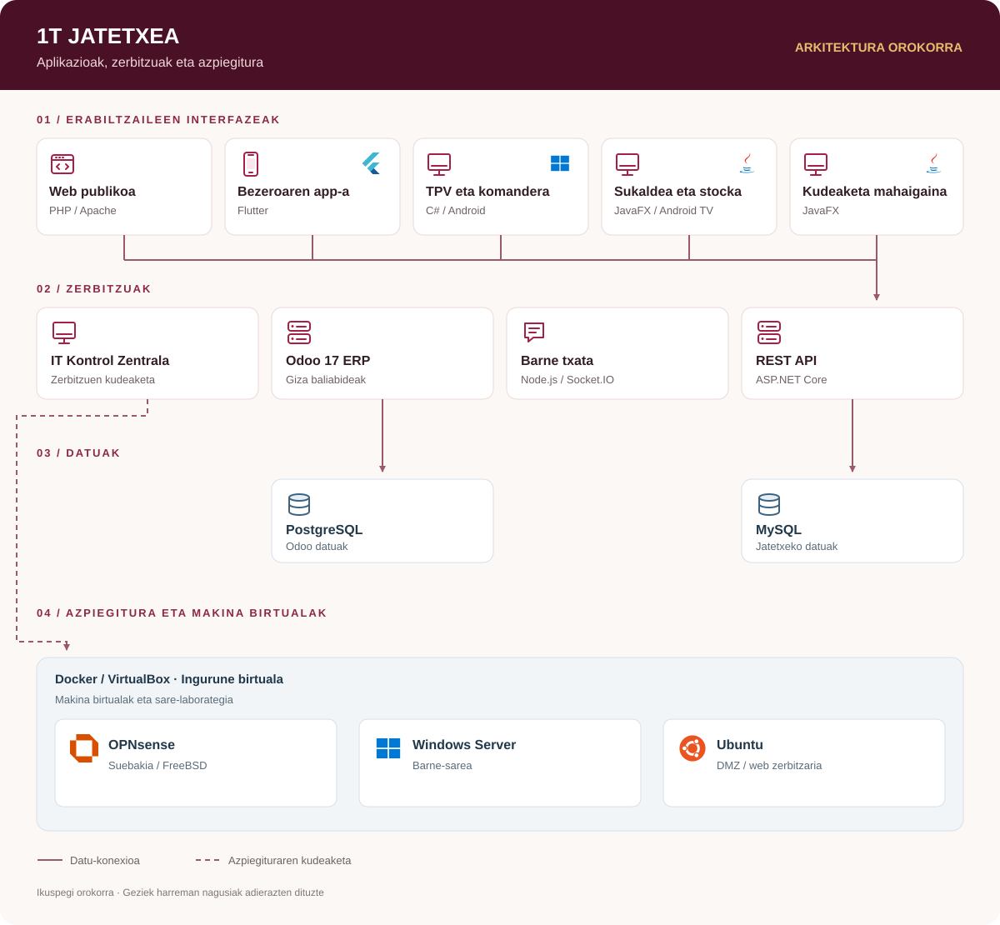
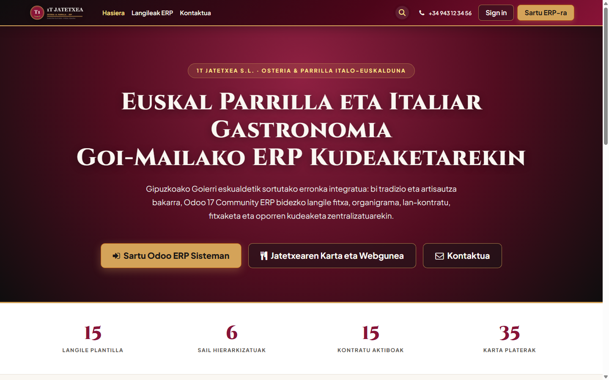
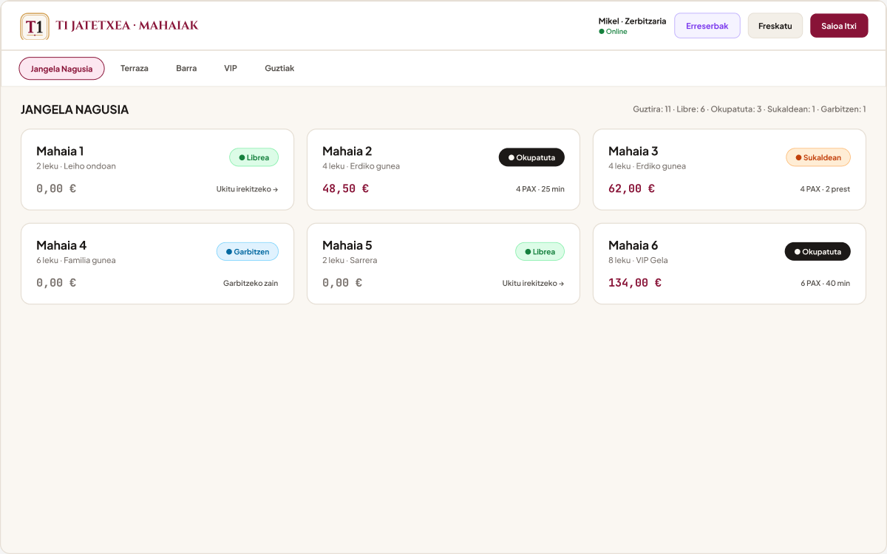

<div align="center">
  

  # 1T Jatetxea

  **Jatetxearen kudeaketa, aplikazioak eta azpiegitura ekosistema bakarrean.**

  Goierri Eskolako erronka integratua · Softwarea · Sareak · Sistemak

  [Proiektua](#proiektua) · [Arkitektura](#arkitektura) · [Aplikazioak](#aplikazioak) · [Abiaraztea](#abiarazte-azkarra) · [Dokumentazioa](#dokumentazioa)
</div>

---

## Proiektua

**1T Jatetxea** jatetxe baten eguneroko jarduna eta hura sostengatzen duen azpiegitura lantzen dituen monorepositorioa da. Bezeroen webgunetik hasi eta mahai, eskaera, sukalde, biltegi eta langileen kudeaketaraino, hainbat aplikazio eta zerbitzu biltzen ditu.

| Bezeroak | Jatetxeko taldea | Sistemak eta administrazioa |
| :--- | :--- | :--- |
| Karta, erreserbak eta bezeroentzako aplikazioak | TPV, komandak, sukaldeko pantailak eta stocka | REST APIa, Odoo, Docker eta sare-azpiegitura |

> Hezkuntza-proiektua da: konfigurazioak eta datu adibideak laborategirako dira. Ez erabili lehenetsitako kredentzialak edo konfigurazioa produkzioan.

## Arkitektura

Ondoko diagramak osagai nagusien ikuspegi orokorra erakusten du. Geziek harreman nagusiak adierazten dituzte; ez dute aplikazio bakoitzaren funtzionalitate-maila edo hedapen-topologia zehatza ordezkatzen.



**Datu-fluxu nagusia:** aplikazioek REST APIa erabiltzen dute jatetxeko datuetarako; Odoo-k bere PostgreSQL datu-basea erabiltzen du. Txata eta IT Kontrol Zentrala zerbitzu osagarri bereiziak dira.

## Aplikazioak

| Eremua | Osagaia | Teknologia | Dokumentazioa |
| :--- | :--- | :--- | :--- |
| Bezeroak | Web publikoa | PHP, Apache | [Webaren gida](01_aplikazioak/bezeroak/web_php_bezeroak/README.md) |
| Bezeroak | Mugikorreko aplikazioa | Flutter | [Flutter gida](01_aplikazioak/bezeroak/mobile_bezeroa_flutter/README.md) |
| Jantokia | TPV mahaigaina | C#, Windows Forms | [TPV dokumentazioa](01_aplikazioak/zerbitzari_langileak/desktop_tpv_csharp/docs/README.md) |
| Jantokia eta barra | Android komandera | Kotlin, Jetpack Compose | [Komanderaren gida](01_aplikazioak/zerbitzari_langileak/zerbitzaria_komandera_android/README.md) |
| Sukaldea | KDS telebista | Kotlin, Android TV | [Android TV gida](01_aplikazioak/sukalde_langileak/sukaldea_kds_android_tv/README.md) |
| Sukaldea, barra eta biltegia | Mahaigaineko aplikazioak | JavaFX, Maven | [Sukaldea](01_aplikazioak/sukalde_langileak/desktop_sukaldea_kds/) · [Barra](01_aplikazioak/zerbitzari_langileak/desktop_barra_bds/) · [Biltegia](01_aplikazioak/biltegi_langileak/desktop_biltegia_stock/) |
| Administrazioa | Kudeaketa mahaigaina | JavaFX, Maven | [Java kudeaketa gida](01_aplikazioak/admin/admin_desktop_java/README.md) |
| Administrazioa | IT Kontrol Zentrala | ASP.NET Core | [Kontrol-panelaren gida](01_aplikazioak/admin/admin_IT_zentrala/README.md) |
| Administrazioa | Odoo ERP | Odoo 17, PostgreSQL | [Odoo gida](01_aplikazioak/admin/odoo_erp/README.md) |
| Zerbitzuak | REST API nagusia | ASP.NET Core, MySQL | [API bilduma eta probak](postman/README.md) |

## Iruditan

| Odoo web ataria | TPVaren mahai-maparen diseinua |
| :---: | :---: |
|  |  |
| [Odoo-ren pantaila gehiago](01_aplikazioak/admin/odoo_erp/README.md) | [TPVaren diseinu-gida](01_aplikazioak/zerbitzari_langileak/desktop_tpv_csharp/docs/README.md) |

## Abiarazte azkarra

### Docker bidez

Beharrezkoa: Git, Docker eta Docker Compose. Docker martxan dagoela, exekutatu biltegiaren erroan:

```powershell
git clone https://github.com/AnderUrienGoierri/1T_Jatetxea_erronka_agents.git
cd 1T_Jatetxea_erronka_agents
docker compose up -d --build
docker compose ps
```

Lehen abioan irudiak eraiki eta datu-baseak hasieratu behar dira; horrek denbora behar dezake. Zerbitzuren bat prest ez badago, begiratu `docker compose logs` eta haren egoera. Gelditzeko, erabili `docker compose down`; datu-bolumenak mantentzen dira.

### Windows-eko kontrol-panela

Windows-en, erroko [Admin_IT_Zentrala.exe](Admin_IT_Zentrala.exe) abiarazlea erabil daiteke, edo [IT Kontrol Zentralaren gidan](01_aplikazioak/admin/admin_IT_zentrala/README.md) adierazitako scriptak. Kontrol-panela **ez da** erroko Docker Compose fitxategiko zerbitzu bat; bereiz abiarazi behar da.

### Tokiko helbideak

| Zerbitzua | Ostalariaren helbidea | Oharrak |
| :--- | :--- | :--- |
| IT Kontrol Zentrala | [localhost:5000](http://localhost:5000/) | Bereiz abiarazita |
| REST API | [localhost:5050](http://localhost:5050/) | Docker barruan `5000` |
| Web publikoa | [localhost:8085](http://localhost:8085/) | PHP / Apache |
| Odoo ERP | [localhost:8070](http://localhost:8070/) | Docker barruan `8069` |
| KDS web | [localhost:8086](http://localhost:8086/) | Telebistarako web zerbitzua |
| Barne txata | `localhost:3001` | Socket.IO |
| phpMyAdmin / Adminer | [localhost:8081](http://localhost:8081/) / [localhost:8082](http://localhost:8082/) | Datu-baseen administrazioa |
| MySQL / PostgreSQL | `localhost:3308` / `localhost:5432` | Datu-baseen atakak |

**Kontuan hartu:** `5000` kontrol-panelarena da ostalarian; APIarena `5050` da. Mugikor eta emuladoreetan `localhost` gailua bera da: erabili ingurunerako egokia den API helbidea.

## Biltegiaren egitura

| Karpeta | Edukia |
| :--- | :--- |
| [01_aplikazioak](01_aplikazioak/) | Bezero, langile eta administrazio aplikazioak |
| [02_azpiegitura_birtuala](02_azpiegitura_birtuala/) | Docker, sare-profilak eta makina birtualak |
| [03_laborategi_fisikoa](03_laborategi_fisikoa/) | Hardwarea, kableatua eta sare fisikoa |
| [04_dokumentazioa](04_dokumentazioa/) | Espezifikazioak eta garapen-dokumentazioa |
| [05_erronka_egin_beharrak](05_erronka_egin_beharrak/) | Ikasgaietako erronkak eta ariketak |
| [db](db/) · [postman](postman/) | Datu-basearen SQLa eta API bilduma |

## Dokumentazioa

- [Azpiegitura birtualaren gida](02_azpiegitura_birtuala/1T_Jatetxea_Entorno_Birtuala/README.md)
- [Laborategi fisikoaren gida](03_laborategi_fisikoa/README.md)
- [APIa probatzeko Postman bilduma](postman/README.md)
- [Garapen-faseak](04_dokumentazioa/Garapen_faseak/README.md)
- [Komit-mezuen hitzarmena](.github/COMMIT_CONVENTION.md)

---

<div align="center">
  <strong>1T Jatetxea</strong><br>
  Goierri Eskola · Erronka integratua
</div>
