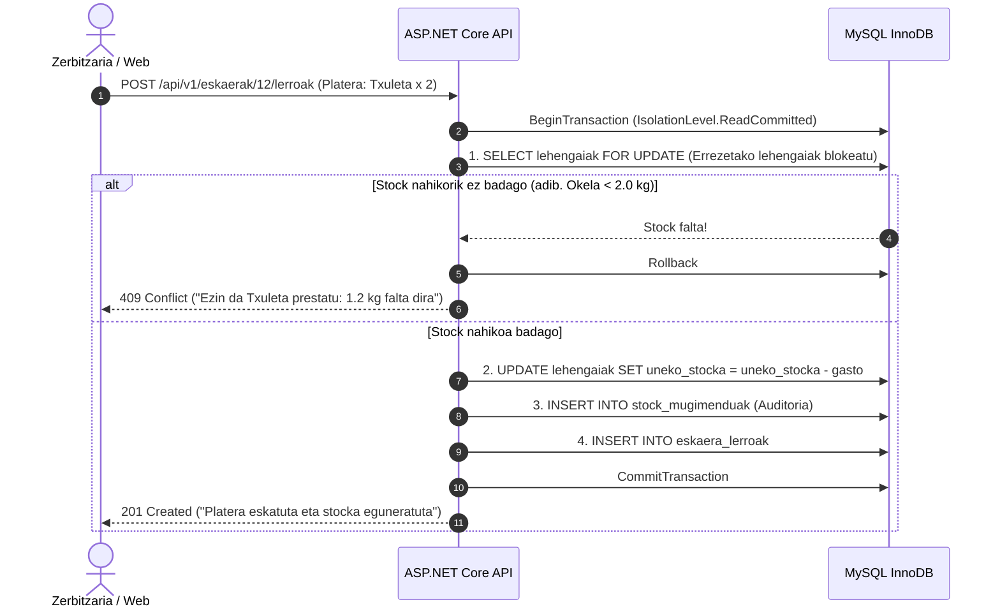

# REST API Kontratua eta Stock Deskontu Transakzionala (C# ASP.NET Core)

Dokumentu honek zehazten du nola deskontatzen den lehengaien stocka platerak kontsumitzean, eta nola jakin zein plater prestatu daitezkeen eta zein lehengai erosi behar diren.

---

## 1. REST Endpoint-en Egitura Estandarizatua

### Erreserbak (`/api/v1/erreserbak`)
- `GET /api/v1/erreserbak?data=2026-11-05&txanda=Bazkaria_1` -> Zerrenda (200 OK)
- `GET /api/v1/erreserbak/{id}` -> Erreserba xehetasuna (200 OK / 404 Not Found)
- `POST /api/v1/erreserbak` -> Erreserba sortu (201 Created / 400 Bad Request / 409 Conflict)
- `DELETE /api/v1/erreserbak/{id}` -> Ezeztatu / Soft Delete (200 OK / 404 Not Found)
- `POST /api/v1/erreserbak/{id}/restore` -> Berreskuratu / Restore (200 OK / 409 Conflict)

### Mahaiak (`/api/v1/mahaiak`)
- `GET /api/v1/mahaiak` -> Mahai guztien egoera (200 OK)
- `PUT /api/v1/mahaiak/{id}/egoera` -> Egoera eguneratu (`Libre`, `Okupatuta`, `Erreserbatuta`, `Garbitzen`)

### Lehengaiak eta Stock Kontrola (`/api/v1/lehengaiak`)
- `GET /api/v1/lehengaiak` -> Lehengai guztien zerrenda eta uneko stocka (200 OK)
- `GET /api/v1/lehengaiak/alertak` -> **Erosketa-zerrenda:** gutxieneko stocketik behera dauden lehengaiak (200 OK)
- `POST /api/v1/lehengaiak/sarrera` -> Hornitzailearen albarana erregistratu (Stock gehitzea) (200 OK / 400 Bad Request)

### Plateren Erabilgarritasuna (`/api/v1/platerak`)
- `GET /api/v1/platerak/erabilgarritasuna` -> Plater bakoitzetik zenbat anoa prestatu daitezkeen kalkulatuta (200 OK)
- `GET /api/v1/platerak/{id}/eskandalloa` -> Plater baten errezeta eta osagaien proportzioak (200 OK)

### Komandetan Platerak Eskatzea (`POST /api/v1/eskaerak/{id}/lerroak`)
- Plater bat gehitzean edo sukaldera bidaltzean, **automatikoki deskontatzen dira plateraren osagaiak** dagokien proportzioan.

---

## 2. Transakzio Pesimista: Plateraren Osagaien Deskontua (`C#`)

Plater bat kontsumitzean, transakzio bakar baten barruan (`MySqlTransaction`) egiten dira eragiketak:



### C# Kodearen Inplementazio Txantiloia (`StockZerbitzua.cs`):

```csharp
public async Task<EmaitzaOperazioa> GehituPlateraEtaDeskontatuStockAsync(int eskaeraId, int plateraId, int kantitatea)
{
    await using var connection = new MySqlConnection(_connectionString);
    await connection.OpenAsync();
    await using var tx = await connection.BeginTransactionAsync(IsolationLevel.ReadCommitted);

    try
    {
        // 1. Lortu plateraren errezetako osagai guztiak eta BLOKEATU lehengaiak pesimistoki
        const string sqlErrezeta = @"
            SELECT po.lehengaia_id, po.kantitatea AS beharrezkoa_anoko, 
                   l.izena, l.uneko_stocka, l.unitatea
            FROM plater_osagaiak po
            JOIN lehengaiak l ON po.lehengaia_id = l.id
            WHERE po.platera_id = @plateraId AND l.ezabatua = 0
            FOR UPDATE;"; // <-- GAKOA: Errenkadak blokeatu

        var osagaiak = new List<dynamic>();
        await using (var cmd = new MySqlCommand(sqlErrezeta, connection, tx))
        {
            cmd.Parameters.AddWithValue("@plateraId", plateraId);
            await using var reader = await cmd.ExecuteReaderAsync();
            while (await reader.ReadAsync())
            {
                osagaiak.Add(new {
                    LehengaiaId = reader.GetInt32("lehengaia_id"),
                    Izena = reader.GetString("izena"),
                    Beharrezkoa = reader.GetDecimal("beharrezkoa_anoko") * kantitatea,
                    UnekoStocka = reader.GetDecimal("uneko_stocka"),
                    Unitatea = reader.GetString("unitatea")
                });
            }
        }

        // 2. Egiaztatu lehengai GUZTIETATIK nahikoa badagoen
        foreach (var osagai in osagaiak)
        {
            if (osagai.UnekoStocka < osagai.Beharrezkoa)
            {
                await tx.RollbackAsync();
                return EmaitzaOperazioa.HutsEgin(
                    $"Ez dago nahikoa stock: '{osagai.Izena}' (Behar dira: {osagai.Beharrezkoa}{osagai.Unitatea}, Unean: {osagai.UnekoStocka}{osagai.Unitatea})",
                    409);
            }
        }

        // 3. Deskontatu lehengai bakoitzaren proportzioa eta gorde mugimendua
        foreach (var osagai in osagaiak)
        {
            const string updateSql = @"
                UPDATE lehengaiak 
                SET uneko_stocka = uneko_stocka - @gastua 
                WHERE id = @lehengaiaId;

                INSERT INTO stock_mugimenduak (lehengaia_id, mota, kantitatea, eskaera_id, oharrak)
                VALUES (@lehengaiaId, 'Kontsumoa_Platera', -@gastua, @eskaeraId, 'Plater kontsumoa');";

            await using var updCmd = new MySqlCommand(updateSql, connection, tx);
            updCmd.Parameters.AddWithValue("@gastua", osagai.Beharrezkoa);
            updCmd.Parameters.AddWithValue("@lehengaiaId", osagai.LehengaiaId);
            updCmd.Parameters.AddWithValue("@eskaeraId", eskaeraId);
            await updCmd.ExecuteNonQueryAsync();
        }

        // 4. Gehitu lerroa komandara
        const string insertLerroaSql = @"
            INSERT INTO eskaera_lerroak (eskaera_id, platera_id, kantitatea, unitate_prezioa, egoera)
            SELECT @eskaeraId, id, @kantitatea, prezioa, 'Eskatua' FROM platerak WHERE id = @plateraId;";

        await using var insCmd = new MySqlCommand(insertLerroaSql, connection, tx);
        insCmd.Parameters.AddWithValue("@eskaeraId", eskaeraId);
        insCmd.Parameters.AddWithValue("@plateraId", plateraId);
        insCmd.Parameters.AddWithValue("@kantitatea", kantitatea);
        await insCmd.ExecuteNonQueryAsync();

        await tx.CommitAsync();
        return EmaitzaOperazioa.Arrakasta("Platera eskatua eta lehengaien stocka deskontatua.");
    }
    catch (Exception ex)
    {
        await tx.RollbackAsync();
        throw;
    }
}
```
