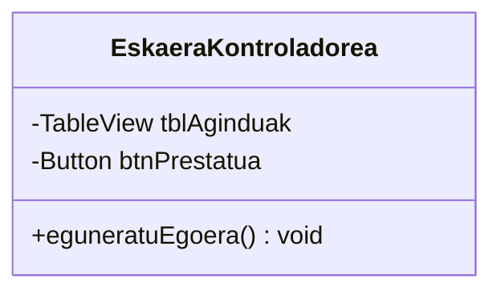

# 1T Jatetxea - IA bidezko Garapen Metodologia eta Lan-Fluxua

Agiri honek Goierri Eskolako 2. DAM mailako `IA_garapena.pdf` gidaren arabera definitutako lan-metodologia egokitzen du **1T Jatetxea Kudeaketa Sistema Integralerako**. Metodologia honen helburua da IA (adimen artifiziala) lankide tekniko gisa erabiltzea, eskuzko zirriborrotik eta Figmako diseinutik hasi eta ekoizpeneko kalitate handiko koderaino modu ordenatu, egonkor eta deterministan iristeko.

---

## 1. Oinarrizko Hiru Printzipioak

1. **Testuinguru gehiago, asmakizun gutxiago:**
   - IAk ez du asmatu behar negozioaren logika, klaseen egitura edo kolore-paleta.
   - Eskaera bakoitzean zehaztu behar dira: proiektuaren deskribapena, klase-diagrama testuan (Mermaid/PlantUML), diseinu-sistema eta erreferentziako txantiloia.

2. **Pixkanaka eta probatuz (Ez eskatu dena batera):**
   - Garapena pantailaz pantaila eta funtzionalitatez funtzionalitate egin behar da.
   - Dena batera eskatuz gero inkoherentziak eta erroreak ugaritzen dira.
   - Urrats bakoitzeko **commit atomiko bat** egin behar da giten, zerbait hautsiz gero atzera egin ahal izateko.

3. **Kodea ulertu eta egiaztatu:**
   - IA garatzailearen laguntzailea da, ez orakulua.
   - Garatzaileak kodearen lerro bakoitza ulertu behar du, eta Scene Builder, IDE edo proba automatizatuen bidez exekutatu aurretik berrikusi.

---

## 2. Lan-Fluxua Bost Urratsetan

```text
[1. Eskuzko Zirriborroa]
        │  (Paperean, errotulagailu ilunez, oharrekin)
        ▼
[2. Wireframe-a IA-rekin]
        │  (Bozeto digitala, elementu nagusien banaketa)
        ▼
[3. Diseinua Figman]
        │  (Diseinu-sistema, auto-layout, geruza-izenak = kode-izenak)
        ▼
[4. Kodea IA-rekin]
        │  (Txantiloia + Klase Diagrama + Estilo Fitxategia)
        ▼
[5. Probatu eta Zuzendu]
           (Exekuzioa, stack trace osoa, alboz alboko konparaketa)
```

### 1. Urratsa: Eskuzko Zirriborroa
- Orri bakoitzean pantaila bakar bat marraztu argi onarekin eta errotulagailu ilunez.
- Pantailak zenbatu eta geziekin adierazi botoi bakoitzak nora eramaten duen.
- Marrazkian bertan oharrak idatzi: «Goitibeherako zerrenda», «Taula scroll-arekin», «Botoi honek X irekitzen du». Idatzita ez dagoena IAk bere kabuz interpretatuko du.

### 2. Urratsa: Wireframe-a IA-rekin
- Zirriborrotik abiatuta oinarrizko wireframe digitala sortu (SVG edo egitura garbia).
- Ez bilatu azken diseinu grafikoa urrats honetan; helburua osagaien antolaketa espaziala finkatzea da.

### 3. Urratsa: Diseinua Figman
- Wireframe-a Figmara eraman (SVG bidez edo eskuz).
- Diseinu-sistema aplikatu: koloreak (hex formatuan), letra-tipoak, neurriak, tarteak eta auto-layout.
- **Arau Kritikoa - Geruzei kodeko izenak eman:**
  - Figmako osagai eta geruzen izenek bat etorri behar dute kodean erabiliko diren aldagai-izenekin.
  - Adibideak:
    - Botoia: `btnBilatu`, `btnGorde`, `btnEzeztatu`
    - Testu-eremua: `txtErabiltzailea`, `txtHelmuga`, `txtPrezioa`
    - Taula: `tblMahaiak`, `tblEskaerak`, `tblLehengaiak`
    - Etiketa: `lblEgoera`, `lblGuztira`

### 4. Urratsa: Kodea IA-rekin Sortzea
Laugarren urrats honetan, IAk kodea sortu aurretik lau sarrera jaso behar ditu:
1. **Figmako diseinua / frame-aren kaptura** (PNG 2x bereizmenarekin).
2. **Txantiloia eta erreferentziako proiektua:** pom.xml / csproj, paketeen egitura, FXML / XAML / HTML adibide oso bat.
3. **Klase-diagrama testuan:** Mermaid edo PlantUML formatuan, klase-izenak, atributuak, metodoak eta erlazioak zehaztuta.
4. **Estilo-dokumentua:** kolore hex balioak, marjinak eta letra-tipoak.

### 5. Urratsa: Probatu eta Zuzendu
- Sortutako kodea berehala konpilatu eta exekutatu.
- Zerbaitek huts egiten badu, **stack trace osoa** eman IAri, inoiz ez bakarrik «ez dabil».
- Egin konparaketa bisuala: aplikazioaren pantaila-argazkia eta Figmako frame-a alboz albo jarri desbideratzeak zuzentzeko.
- Emaitza onartzean, egin commit atomikoa.

---

## 3. Ohiko Akatsen Prebentzio-Zerrenda

| Akats Mota | Arriskua / Kausa | Konponbide Estandarra |
| :--- | :--- | :--- |
| **Izen desadostasunak** | FXML/UI izenak eta kontroladorea ez datoz bat (`fx:id="btnBilatu"` vs `@FXML Button btnBuscar`). | Figmako geruzen izen bera erabili FXML eta kontroladoreko aldagaietan. |
| **Baliabideen bide okerrak** | CSS, ikono edo irudien bide erlatiboak okerrak izatea (`getResource("estiloa.css")`). | Bide absolutuak erabili klase-ibilbidean: `getResource("/css/estiloa.css")` edo `file:///` estekak. |
| **JavaFX CSS vs Web CSS** | Web estiloko arauak JavaFX-en jartzea (`background-color` JavaFX-en). | JavaFX fitxategietan beti erabili `-fx-` aurrizkia (`-fx-background-color`, `-fx-text-fill`). |
| **Existitzen ez diren metodoak** | IAk metodo asmatuak sortzea (`btn.setOnClick()` JavaFX-en). | JavaFX-en `btn.setOnAction()`, C#-n `btn.Click +=`, Web-en `addEventListener('click')`. |
| **Moduluen baimen faltak** | `module-info.java` fitxategian FXML-ari sarbidea ez ematea. | `opens eus.goierri.jatetxea.controller to javafx.fxml;` adierazpena sartu. |
| **Scene Builder bateragarritasuna** | Klase pertsonalizatuak Scene Builder-ek ez ezagutzea. | Proiektuko JAR fitxategia sortu (`mvn package`) eta Scene Builder-eko Library panelsean inportatu. |

---

## 4. IA Eskatzean Eman Bearreko Testuinguru Txantiloia

IAri funtzionalitate edo pantaila berri bat eskatzean, egitura hau erabili behar da:

```markdown
### 1. Testuingurua eta Helburua
- Aplikazioa: [adib. JavaFX Sukaldea KDS / C# TPV / Web PHP]
- Pantaila: [adib. Sukaldeko aginduen panela]
- Erabiltzailea: [adib. Sukaldaria]

### 2. Egitura eta Klase Diagrama


### 3. Figmako Elementuak eta Izendapenak
- Taula: tblAginduak
- Botoiak: btnPrestatua, btnEzeztatu
- Etiketak: lblMahaiaZenbakia, lblKronometroa

### 4. Estilo Arauak
- Letra-tipoa: Inter (Sans) eta JetBrains Mono (Monospace)
- Mihisea: #09090b (Zinc-950)
- Gainazala: #18181b (Zinc-900)
- Egoera koloreak: Berdea (#10b981), Laranja (#f59e0b), Gorria (#ef4444)

### 5. Eskakizun Espezifikoa
- Sortu soilik [Fitxategi-izena], ez aldatu beste modulurik.
- Eman kode osoa, komentatuta eta azalpen labur batekin.
```
